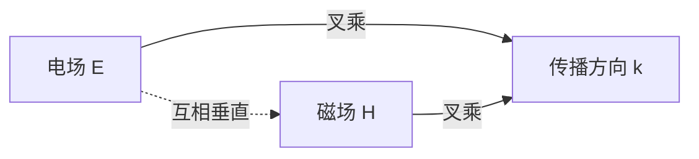

# 电磁波的基本性质

电磁波的基本性质是波动学与电磁学的交汇点。在学完机械波后，你可能会想：既然光也是波，那它的“振动”到底在振什么？和绳子上的波有什么区别？

## 它是什么

电磁波是变化的电场与磁场在空间中交替激发、向外传播的过程。在自由空间（真空或均匀各向同性介质）中传播的平面电磁波具有三个==核心性质==：

1. **横波性**：电场强度 $\vec{E}$ 和磁场强度 $\vec{H}$ 互相垂直，且都垂直于波的传播方向 $\vec{k}$。
2. **同相性**：$\vec{E}$ 和 $\vec{H}$ 的振动相位相同，同时达到最大值，同时过零。
3. **右手螺旋关系**：$\vec{E} \times \vec{H}$ 的方向即为波的传播方向（坡印廷矢量 $\vec{S}$ 的方向）。

> [!IMPORTANT]
> 考试最常考的一句话：==电磁波是横波，$\vec{E}$、$\vec{H}$、$\vec{k}$ 三者两两垂直，且 $\vec{E}$ 与 $\vec{H}$ 同相位。==

## 为什么需要掌握它

在南邮《大学物理》中，这部分虽然放在第11章机械波之后作为拓展，但它是后续光学（如偏振、双折射）的物理基础。例如，方解石中的双折射现象之所以能将自然光分解为 o 光和 e 光，正是因为光本质上是电磁波，其 $\vec{E}$ 矢量的振动方向决定了它在晶体中的传播行为。如果不理解电磁波的横波性和偏振方向，就无法真正搞懂双折射。

## 怎么做：解题核心逻辑

遇到判断电磁波性质的选择题，按以下三步排查：

1. **看方向**：确认 $\vec{E}$、$\vec{H}$（或 $\vec{B}$）、$\vec{k}$ 是否两两垂直。
2. **看相位**：确认选项中是否写了“有相位差”。自由空间中它们必须同相。
3. **看手性**：若题目给出具体坐标系分量，用右手定则验证 $\vec{E} \times \vec{H}$ 是否指向 $\vec{k}$。

### 算对了的例子

**题目**：电磁波在自由空间传播时，电场强度 $\vec{E}$ 和磁场强度 $\vec{H}$ 的关系是？
A. 在垂直于传播方向的同一条直线上
B. 朝互相垂直的两个方向传播
C. 互相垂直，且都垂直于传播方向
D. 有相位差 $\pi/2$

**解析**：
- A错：如果在同一直线上，就不满足两两垂直了。
- B错：电磁波是一个整体沿 $\vec{k}$ 传播，不是分头传播。
- D错：自由空间中 $\vec{E}$ 和 $\vec{H}$ ==同相位==，没有相位差。
- C对：完全符合横波性与正交性。

答案选 **C**。

## 与相近概念的区别

很多同学容易把电磁波和前面学的机械波混为一谈，请注意下表对比：

| 比较维度 | 机械波 | 电磁波 |
| :--- | :--- | :--- |
| **传播介质** | 必须有弹性介质 | 不需要介质，真空中可传播 |
| **波的类型** | 可以是横波，也可以是纵波 | ==只能是横波== |
| **振动实体** | 质点的位移 | 电场 $\vec{E}$ 与磁场 $\vec{H}$ |

> [!NOTE]
> 机械波中质点振动方向可以与传播方向平行（纵波），但电磁波中 $\vec{E}$ 和 $\vec{H}$ 永远不可能平行于传播方向。

## 常见的坑

> [!WARNING]
> **易错坑1：混淆相位关系。** 选项里经常出现“$\vec{E}$ 和 $\vec{H}$ 相位差为 $\pi/2$”，这是错的！只有在导电介质中衰减传播时才可能有相位差，自由空间中必定同相。

> [!CAUTION]
> **易错坑2：符号替换陷阱。** 题干有时用磁感应强度 $\vec{B}$，有时用磁场强度 $\vec{H}$。在各向同性介质中两者方向一致，性质结论不变，不要因为换了个字母就不敢选。

> [!TIP]
> **记忆口诀**：“三垂一同右螺旋”——$\vec{E}$、$\vec{H}$、$\vec{k}$ 三者两两垂直，同相位振荡，构成右手螺旋。
