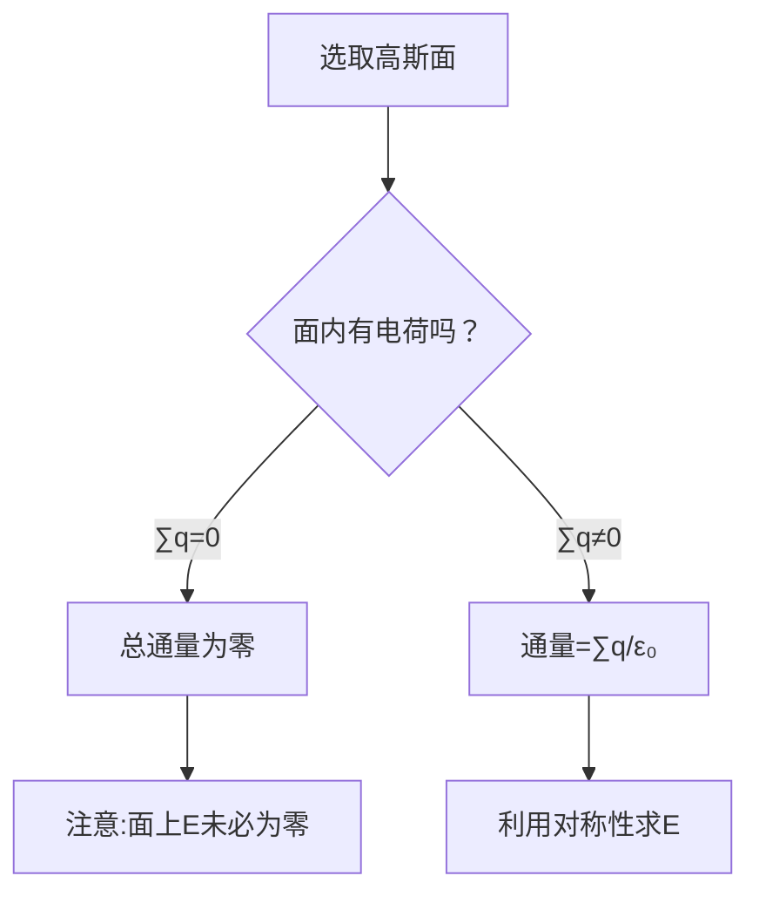

# 电通量的概念与静电场的高斯定理

---
requires: [大学物理/电场强度, 大学物理/矢量面积分]
---

## 电通量：穿过面的“电场线数”

想象下雨时你拿一个呼啦圈去接雨滴。如果圈面正对雨滴方向，接到的最多；如果把圈转成平行于雨滴方向，就一滴也接不到。电通量 $\Phi_e$ 就是这个思路的数学化：它描述的是==穿过某一曲面的电场线的净条数==。

对于均匀电场中的平面，定义式为：

$$\Phi_e = \vec{E} \cdot \vec{S} = ES\cos\theta$$

其中 $\vec{S}$ 是面积矢量（大小为面积 $S$，方向沿法向 $\vec{n}$），$\theta$ 是 $\vec{E}$ 与 $\vec{n}$ 的夹角。对于非均匀场或曲面，则需要积分：$\Phi_e = \int_S \vec{E} \cdot d\vec{S}$。

> [!NOTE]
> **电通量 vs 电场强度**
> | | 电场强度 $\vec{E}$ | 电通量 $\Phi_e$ |
> |---|---|---|
> | 本质 | 空间某点的矢量 | 穿过某个面的标量 |
> | 依赖 | 所有电荷共同决定 | 既看 $\vec{E}$ 又看面的取向和大小 |

## 高斯定理：闭合面的“收支平衡”

如果我们把呼啦圈换成一个完全封闭的气球（闭合曲面），穿进去的电场线和穿出来的电场线会互相抵消。那么，==净流出气球的电场线总数，只取决于气球内部包住了多少电荷==。这就是静电场的高斯定理：

$$\oint_{S}\vec{E}\cdot d\vec{S}=\frac{\sum q_{\text{内}}}{\varepsilon_{0}}$$

等式左边叫作通过闭合面 $S$（称为**高斯面**）的电通量，右边是高斯面内包围的电荷代数和除以真空介电常数 $\varepsilon_0$。

> [!IMPORTANT]
> 高斯面上的 $\vec{E}$ 是由==空间中所有电荷==（面内+面外）共同激发的，但穿过该闭合面的**总电通量**只由面内的 $\sum q_{\text{内}}$ 决定。面外电荷对总通量的贡献恒为零（穿入多少就穿出多少）。

这里有一个极易踩的坑：通量为零，意味着面上各点场强一定为零吗？来看南邮考过的一道题：

根据高斯定理，闭合面内电荷代数和为零时，闭合面上各点场强不一定处处为零。比如一个电偶极子被包在闭合面内，$\sum q = +q + (-q) = 0$，总通量为零，但面上各点的 $\vec{E}$ 显然不为零。因此正确答案是“闭合面上各点场强不一定处处为零”。

> [!CAUTION]
> 绝对不要把“总通量为零”等同于“面上场强处处为零”！同理，“面上场强处处为零”可以推出“面内无净电荷”，但不能反推。

## 怎么用高斯定理求场强？

既然公式里既有 $\Phi_e$ 又有 $\vec{E}$，什么时候能用高斯定理直接算出 $E$？关键在于==对称性==。只有当电荷分布具有高度对称性（球对称、轴对称、面对称）时，我们才能巧妙构造高斯面，把 $\vec{E}$ 从积分号里提出来。

解题三步走：
1. **看对称**：分析电荷分布的对称性。
2. **画高斯面**：构造一个闭合面，使得面上要么 $\vec{E} \parallel d\vec{S}$ 且 $E$ 为常数，要么 $\vec{E} \perp d\vec{S}$（这部分通量为 0）。
3. **列等式**：计算左边的通量和右边的 $\sum q_{\text{内}}$，解出 $E$。

### 算对了的例子：同心带电球面

**题目**：两个同心的均匀带电球面，内球面半径 $R_1$ 带电荷 $Q_1$，外球面半径 $R_2$ 带电荷 $Q_2$，求空间各处场强。

**解析**：电荷分布是球对称的，所以 $\vec{E}$ 必然沿径向，且同一球面上 $E$ 大小相等。我们取半径为 $r$ 的同心球面作为高斯面。

- **区域Ⅰ（$r < R_1$）**：高斯面内没有包围任何电荷，$\sum q_{\text{内}} = 0$。由高斯定理得 $E \cdot 4\pi r^2 = 0$，故 $E = 0$。
- **区域Ⅱ（$R_1 < r < R_2$）**：高斯面包围了内球面，$\sum q_{\text{内}} = Q_1$。
  $$E \cdot 4\pi r^2 = \frac{Q_1}{\varepsilon_0} \implies E = \frac{Q_1}{4\pi\varepsilon_0 r^2}$$
- **区域Ⅲ（$r > R_2$）**：高斯面包围了两个球面，$\sum q_{\text{内}} = Q_1 + Q_2$。
  $$E \cdot 4\pi r^2 = \frac{Q_1 + Q_2}{\varepsilon_0} \implies E = \frac{Q_1 + Q_2}{4\pi\varepsilon_0 r^2}$$

> [!TIP]
> 遇到“无限大均匀带电平面”怎么办？选一个轴线垂直于平面的圆柱形高斯面（像药胶囊一样跨在平面上），利用面对称性，两底面通量相加等于 $\sigma S / \varepsilon_0$，侧面通量为零，瞬间就能得出 $E = \sigma / (2\varepsilon_0)$，且与距离 $x$ 无关——这正是那道选择题中 $E-x$ 图像呈水平直线的根本原因。
