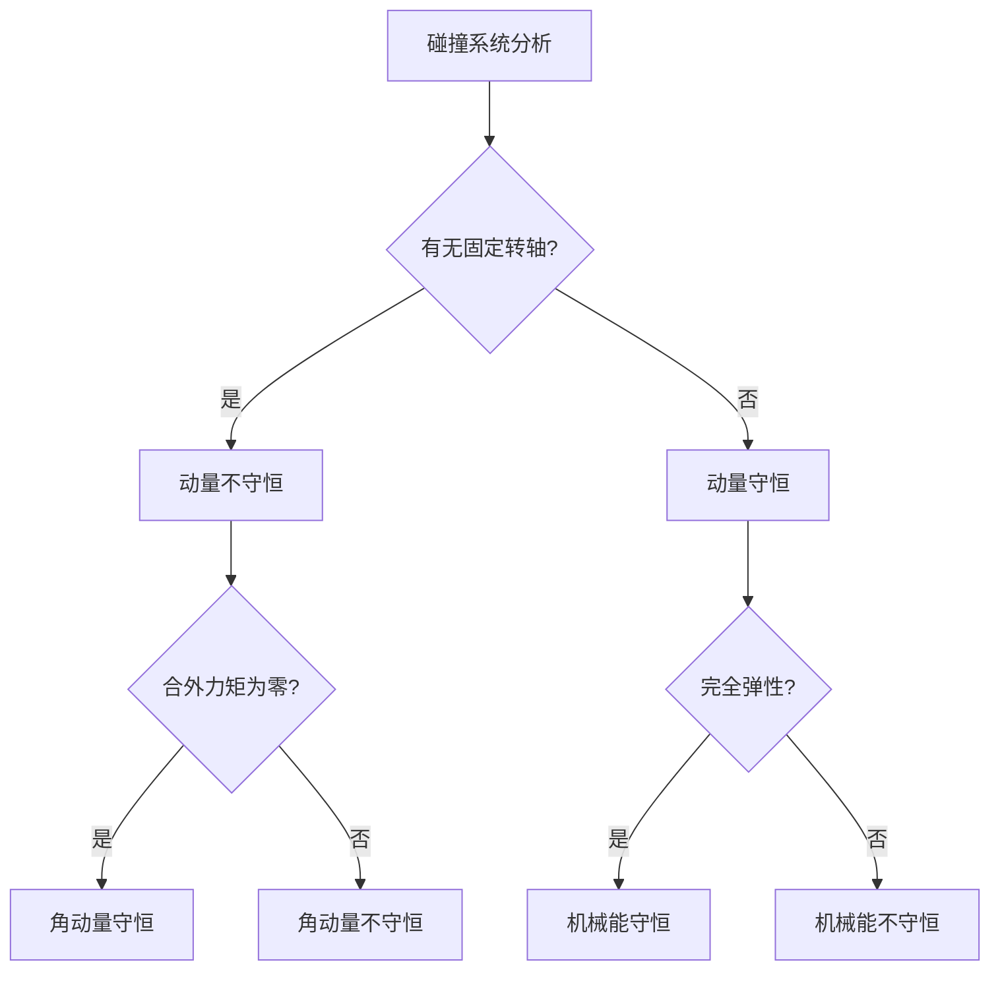

# 弹性碰撞与非弹性碰撞

## 碰撞的本质与分类

碰撞是物体间在极短时间内发生强烈相互作用的过程。为什么我们通常不直接用牛顿第二定律 $F=ma$ 求解，而要用守恒定律？因为碰撞时间 $\Delta t \to 0$，内力 $F_{int} \gg F_{ext}$，外力冲量可忽略，但内力细节复杂且未知。因此，==利用守恒量（动量、能量）建立初末态联系== 是解题核心。

根据机械能是否损失，碰撞分为三类：

| 类型 | 形变恢复 | 动能 $E_k$ | 典型模型 |
| :--- | :--- | :--- | :--- |
| 完全弹性碰撞 | 完全恢复 | 守恒 | 分子/原子碰撞 |
| 非弹性碰撞 | 部分恢复 | 有损失 | 宏观物体一般碰撞 |
| 完全非弹性碰撞 | 完全不恢复 | 损失最大 | 子弹打木块、粘连 |

> [!IMPORTANT]
> 无论哪种碰撞，只要系统所受合外力为零（或某方向分量为零），==系统总动量（或该方向分量）一定守恒==。但机械能仅在完全弹性碰撞中守恒。

## 定轴转动中的碰撞陷阱

当碰撞涉及“固定转轴”时，你的第一反应是什么？是动量守恒吗？请思考：轴对杆有没有作用力？这个力是不是外力？

> [!WARNING]
> 对于绕固定轴转动的系统（如细杆撞击），轴处约束力是巨大的外力，==系统动量不守恒==！但由于该外力过转轴，力矩为零，若重力矩也为零（如水平面或竖直瞬间），则 ==对转轴的角动量守恒==。

## 经典例题解析：双球撞杆

**题目**：光滑水平桌面上，长 $2L$、质量 $m$ 的匀质细杆（$J=\frac{1}{3}mL^2$）绕中点 $O$ 自由转动。两质量均为 $m$ 的小球以速率 $v$ 垂直正对杆两端相向运动，发生==完全非弹性碰撞==后粘在杆端。求碰后角速度 $\omega$。

**解题关键点**：
1.  **判守恒**：水平面光滑，轴过质心，重力与支持力平衡且过轴，合外力矩为零 $\Rightarrow$ 角动量守恒。
2.  **算初态角动量**：两球虽“相向”平动，但对中心轴 $O$ 的角动量方向==相同==（均使杆顺时针转）。
    $$ L_i = m v L + m v L = 2mvL $$
3.  **算末态转动惯量**：杆加两个质点。
    $$ J_f = J_{\text{杆}} + 2m L^2 = \frac{1}{3}mL^2 + 2mL^2 = \frac{7}{3}mL^2 $$
4.  **列方程求解**：由 $L_i = J_f \omega$ 得：
    $$ 2mvL = \frac{7}{3}mL^2 \omega \implies \omega = \frac{6v}{7L} $$

> [!TIP]
> 判断角动量方向时，务必用 $\vec{L}=\vec{r}\times\vec{p}$ 叉乘法则，切勿仅凭“相向运动”就误认为角动量抵消。本题中两球位置矢量 $\vec{r}$ 反向、动量 $\vec{p}$ 也反向，负负得正，角动量叠加。

> [!CAUTION]
> 完全非弹性碰撞后小球与杆共速，机械能必然损失。切勿列出 $\frac{1}{2}(2m)v^2 = \frac{1}{2}J_f\omega^2$ 的错误等式。此类问题只能用角动量守恒求解。
