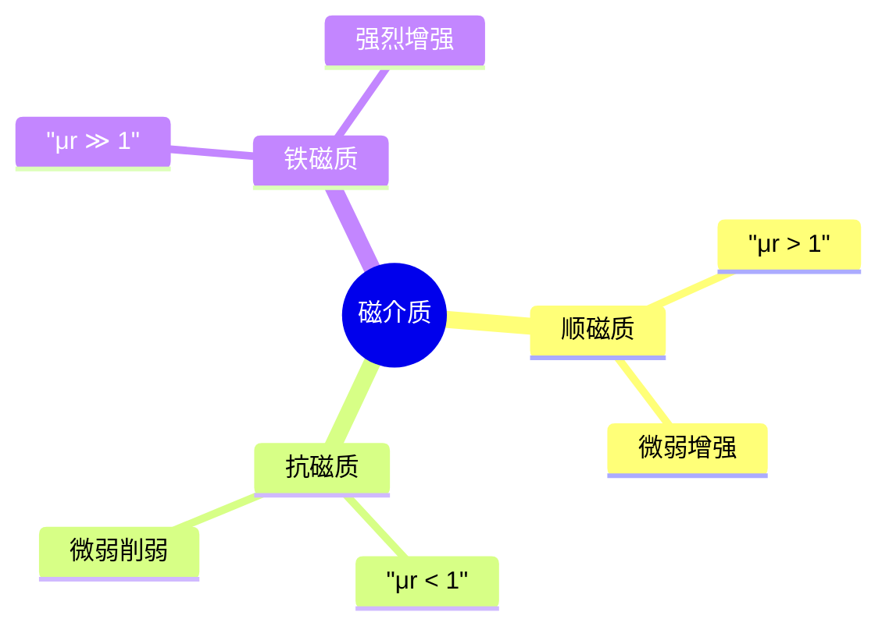

# 磁介质的分类、磁化强度与磁介质中的安培环路定理（H矢量）

> [!IMPORTANT]
> 引入 $\vec{H}$ 的根本目的：在磁介质中，直接用自由电流求磁场，==绕开难以测量的束缚电流==。

## 磁介质的分类

外磁场进入物质后，内部微观分子电流会产生附加磁场。根据叠加效果，磁介质分为三类：

| 类别 | 相对磁导率 $\mu_r$ | 附加场方向 | 典型材料 |
| :---: | :---: | :---: | :---: |
| 顺磁质 | $\mu_r > 1$ | 与外场同向 | 铝、铂 |
| 抗磁质 | $\mu_r < 1$ | 与外场反向 | 铜、铋 |
| 铁磁质 | $\mu_r \gg 1$ | 与外场同向且极强 | 铁、钴、镍 |

> [!WARNING]
> 易错坑：$\mu_r$ 永远为正数！抗磁质是 $\mu_r < 1$ 而非 $\mu_r < 0$。考试中常把“$\mu_r<0$”作为干扰项。

## 磁化强度与 H 矢量

单位体积内的总磁矩定义为**磁化强度**：
$$ \vec{M} = \frac{\sum \vec{p}_m}{\Delta V} $$

真空中安培环路定理只含传导电流 $I_0$，但在介质中，被磁化的分子等效于宏观的“磁化电流（束缚电流）”，它也会产生磁场。若每次都要算出束缚电流再求 $\vec{B}$，过程极其繁琐。为此，定义 ==磁场强度 $\vec{H}$==：
$$ \vec{H} = \frac{\vec{B}}{\mu_0} - \vec{M} $$

对于各向同性线性介质，满足本构关系 $\vec{M} = \chi_m \vec{H}$，代入可得：
$$ \vec{B} = \mu_0(1+\chi_m)\vec{H} = \mu_0 \mu_r \vec{H} = \mu \vec{H} $$
其中 $\mu_r = 1 + \chi_m$。因此课件中的公式 $M = (\mu_r - 1)H$ 就是这么来的。

## 磁介质中的安培环路定理

既然定义了 $\vec{H}$，它的环路积分有什么性质？结论非常优美：
$$ \oint_L \vec{H} \cdot \mathrm{d}\vec{l} = \sum I_{0,\text{内}} $$

> [!TIP]
> 解题口诀：**用 $\vec{H}$ 找电流，用 $\mu$ 换 $\vec{B}$**。环路右边只数“穿过环路的自由传导电流”，完全不用管磁化电流！

### 与相近概念的区别

- **$\vec{B}$（磁感应强度）**：描述空间真实的总磁场（包含自由电流和磁化电流的共同贡献），决定洛伦兹力大小。
- **$\vec{H}$（磁场强度）**：辅助计算量，其环路积分仅由自由传导电流决定。
- **$\vec{M}$（磁化强度）**：描述介质被磁化的程度。

## 算对一道题：螺绕环求 $\mu_r$

**题目**：细螺绕环每厘米绕 10 匝，电流 $I=2.0\,\mathrm{A}$，测得铁环内 $B=1.0\,\mathrm{T}$，求 $\mu_r$。

**第一步：选环路求 $H$**
取半径为 $r$ 的同心圆为安培环路。设单位长度匝数为 $n = 10\,\mathrm{cm}^{-1} = 1000\,\mathrm{m}^{-1}$。
$$ \oint \vec{H} \cdot \mathrm{d}\vec{l} = H \cdot 2\pi r = n \cdot (2\pi r) \cdot I $$
两边消去 $2\pi r$，得到：
$$ H = nI = 1000 \times 2.0 = 2000\,\mathrm{A/m} $$

**第二步：用本构关系求 $\mu_r$**
由 $B = \mu_0 \mu_r H$，解出：
$$ \mu_r = \frac{B}{\mu_0 H} = \frac{1.0}{4\pi \times 10^{-7} \times 2000} \approx 3.98 \times 10^2 $$

> [!CAUTION]
> 高危误区：在同轴电缆等分区问题中，导体内部（如 $r < R_1$）没有充满磁介质，此时 $B = \mu_0 H$；而在两导体之间的绝缘介质区（$R_1 < r < R_2$），才使用 $B = \mu H$。切勿全空间无脑乘 $\mu$！
