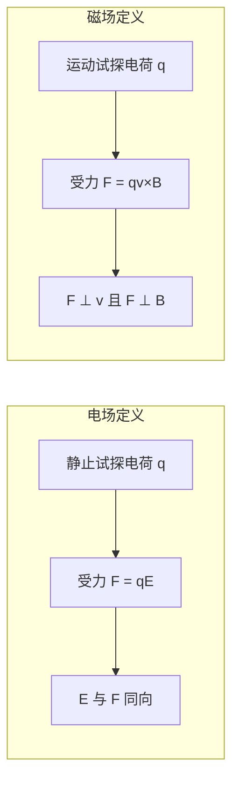

# 磁场与磁感应强度的定义
在静电学中，我们通过电荷在电场中受力来定义电场强度 $\vec{E}$。对于磁场，能否用类似的方法——**通过试探电荷在磁场中的受力**来定义磁感应强度 $\vec{B}$？

直接模仿会碰到一个根本困难：==静止电荷在磁场中不受力==。要让试探电荷受力，必须先让它运动。但一旦运动，力的方向就复杂了——它不沿磁场方向，而是垂直于速度与磁场构成的平面。

这就是两个场的本质区别：==电场力沿场线方向，磁场力垂直于场线方向==。

### 用运动电荷定义 $\vec{B}$

实验规律如下：

1. 电荷 $q$ 以速度 $\vec{v}$ 通过空间某点，所受磁力 $\vec{F}$ 始终垂直于 $\vec{v}$。
2. 力的大小 $F \propto q v$，且比例系数随 $\vec{v}$ 的方向变化——**存在一个使 $F = 0$ 的特定方向**。
3. 当 $\vec{v}$ 垂直于该零力方向时，$F$ 取最大值 $F_{\max}$，且 $\vec{F}$ 垂直于 $\vec{v}$ 与零力方向所在平面。

据此定义：
- ==磁感应强度 $\vec{B}$ 的方向==：该点小磁针 N 极指向，即运动电荷**零受力**方向（或其反方向，按右手定则确定）。
- ==磁感应强度 $\vec{B}$ 的大小==：
  $$B = \frac{F_{\max}}{|q|v}$$

完整的矢量关系为洛伦兹力公式：
$$\vec{F} = q \vec{v} \times \vec{B}$$

[!IMPORTANT]
> $\vec{B}$ 的 SI 单位为特斯拉（$\text{T}$），$1\,\text{T} = 1\,\text{N}/(\text{A} \cdot \text{m})$。常见地磁场约 $5 \times 10^{-5}\,\text{T}$，医用 MRI 可达 $1.5 \sim 3\,\text{T}$。

### 用载流试探线圈定义 $\vec{B}$（等效方法）

实际测量中，用 **载流小线圈**（磁矩 $\vec{p}_m = IS\vec{n}$）作试探元件更方便：

- 将线圈置入磁场，它一般会受到磁力矩而转动；
- 存在一个**稳定平衡方向**——线圈磁矩 $\vec{p}_m$ 的指向；
- 此时磁力矩为零；当 $\vec{p}_m \perp \vec{B}$ 时，磁力矩取最大值 $M_{\max}$。

于是等效定义：
$$\vec{B}\text{ 方向} = \text{线圈稳定平衡时 }\vec{p}_m\text{ 的方向}$$
$$B = \frac{M_{\max}}{p_m}$$

[!TIP]
> 把 $\vec{B}$ 类比为 "每单位磁矩所受的最大力矩"。这与电场中 $\vec{E}$ = "每单位电荷所受的力" 的结构完全对应，只是磁的"受力"表现为**力矩**而非力。

### 一个算对了的例子

**题**：一半径 $r = 10\,\text{cm}$ 的细导线圆环，通有电流 $I = 3.0\,\text{A}$。求圆环中心处的磁感应强度。（$\mu_0 = 4\pi \times 10^{-7}\,\text{T} \cdot \text{m}/\text{A}$）

**解**：由毕奥-萨伐尔定律导出圆电流轴线上磁场，令轴向坐标 $x = 0$（圆心）得：
$$B = \frac{\mu_0 I}{2r}$$

代入：
$$B = \frac{4\pi \times 10^{-7} \times 3.0}{2 \times 0.10} = 6\pi \times 10^{-6} \approx 1.88 \times 10^{-5}\,\text{T}$$

| 对比项 | 电场强度 $\vec{E}$ | 磁感应强度 $\vec{B}$ |
|---|---|---|
| 试探元件 | 静止点电荷 | 运动电荷 / 载流小线圈 |
| 受力特点 | $\vec{F} \parallel \vec{E}$ | $\vec{F} \perp \vec{B}$（洛伦兹力）|
| 定义式 | $\vec{E} = \vec{F}/q$ | $B = F_{\max}/(\|q\|v)$ |
| 场源 | 电荷（有源场） | 运动电荷 / 电流（==无源场==） |

[!WARNING]
> 初学极易混淆：磁感应强度不等于每单位磁荷受力（磁单极子不存在）。磁场对试探元的作用**永远是侧向的**——$\vec{F} = q\vec{v} \times \vec{B}$ 中没有沿 $\vec{B}$ 的分量。这与电场力可以做正功形成鲜明对比。
