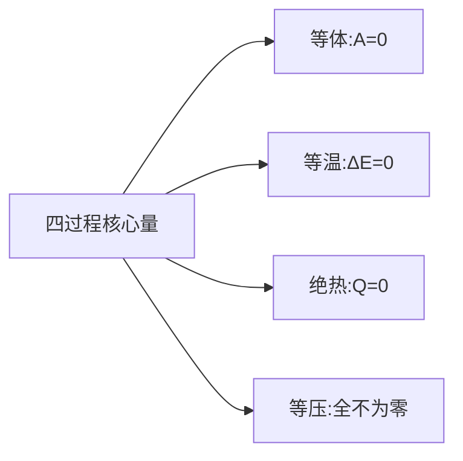

# 理想气体的等体、等压、等温、绝热过程（ΔE、A、Q的计算）

## 它是什么

理想气体在状态变化时，常限制某一个参量不变：==等体、等压、等温、绝热==。我们要算三个量：内能变化 $\Delta E$、做功 $A$、吸热 $Q$，并满足热力学第一定律 $Q=\Delta E+A$（南邮约定 $A$ 为气体对外做功）。

先问一句：若体积不变，活塞没动，气体对外做功是多少？自然是 $A=0$。

## 怎么做：四个过程对照

设物质的量为 $n=\frac{m}{M}$，刚性分子自由度 $i$，则 $C_{v,m}=\frac{i}{2}R$，$C_{p,m}=C_{v,m}+R$。

| 过程 | 过程特征 | $\Delta E$ | $A$ | $Q$ |
|---|---|---|---|---|
| 等体 | $V$ 常量 | $nC_{v,m}\Delta T$ | $0$ | $nC_{v,m}\Delta T$ |
| 等压 | $p$ 常量 | $nC_{v,m}\Delta T$ | $p(V_2-V_1)=nR\Delta T$ | $nC_{p,m}\Delta T$ |
| 等温 | $T$ 常量 | $0$ | $nRT\ln\frac{V_2}{V_1}$ | 同 $A$ |
| 绝热 | $Q=0$ | $nC_{v,m}\Delta T$ | $-\Delta E$ | $0$ |

> [!IMPORTANT]
> 绝热过程方程：$T_1V_1^{\gamma-1}=T_2V_2^{\gamma-1}$，$\gamma=C_{p,m}/C_{v,m}$。

## 相近过程的区别

从同一状态膨胀到 $2V_1$：==等压过程对外做功最多、内能增加最多、吸热最多==；绝热不吸热，靠减少内能做功。

再看双原子分子（$i=5$）等压膨胀：吸热 $Q_p=n\frac{7}{2}R\Delta T$，做功 $A=nR\Delta T$，所以 $A/Q_p=2/7$。

> [!TIP]
> 比值公式：$A/Q_p=R/C_{p,m}=2/(i+2)$，双原子代入 $i=5$ 就是 $2/7$。

## 常见的坑

- 把“升温”等同于“一定吸热”：绝热压缩也升温，但 $Q=0$。
- 等温里 $\ln\frac{p_1}{p_2}$ 和 $\ln\frac{V_2}{V_1}$ 相等是因为 $pV$ 常量，别反写。
- 循环看 $p$-$V$ 图方向：逆时针净功为负，则净吸热也为负。

> [!WARNING]
> 循环总 $\Delta E=0$，不要由“回到原状”推出 $Q=0$。

## 算对了的例子

题：$E$-$V$ 图中理想气体内能随体积成直线，判断过程。

理想气体 $E=nC_{v,m}T$，而 $T=\frac{pV}{nR}$，所以
$$E=\frac{C_{v,m}}{R}pV$$
直线过原点意味着 $p$ 为常量，故是==等压过程==。

结论：四个过程先抓“谁为零”，再用 $Q=\Delta E+A$ 补齐第三个量，就不易乱。
