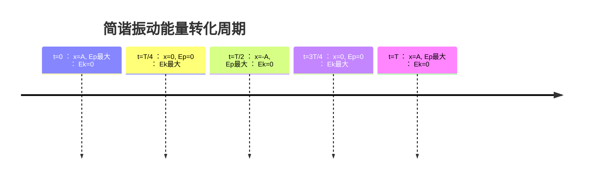

# 简谐振动的动能、势能与总机械能

## 简谐振动系统的机械能

弹簧振子在光滑水平面上振动，系统只有动能和弹性势能相互转化，总机械能守恒。理解能量转换规律，是分析振幅变化、外力做功等问题的关键。

### 能量的瞬时表达式

设振子质量为 $m$，弹簧劲度系数为 $k$，以平衡位置为坐标原点，振动方程为：
$$x = A\cos(\omega t + \varphi)$$

其中 $\omega = \sqrt{k/m}$。

**势能**  
弹簧弹性势能零点通常取在弹簧原长处（即平衡位置）。
$$E_p = \frac{1}{2}kx^2 = \frac{1}{2}kA^2\cos^2(\omega t + \varphi)$$

**动能**  
由速度 $v = -\omega A\sin(\omega t + \varphi)$ 可得：
$$E_k = \frac{1}{2}mv^2 = \frac{1}{2}m\omega^2A^2\sin^2(\omega t + \varphi)$$
利用 $\omega^2 = k/m$，上式等价于：
$$E_k = \frac{1}{2}kA^2\sin^2(\omega t + \varphi)$$

**总机械能**
$$E = E_k + E_p = \frac{1}{2}kA^2$$

> [!IMPORTANT]
> ==总能量与振幅的平方成正比，与时间无关==，即 $E \propto A^2$。振幅增大为 2 倍，总能量变为 4 倍；频率变化不直接影响总能量，但若通过改变 $k$ 或 $m$ 实现频率变化，则需重新判断 $A$ 是否改变。

### 能量随时间的变化规律

- 动能与势能都随时间周期性变化，但它们的**变化频率是振动频率的 2 倍**。
- 任意时刻，==动能与势能之和为常数==，两者此消彼长。

下图直观展示了位移、势能、动能在一个周期内的变化关系：

> [!WARNING]
> 动能变化的周期是 $T/2$，不是 $T$。考题常直接问“动能变化周期”，要看清。

### 任意位移处的能量分配

已知总能量 $E = \frac{1}{2}kA^2$，当位移为 $x$ 时：
- 势能 $E_p = \frac{1}{2}kx^2$
- 动能 $E_k = E - E_p = \frac{1}{2}k(A^2 - x^2)$

**常见考题**：当 $x = A/2$ 时，$E_p = \frac{1}{4}E$，则 $E_k = \frac{3}{4}E$。

| 位移 | 势能占比 | 动能占比 |
|:---:|:---:|:---:|
| $x=0$ | $0$ | $100\%$ |
| $x=A/2$ | $25\%$ | $75\%$ |
| $x=A$ | $100\%$ | $0$ |

### 一个算对了的例子

> 一弹簧振子作简谐振动，总能量为 $E_1$。若振幅增为原来的 2 倍，重物质量增为原来的 4 倍，总能量 $E_2$ 变为多少？

弹簧没换，劲度系数 $k$ 不变。总能量公式 $E = \frac{1}{2}kA^2$ 中只含 $A$ 不含 $m$，所以：
$$E_2 = \frac{1}{2}k(2A)^2 = 4 \times \frac{1}{2}kA^2 = 4E_1$$

> [!CAUTION]
> 很多同学会误以为质量影响总能量，或者去算频率变化。记住：==弹簧振子总能量只取决于 $k$ 和 $A$==，与 $m$ 无关。

### 半周期内弹性力做功为何为零

根据动能定理，合外力做功等于动能变化量。半个周期后，振子到达关于平衡位置的对称点，速度大小不变，$\Delta E_k = 0$，故弹性力做功为零。从功的积分角度看，前四分之一周期做正功，后四分之一做负功，总和恰好为零。
