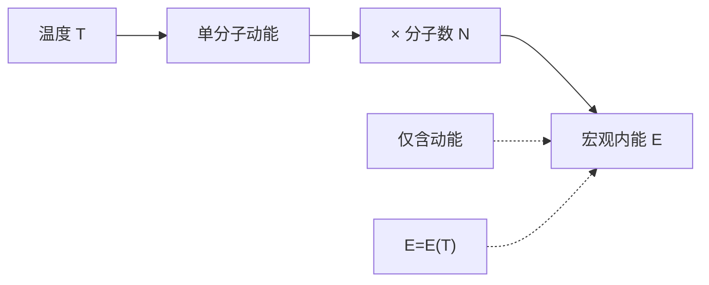

# 能量按自由度均分定理与理想气体内能

## 能量按自由度均分定理与理想气体内能

温度在微观上究竟代表什么？它仅仅是分子平均平动动能的量度，还是包含了转动和振动？要回答这个问题，就需要引入“自由度”的概念，并理解能量是如何在这些自由度间分配的。

### 自由度与均分定理

自由度 $i$ 是确定物体空间位置所需的独立坐标数。对于理想气体分子：

| 分子类型 | 平动 $t$ | 转动 $r$ | 总自由度 $i$ (刚性) |
| :--- | :---: | :---: | :---: |
| 单原子 | 3 | 0 | 3 |
| 双原子 | 3 | 2 | 5 |
| 多原子 | 3 | 3 | 6 |

> [!IMPORTANT]
> ==能量按自由度均分定理==：在温度为 $T$ 的平衡态下，分子每个自由度的平均动能均为 $\frac{1}{2}kT$。

因此，一个分子的平均总动能为 $\overline{\varepsilon}_k = \frac{i}{2}kT$。注意区分：$\frac{3}{2}kT$ 仅是==平均平动动能==，对所有气体普适；而 $\frac{i}{2}kT$ 才是包含转动的==平均动能==。

### 理想气体的内能

既然知道了单个分子的能量，如何求宏观内能？将分子数 $N$ 乘以单分子平均动能即可。对于 $\nu$ mol 理想气体：

$$
E = N \cdot \frac{i}{2}kT = \nu N_A \cdot \frac{i}{2}kT = \frac{i}{2}\nu RT
$$

> [!NOTE]
> 理想气体忽略分子间势能，故==内能仅由分子动能决定==，是温度 $T$ 的单值函数 $E(T)$。状态一定则内能一定，但内能的绝对值不可直接测量，只有变化量 $\Delta E$ 才有物理意义。

### 易错辨析与实战

做题时最容易混淆“平动动能”与“总动能”，以及误用常量 $k$ 和 $R$。

> [!WARNING]
> - 问“平均平动动能”永远选 $\frac{3}{2}kT$，与分子种类无关。
> - 问“内能”必须用 $\frac{i}{2}\nu RT$（摩尔量级）或 $\frac{i}{2}NkT$（分子量级），切勿混用 $k$ 与 $R$。
> - 氢气、氧气等双原子分子在常温下视为刚性，取 $i=5$。

以课件中计算题为例：$2\ \mathrm{g}$ 氢气（$\nu=1\ \mathrm{mol}$），$T=400\ \mathrm{K}$。

1.  **平均平动动能**：$\overline{\varepsilon}_t = \frac{3}{2}kT = \frac{3}{2} \times 1.38\times10^{-23} \times 400 = 8.28\times10^{-21}\ \mathrm{J}$
2.  **平均动能**（双原子 $i=5$）：$\overline{\varepsilon}_k = \frac{5}{2}kT = 1.38\times10^{-20}\ \mathrm{J}$
3.  **内能**：$E = \frac{5}{2}\nu RT = \frac{5}{2} \times 1 \times 8.31 \times 400 = 8.31\times10^{3}\ \mathrm{J}$

> [!TIP]
> 比较不同气体时：同温则 $\overline{\varepsilon}_t$ 必相等；但内能 $E$ 还取决于 $\nu$ 和 $i$。如同温同质量的 $\mathrm{H_2}$ 与 $\mathrm{He}$，虽 $\overline{\varepsilon}_t$ 相同，但因摩尔质量和自由度不同，内能并不相等。
