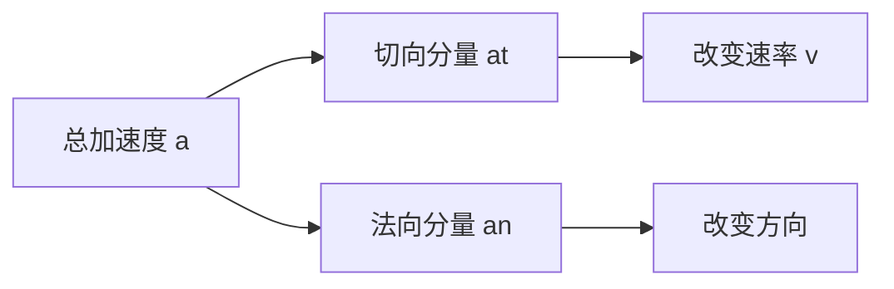

# 自然参数下的切向加速度与法向加速度

## 什么是自然坐标系下的加速度

在直角坐标系中，加速度 $\boldsymbol{a}$ 被分解为 $a_x, a_y$。但在曲线运动中，这种分解往往无法直观反映运动状态的变化。**自然坐标系**以质点所在位置为原点，建立两个正交单位矢量：
- $\boldsymbol{\hat{\tau}}$：沿轨迹切线方向（指向速度方向）；
- $\boldsymbol{\hat{n}}$：沿主法线方向（指向曲率中心/凹侧）。

此时，加速度分解为：
$$ \boldsymbol{a} = a_t \boldsymbol{\hat{\tau}} + a_n \boldsymbol{\hat{n}} $$

> [!IMPORTANT]
> ==核心物理意义==：
> - **切向加速度** $a_t = \frac{dv}{dt}$：仅由速率变化引起。若 $a_t=0$，则为匀速率运动。
> - **法向加速度** $a_n = \frac{v^2}{\rho}$：仅由速度方向变化引起。$\rho$ 为曲率半径。若 $a_n=0$，则为直线运动。

## 为什么需要这种分解？

直角坐标系的基矢量 $\boldsymbol{i}, \boldsymbol{j}$ 是固定的，而自然坐标系的基矢量 $\boldsymbol{\hat{\tau}}, \boldsymbol{\hat{n}}$ 随质点位置变化。
- **优势**：直接关联动力学中的“切向力”（做功，改变动能）和“法向力”（不做功，提供向心力）。
- **应用场景**：圆周运动、抛体运动曲率分析、非均匀曲线轨道。

> [!TIP]
> 记忆口诀：**切向管快慢，法向管弯直**。

## 如何计算？

1. **求速度大小** $v(t)$：通常由路程 $s(t)$ 求导得到 $v = \frac{ds}{dt}$，或由速度矢量求模 $v = |\boldsymbol{v}|$。
2. **求切向加速度**：$a_t = \frac{dv}{dt}$。
3. **求法向加速度**：
   - 若已知 $\rho$：$a_n = \frac{v^2}{\rho}$。
   - 若已知总加速度 $\boldsymbol{a}$：利用 $a = \sqrt{a_t^2 + a_n^2}$ 反推 $a_n = \sqrt{a^2 - a_t^2}$。
4. **求曲率半径**：$\rho = \frac{v^2}{a_n}$。

| 维度 | 切向加速度 $a_t$ | 法向加速度 $a_n$ |
| :--- | :--- | :--- |
| **公式** | $\frac{dv}{dt}$ | $\frac{v^2}{\rho}$ |
| **方向** | 沿切线（与 $\boldsymbol{v}$ 同向或反向） | 指向曲率中心（垂直于 $\boldsymbol{v}$） |
| **作用** | 改变速度大小 | 改变速度方向 |

> [!WARNING]
> **常见坑**：
> 1. 混淆 $a_t$ 与 $\frac{d|\boldsymbol{v}|}{dt}$：二者等价，但不同于 $|\frac{d\boldsymbol{v}}{dt}|$（后者是总加速度大小）。
> 2. 误认为匀速圆周运动 $a=0$：其实 $a_t=0$，但 $a_n \neq 0$，总加速度不为零。

## 典型例题解析

**题目**：一质点作半径为 $R$ 的圆周运动，其路程 $s=\frac{1}{2}kRt^{2}$ ($k$ 为常数)，求 $t$ 时刻的切向、法向加速度及总加速度大小。

**解析**：
1. **求速率**：
   $$ v = \frac{ds}{dt} = \frac{d}{dt}\left(\frac{1}{2}kRt^2\right) = kRt $$
2. **求切向加速度**：
   $$ a_t = \frac{dv}{dt} = \frac{d}{dt}(kRt) = kR $$
   （说明速率均匀增加）
3. **求法向加速度**：
   对于圆周运动，曲率半径 $\rho = R$。
   $$ a_n = \frac{v^2}{R} = \frac{(kRt)^2}{R} = k^2 R t^2 $$
4. **求总加速度大小**：
   $$ a = \sqrt{a_t^2 + a_n^2} = \sqrt{(kR)^2 + (k^2 R t^2)^2} = kR\sqrt{1 + k^2 t^4} $$

> [!NOTE]
> 此例展示了即使切向加速度恒定，法向加速度也会随时间剧烈变化（$t^2$ 关系），导致总加速度方向不断改变。
