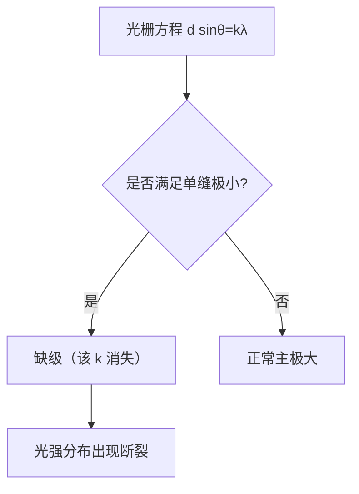

# 光栅方程、缺级现象与光谱分辨

## 光栅方程

光栅方程是描述多缝干涉后主极大（亮纹）位置的核心公式。它回答一个问题：当一束光打在光栅上，在哪些角度上会出现明亮的条纹？

光栅的每条缝都相当于一个子波源。==只有相邻缝发出的光在某个方向上相位差为 $2\pi$ 的整数倍（即光程差为波长的整数倍）时，才会在该方向彼此加强，形成主极大==。

相邻缝到观察方向的光程差为 $d\sin\theta$：

> [!IMPORTANT]
> $$
> d\sin\theta = k\lambda, \quad k = 0,\pm 1,\pm 2,\dots
> $$
> $d$ 为光栅常数（相邻缝中心间距），$\theta$ 为衍射角，$\lambda$ 为波长，$k$ 为主极大级次。

- **$k=0$**：零级，所有波长的光重叠为中央明纹。
- **$|k| \ge 1$**：各级谱线相对于零级左右对称分布。

实际器件中，$d$ 往往由“每毫米（厘米）刻线数”给出：
$$ d = \frac{1\mathrm{mm}}{N} $$

> [!TIP]
> **易错提醒**：题目给的是“每毫米 $N$ 条”，$d$ 就等于 $1/N$ 毫米。牢记单位统一后再代入公式，$d$ 与 $\lambda$ 必须同量纲。

---

## 缺级现象

==光栅衍射实际是多缝干涉受单缝衍射调制的综合结果==。如果某个主极大方向恰好与单缝衍射的极小方向重合，该级次就会被“抑制”消失——这就是**缺级**。

单缝衍射极小的条件为：
$$ a\sin\theta = k'\lambda, \quad k' = \pm 1,\pm 2,\dots $$
式中 $a$ 是透光缝宽。

联立光栅方程与极小条件得到缺级判据：
$$ k = \frac{d}{a}k' $$

> [!WARNING]
> **常见坑**：$d/a$ 为整数时，该整数及其整数倍对应的谱线恰好与单缝衍射极小重合，**全部缺级**。若 $d/a$ 不是整数（如 2.5），则不会发生严格缺级，但单缝衍射的中央包络线会限制可见谱线的级次范围。

**缺级的物理意义**：单缝衍射的能量“包络”限制了各级主极大的相对强度，包络的零点处对应的主极大就变成了暗点。

---

## 光谱分辨与重叠

复色光经过光栅后，不同波长的主极大出现在不同角度，便形成了光谱。由此产生两个常见问题：

### 1. 色散：哪种颜色偏得更远？

对于同一级次 $k$，$\sin\theta = k\lambda / d$，即 $\lambda$ 越大 $\theta$ 越大。==白光的同级光谱中，**红光**偏转最大，离中央明纹最远，紫光最近==。

### 2. 级次范围受什么限制？

最大可能级次由 $|\sin\theta| \le 1$ 决定：
$$ |k_{\max}| \le \frac{d}{\lambda} $$
$k_{\max}$ 取不大于 $d/\lambda$ 的整数。超过这个范围的光谱级次无法在屏上出现。

### 3. 不同波长何时重叠？

若 $\lambda_1$ 的第 $k$ 级与 $\lambda_2$ 的第 $k'$ 级在同一角度出现：
$$ k\lambda_1 = k'\lambda_2 \quad \Rightarrow \quad \frac{k}{k'} = \frac{\lambda_2}{\lambda_1} $$
题目常要求“不计中央明纹第二次重合”，则需将最简整数比再乘以 2 倍，代入光栅方程解 $d$。

---

## 典型算例

**题**：一衍射光栅每厘米 200 条缝，缝宽 $a = 2\times10^{-3}\ \mathrm{cm}$，透镜焦距 $f = 1\ \mathrm{m}$，$\lambda = 600\ \mathrm{nm}$。求单缝衍射中央明纹宽度，及其中包含的光栅主极大数目。

**解**：

1. **光栅常数**：$d = \dfrac{1}{200}\ \mathrm{cm} = 5\times10^{-5}\ \mathrm{m}$
2. **单缝中央明纹半角宽**：$\sin\theta \approx \lambda / a$  
   线宽度：$\Delta x = 2f\cdot \dfrac{\lambda}{a} = 2\times 1 \times \dfrac{600\times10^{-9}}{2\times10^{-5}} = 0.06\ \mathrm{m} = 6\ \mathrm{cm}$
3. **中央明纹内的主极大级次**：  
   第一极小对应 $a\sin\theta = \lambda$，代入光栅方程得 $k = d/a = 2.5$。  
   包含的整数级次为 $k = 0,\pm 1,\pm 2$，共 **5** 条主极大。

| 对比项目 | 单缝衍射极小 | 光栅主极大 |
|----------|--------------|------------|
| 条件 | $a\sin\theta = k'\lambda$ | $d\sin\theta = k\lambda$ |
| 作用 | 形成暗纹，构成包络 | 产生亮纹 |
| 缺级条件 | $k = (d/a)k'$ 为整数 | 该 $k$ 消失 |

> [!NOTE]
> **两者区别**：光栅方程决定的是干涉加强方向，而缺级由单缝衍射的零点叠加决定。解题时两步走：先用光栅方程找主极大位置，再用单缝包络判断是否会出现或可见。
