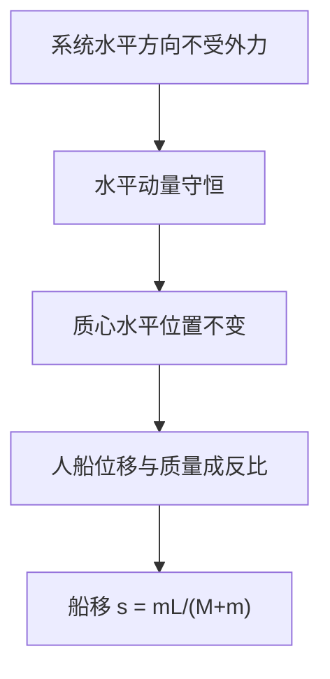

# 质心与质心运动定理

## 什么是质心

质心是质点系质量分布的平均位置。你可以把它理解为系统质量的“代表点”——在研究整体平动时，可以把所有质量集中到这一点来处理。

对于 $n$ 个质点组成的系统，质心位置为：

$$
\mathbf{r}_C = \frac{\sum m_i \mathbf{r}_i}{\sum m_i}
$$

对于质量连续分布的刚体，求和改为积分：

$$
\mathbf{r}_C = \frac{\int \mathbf{r} \, dm}{\int dm}
$$

> [!IMPORTANT]
> 质心的位置只取决于质量分布，与坐标系选取无关。对一个确定的物体，质心是唯一的。

---

## 质心运动定理

质心运动定理是说：**==质心的运动，相当于系统全部质量集中于此点、全部外力作用于此点的质点运动==**。数学表达为：

$$
\sum \mathbf{F}_{\text{外}} = M \, \mathbf{a}_C
$$

其中 $M = \sum m_i$ 是系统总质量，$\mathbf{a}_C$ 是质心的加速度。

> [!TIP]
> 记忆口诀：外力的合力推动质心走，内力不影响质心运动。

---

## 为什么需要它

当我们面对复杂的质点系或刚体运动时，直接分析每个质点的运动很困难。质心运动定理把问题降维：

- 不管系统内部怎么相互作用，质心的平动只由外力决定
- 质心系（以质心为原点的参考系）中，牛顿定律形式简化，是处理碰撞、转动的基础

---

## 两大常见误区

下面这个表格来自南邮考试高频辨析：

| 条件 | 结论 | 反例 |
|------|------|------|
| 合外力为零 | ==合外力矩不一定为零== | 力偶：等大、反向、不共线的两个力，合力为零但产生力矩 |
| 合外力矩为零 | ==合外力不一定为零== | 所有外力作用线均通过转轴或质心，力矩为零但合力可能很大 |

> [!WARNING]
> 有角加速度 $ \alpha \neq 0 $ 的物体，合外力矩 $M = J\alpha$ 必不为零，但合外力**可以为零**！一对力偶就能产生角加速度而合力为零。

做错这道选择题的同学，往往直接把“有力矩”等同于“有合力”，忽略了力偶的特殊情形。

---

## 质心运动定理的经典应用：人船模型

一个典型的人船模型问题，可以用质心运动定理快速求解：人从船头走到船尾，船会怎么动？

**解题逻辑链：**

**具体推导：**

设人和船质量分别为 $m$、$M$，船长 $L$。初始静止，系统总动量 $p = 0$。

整个过程水平方向无外力，动量守恒：

$$
Mv_{\text{船}} - mv_{\text{人}} = 0
$$

两边同时对时间积分，速度积分得位移：

$$
M \int_0^T v_{\text{船}} \, dt = m \int_0^T v_{\text{人}} \, dt \quad \Rightarrow \quad M s_{\text{船}} = m s_{\text{人}}
$$

几何关系：人相对船的位移等于船长 $L$，而人与船反向运动，所以：

$$
s_{\text{人}} + s_{\text{船}} = L
$$

联立解得：

$$
s_{\text{船}} = \frac{m}{M+m} L, \quad s_{\text{人}} = \frac{M}{M+m} L
$$

**数值代入**：$m = 50\,\text{kg}$，$M = 100\,\text{kg}$，$L = 3.6\,\text{m}$

$$
s_{\text{船}} = \frac{50}{100+50} \times 3.6 = 1.2\,\text{m}
$$

> [!NOTE]
> 用质心运动定理同样可以解释：系统初始质心静止，水平不受外力，质心位置保持不变。人往前走时船必须往后移，才能让质心原地不动。两种思路，结果一致。
