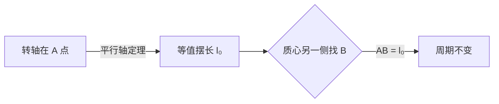

# 转动惯量的计算与平行轴定理

## 转动惯量：刚体转动的“惯性度量”

转动惯量 $I$ 描述刚体绕定轴转动时惯性的大小，定义为

$$
I = \sum_i \Delta m_i r_i^2 \quad \text{或} \quad I = \int r^2 \, dm
$$

其中 $r_i$ 是质量元 $\Delta m_i$ 到**转轴**的垂直距离。与平动中质量 $m$ 的地位类似，$I$ 越大，改变转动状态越困难。

> [!IMPORTANT]
> 转动惯量**不是刚体的固有属性**，它同时取决于刚体的质量分布和**转轴的位置与方向**。提到 $I$ 必须说明绕哪根轴。

## 常用刚体的转动惯量

| 刚体（质量 $m$） | 转轴位置 | 转动惯量 |
|---|---|---|
| 细杆（长 $l$） | 过中心 ⊥ 杆 | $\frac{1}{12}ml^2$ |
| 细杆（长 $l$） | 过端点 ⊥ 杆 | $\frac{1}{3}ml^2$ |
| 细圆环（半径 $R$） | 过中心 ⊥ 环面 | $mR^2$ |
| 均匀圆盘（半径 $R$） | 过中心 ⊥ 盘面 | $\frac{1}{2}mR^2$ |
| 均匀球体（半径 $R$） | 过球心 | $\frac{2}{5}mR^2$ |

> [!TIP]
> 计算技巧：利用对称性把积分拆成已知部分之和；均匀圆盘可看作无数细圆环的叠加，$dm = \sigma \cdot 2\pi r\, dr$。

## 平行轴定理

若 $I_c$ 是刚体绕**过质心**的某轴的转动惯量，则绕与该轴**平行**、相距 $d$ 的任意轴的转动惯量为

$$
\boxed{I = I_c + md^2}
$$

> [!WARNING]
> 易错点：$I_c$ 必须是对**质心轴**的转动惯量，不能从任意轴出发平移；$d$ 是两平行轴之间的垂直距离。

**为什么需要它？** 直接积分往往麻烦，但质心轴的 $I_c$ 通常已知（如上表）。用平行轴定理可一步求出任意平行轴的 $I$。

**一个算对了的例子**（习题 6.2 的简化版）：复摆对 O 轴的转动惯量为 $I$，在 O 轴下方 $l=0.1\,\text{m}$ 处加质量 $m=0.05\,\text{kg}$，由平行轴定理，新增部分对 O 轴的转动惯量为 $ml^2$。于是总转动惯量从 $I$ 变为

$$
I' = I + ml^2
$$

代入周期公式 $T = 2\pi\sqrt{I/(Mgr_c)}$ 联立求解，即可由原周期 $T_1=0.5\,\text{s}$ 和新周期 $T_2=0.6\,\text{s}$ 解出 $I$。

## 复摆与可倒逆性

复摆小角度摆动时，由角动量定律 $dJ_z/dt = M_z$ 得

$$
\frac{d^2\theta}{dt^2} + \frac{Mgr_c}{I}\theta = 0
$$

周期为

$$
T = 2\pi\sqrt{\frac{I}{Mgr_c}}
$$

定义**等值摆长** $l_0 = \frac{I}{mr_c}$。利用平行轴定理 $I = I_c + mr_c^2$，改写为

$$
l_0 = r_c + \frac{I_c}{mr_c}
$$

> [!IMPORTANT]
> 上式中 $I_c$ 是固定量（绕质心轴），只有 $r_c$ 随转轴位置变化。给定 $l_0$，方程 $f(x)=l_0$ 有两个根 $x_1, x_2$，且 $x_1 + x_2 = l_0$。这说明：若转轴过 A 点时等值摆长为 $l_0$，则在质心另一侧找到 B 点使 $\overline{AB}=l_0$，转轴移至 B 点后周期不变——这就是**可倒逆性**。

> [!CAUTION]
> 可倒逆性成立的前提是质心必须位于两转轴连线上。若两转轴到质心距离不等或不在同一直线上，则间距不是等值摆长，周期一般不同。

利用可倒逆性，实验上只需测量复摆两倒逆点的间距 $l_0$ 和周期 $T$，即可由 $g = \frac{4\pi^2 l_0}{T^2}$ 精确测定重力加速度，无需知道 $I_c$ 和质心位置。
