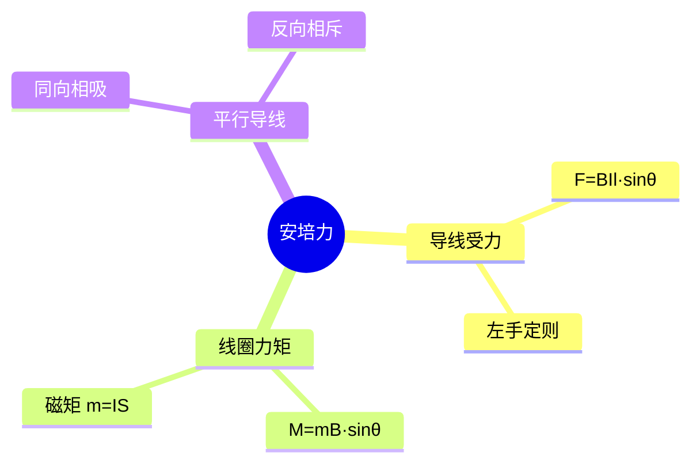

# 安培力与载流线圈的磁力矩

## 安培力：载流导线在磁场中受力

一段电流元 $I\mathrm{d}\vec{l}$ 处在磁场 $\vec{B}$ 中，会受到磁场的作用力——这就是 ==安培力==：

$$
\mathrm{d}\vec{F} = I\,\mathrm{d}\vec{l} \times \vec{B}
$$

对一根有限长导线，受力为各电流元受力的矢量和 $\vec{F} = \displaystyle\int I\,\mathrm{d}\vec{l} \times \vec{B}$。

**特例（高频考点）**：匀强磁场中长度为 $l$ 的直导线，电流方向与 $\vec{B}$ 垂直时

$$
F = BIl
$$

方向用左手定则（或 $\vec{l}\times\vec{B}$ 的右手叉乘）判定。

> [!WARNING]
> - 必须是**垂直分量**才贡献力：$F = BIl\sin\theta$，电流与磁场平行时 $F=0$。
> - 闭合线圈在**匀强**磁场中受力的**矢量和为零**，但**力矩一般不为零**——线圈可以转动而不会平动。

## 载流导线间的相互作用

两根平行长直导线，电流同向时相互**吸引**，反向时相互**排斥**。单位长度受力：

$$
\frac{\mathrm{d}F}{\mathrm{d}l} = \frac{\mu_0 I_1 I_2}{2\pi a}
$$

这来自"一根导线产生磁场，另一根导线在该磁场中受安培力"的叠加思路。

## 磁力矩与磁矩

面积为 $S$、通有电流 $I$ 的平面线圈，定义其 ==磁矩==（方向沿法线，按右手螺旋）：

$$
\vec{m} = IS\,\hat{n}
$$

线圈在匀强磁场中受到的磁力矩：

$$
\vec{M} = \vec{m} \times \vec{B},\qquad M = mB\sin\theta = BIS\sin\theta
$$

| 夹角 $\theta$（$\vec m$ 与 $\vec B$） | 线圈位置 | $M$ | 磁通量 $\Phi$ |
|---|---|---|---|
| $90^\circ$ | 平面平行于 $\vec B$ | $BSI$（**最大**） | $0$ |
| $0^\circ$ | 平面垂直于 $\vec B$ | $0$ | $BS$（**最大**） |
| $180^\circ$ | 平面垂直于 $\vec B$ | $0$ | $-BS$（不稳定平衡） |

> [!TIP]
> **口诀**：磁力矩最大时磁通量为零；磁通量最大时磁力矩为零。两者正交。
> 稳定平衡条件：$\vec m$ 与 $\vec B$ 同向（$\theta = 0^\circ$），磁力矩使线圈转到这个位置。

## 算对了的例子：电流天平

**题目**：质量 $m$、长 $l$ 的直导线放在水平匀强磁场 $\vec B$ 中，当安培力与重力平衡时求 $I$。

**解**：导线水平放置、电流方向与水平磁场垂直，故

$$
F = BIl,\quad\text{方向竖直向上}
$$

平衡条件 $BIl = mg$，解得

$$
\boxed{I = \dfrac{mg}{Bl}}
$$

> [!NOTE]
> 判断方向时先画 $\vec l$（电流方向）和 $\vec B$，用右手叉乘 $\vec l \times \vec B$ 得到 $\vec F$，再与重力比较。

## 常见误区速查

> [!CAUTION]
> - 不要混淆 $\theta$ 的定义：磁力矩公式里的 $\theta$ 是 **$\vec m$（法线）与 $\vec B$** 的夹角，而磁通量公式里的角是同**一个**角。$M = mB\sin\theta$ 与 $\Phi = BS\cos\theta$ 恰好互补。
> - 闭合线圈在匀强磁场中**合力为零但力矩可不为零**；在非匀强磁场中合力一般不为零。
> - 载流圆线圈中心处的磁场 $B = \mu_0 I/(2R)$，方向沿轴线，不要与直导线公式 $\mu_0 I/(2\pi a)$ 混淆。
