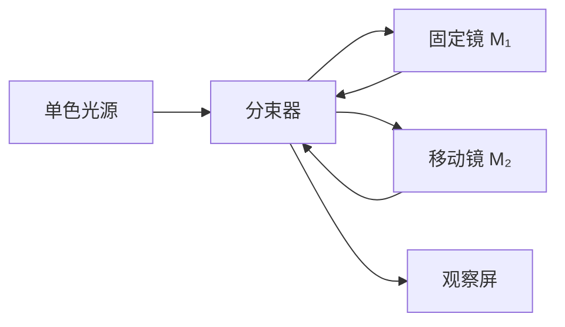

# 迈克尔逊干涉仪的原理与应用

## 仪器是什么

迈克耳孙干涉仪利用==同源光的分束与往返光程差==产生干涉，可精确测量微小长度、折射率和波长。其核心优势是：反射镜移动 $\Delta d$ 时，光线往返一次，光程差改变 $2\Delta d$。

> [!IMPORTANT]
> 迈克耳孙干涉仪中，平面镜移动距离为 $d$，对应光程差变化 $2d$；光程差每改变一个波长，干涉条纹移动一条。

## 干涉原理

分束器把入射光分成两束：一束经 $M_1$ 返回，另一束经 $M_2$ 返回。两束光重新重合后发生干涉。若两臂几何光程差为 $\delta$，则相位差为

$$
\Delta\varphi=\frac{2\pi}{\lambda}\delta.
$$

因此，亮纹条件为

$$
\delta=k\lambda,
$$

暗纹条件为

$$
\delta=\left(k+\frac12\right)\lambda.
$$

> [!TIP]
> 判断条纹移动时，不要盯着镜子走了多远，要先问：==往返光程改变了多少？==

可动反射镜移动距离 $d$，光程差改变 $\Delta\delta=2d$，故移动的条纹数为

$$
N=\frac{\Delta\delta}{\lambda}
=\boxed{\frac{2d}{\lambda}}.
$$

若 $d$ 不是 $\lambda/2$ 的整数倍，结果表示条纹移动数；通常可理解为跨过的条纹数。

## 测量薄膜厚度

在某一光路中放入折射率为 $n$、厚度为 $d$ 的透明薄膜。光在该光路中往返通过薄膜，因此原空气层光程 $2d$ 变为 $2nd$，光程改变量为

$$
\Delta\delta=2nd-2d=2(n-1)d.
$$

若由此产生 $N$ 条条纹移动，则

$$
N\lambda=2(n-1)d,
$$

所以

$$
\boxed{d=\frac{N\lambda}{2(n-1)}}.
$$

例如，$\lambda=589\,\mathrm{nm}$、$n=1.40$、$N=7.0$：

$$
d=\frac{7.0\times589\,\mathrm{nm}}{2(1.40-1)}
=5153.75\,\mathrm{nm}.
$$

## 与相近实验的区别

| 装置 | 主要观察量 | 关键关系 |
|---|---|---|
| 迈克耳孙干涉仪 | 等倾条纹或等厚条纹 | 反射镜移动 $d$，光程变 $2d$ |
| 牛顿环 | 空气膜等厚干涉 | 明环半径满足 $r_m^2=mR\lambda$ |
| 双缝干涉 | 屏上明暗条纹 | 相邻条纹间距由缝距、波长和屏距决定 |

> [!WARNING]
> 薄膜在迈克耳孙干涉仪中通常使光往返两次，所以光程改变量是 $2(n-1)d$，不是 $(n-1)d$。是否还发生额外的半波损失，必须结合分束器等光路细节判断，不能机械地再添一个 $\lambda/2$。

## 常见坑

- 把反射镜位移 $d$ 当作光程差 $d$，漏掉“往返”因子 2。
- 求膜厚时使用 $d=N\lambda/(n-1)$，同样漏掉双程因子。
- 把条纹“移动了 $N$ 条”误写成第 $N$ 个亮纹位置变化 $N\lambda$。前者说的是条纹序列整体平移多少个周期。
