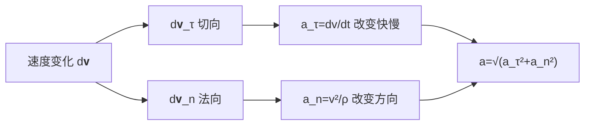

# 速度、加速度的定义与微分关系

## 速度与加速度

质点沿曲线运动时，位置用位矢 $\mathbf{r}(t)$ 描述。==速度是位置的变化率，加速度是速度的变化率==——这两层微分关系是整个运动学的地基：

$$\mathbf{v}(t)=\frac{d\mathbf{r}(t)}{dt},\qquad \mathbf{a}(t)=\frac{d\mathbf{v}(t)}{dt}$$

若 $\mathbf{r}(t)=x(t)\hat{i}+y(t)\hat{j}+z(t)\hat{k}$，对时间求导只需逐分量进行：

$$\mathbf{v}=v_x\hat{i}+v_y\hat{j}+v_z\hat{k},\qquad v_x=\frac{dx}{dt}\ \text{等}$$

$$\mathbf{a}=a_x\hat{i}+a_y\hat{j}+a_z\hat{k},\qquad a_x=\frac{dv_x}{dt}=\frac{d^2x}{dt^2}\ \text{等}$$

| 概念 | 定义 | 方向 | 与瞬时值的关系 |
|---|---|---|---|
| 平均速度 $\bar{\mathbf{v}}$ | $\dfrac{\Delta\mathbf{r}}{\Delta t}$ | 与位移 $\Delta\mathbf{r}$ 同向 | $\Delta t\to 0$ 时的极限即 $\mathbf{v}$ |
| （瞬时）速度 $\mathbf{v}$ | $\dfrac{d\mathbf{r}}{dt}$ | 沿轨迹**切线**，指向运动方向 | 其大小等于速率 $v=\|\mathbf{v}\|$ |
| 平均加速度 $\bar{\mathbf{a}}$ | $\dfrac{\Delta\mathbf{v}}{\Delta t}$ | 与 $\Delta\mathbf{v}$ 同向 | $\Delta t\to 0$ 时的极限即 $\mathbf{a}$ |
| （瞬时）加速度 $\mathbf{a}$ | $\dfrac{d\mathbf{v}}{dt}$ | **一般不沿切线**，指向轨迹凹侧 | 可分解为切向与法向分量 |

> [!IMPORTANT]
> 速度 $\mathbf{v}$ 永远沿轨迹切线方向；但加速度 $\mathbf{a}$ 的方向一般与速度**不共线**。只要轨迹弯曲或速率变化，$\mathbf{a}\neq 0$。

## 加速度为何要拆成“切向 + 法向”

曲线运动中，速度 $\mathbf{v}$ 是矢量，它的改变包含两件事：大小变没变？方向变没变？

把速度增量分解为沿切线（$\hat{e}_\tau$，即 $\hat{\mathbf{v}}$）和沿法线（$\hat{e}_n$，指向凹侧）两部分 $d\mathbf{v}=d\mathbf{v}_\tau+d\mathbf{v}_n$，取极限后得

$$\mathbf{a}=\underbrace{\frac{dv}{dt}\hat{e}_\tau}_{\mathbf{a}_\tau:\ \text{改变速率}}+\underbrace{\frac{v^2}{\rho}\hat{e}_n}_{\mathbf{a}_n:\ \text{改变方向}}$$

其中 $\rho$ 是轨迹在该点的曲率半径（圆运动时 $\rho=R$）。总加速度大小

$$a=\sqrt{a_\tau^2+a_n^2}$$

> [!NOTE]
> 若某时刻 $a_\tau=0$，则 $\mathbf{a}\perp\mathbf{v}$，速率不变（如匀速圆周运动）；若 $a_n=0$，则轨迹在该点不弯曲（直线运动或拐点）。

## 常见误区

> [!WARNING]
> **混淆 $a$ 与 $dv/dt$**：$a=|\mathbf{a}|$ 是总加速度的大小，而 $dv/dt$ 只是切向分量 $a_\tau$。曲线运动中一般 $a\neq dv/dt$，例如匀速圆周运动 $dv/dt=0$ 但 $a_n=v^2/R\neq 0$。

> [!CAUTION]
> **把 $\Delta r$ 当路程**：$|\Delta\mathbf{r}|$ 是位移大小（弦长），而路程是弧长 $\Delta s$。只有当 $\Delta t\to 0$ 时二者之比才趋于 1，因此 $v=|d\mathbf{r}/dt|=ds/dt$ 严格成立，但 $|{\Delta\mathbf{r}}/{\Delta t}|\neq$ 平均速率（后者定义为 $\Delta s/\Delta t$）。

> [!WARNING]
> **以为加速度恒定就一定是直线运动**：反例就是抛体运动——$\mathbf{a}=-g\hat{j}$ 恒定，轨迹却是抛物线。判断轨迹要看 $\mathbf{a}$ 与 $\mathbf{v}$ 是否共线，而非 $\mathbf{a}$ 是否恒定。

## 一个算对的例子（切向/法向分解）

> 一质点作半径为 $R$ 的圆周运动，路程 $s=\dfrac{1}{2}kRt^2$（$k$ 为常数）。求 $a_\tau$、$a_n$ 及 $a$。

先由路程得速率（第一步总是 $v=ds/dt$）：

$$v=\frac{ds}{dt}=kRt$$

再分别套用两个分量公式：

$$a_\tau=\frac{dv}{dt}=kR\quad(\text{常数})$$

$$a_n=\frac{v^2}{R}=\frac{(kRt)^2}{R}=k^2Rt^2$$

$$a=\sqrt{a_\tau^2+a_n^2}=\sqrt{(kR)^2+(k^2Rt^2)^2}=kR\sqrt{1+k^2t^4}$$

可以看到：虽然“加速”的速率变化很均匀（$a_\tau$ 恒定），但由于转弯越来越快，$a_n$ 随 $t^2$ 增长，总加速度也随之增大。

> [!TIP]
> 求解切向/法向加速度的固定套路：先由运动方程或路程求出 $v(t)$，再用 $a_\tau=dv/dt$、$a_n=v^2/\rho$。若题目给的是 $\mathbf{r}(t)$，也可先求 $\mathbf{a}=d^2\mathbf{r}/dt^2$，再用 $a_\tau=\mathbf{a}\cdot\hat{\mathbf{v}}$、$a_n=\sqrt{a^2-a_\tau^2}$ 反解，还能顺便得到曲率半径 $\rho=v^2/a_n$。
