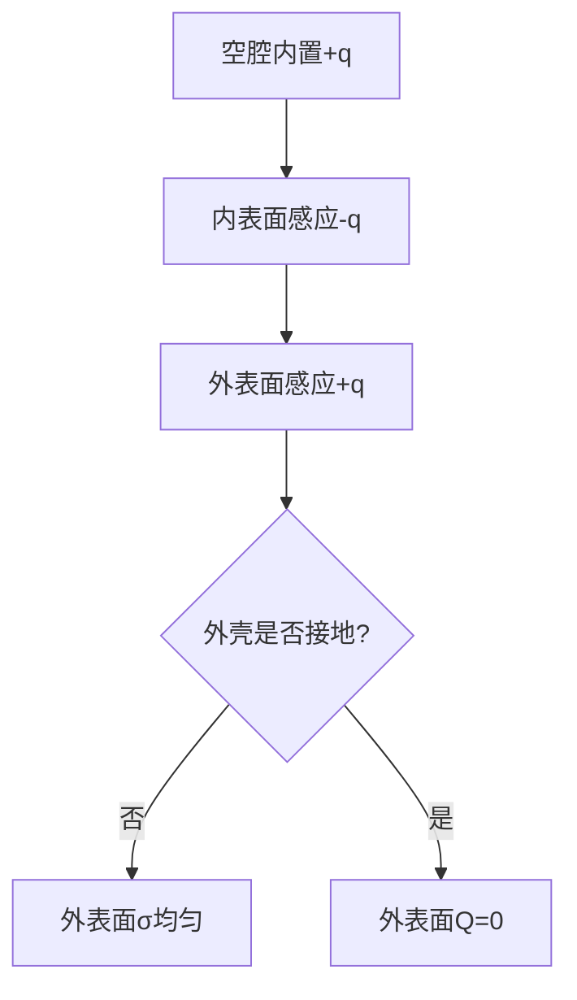

# 静电平衡条件、导体表面电荷分布及接地问题

## 静电平衡条件与物理图像

导体内部存在大量自由电荷，当置于电场中时，电荷会如何运动？若电荷持续定向移动，还能称为“静电”吗？显然不能。因此，==静电平衡的本质是导体内部合场强处处为零==。这包含两个核心条件：

> [!IMPORTANT]
> 1. 导体内部任意一点 $E_{\text{内}} = 0$；
> 2. 导体表面外侧附近 $E_{\text{表}} \perp$ 表面，且 $E_{\text{表}} = \frac{\sigma}{\varepsilon_0}$。

由 $E_{\text{内}}=0$ 可直接推论：导体是等势体，表面是等势面，体内电势等于表面电势。注意填空3考查的正是此点：外部带电体在导体体内产生的电场**不会**单独存在，而是被感应电荷的电场完全抵消，所有电荷在体内产生的场强**矢量和**为零。

## 电荷分布规律与接地模型

既然内部无净电荷，电荷只能分布在表面。但分布均匀吗？这取决于导体的几何形状与外部环境。对于孤立导体，曲率大处 $\sigma$ 大；但对于非孤立系统（如空腔、外电场），需结合高斯定理与叠加原理分析。

> [!WARNING]
> 接地不等于“电荷全部流入大地”！接地的本质是==强制导体电势为零==。如选择2中左端接地，因右侧正电荷受M吸引无法流走，实际是大地电子流入中和了右端正电荷，而非左端负电荷消失。

对比两类典型场景：

| 场景 | 内表面电荷 | 外表面电荷 | 关键判据 |
| :--- | :--- | :--- | :--- |
| 空腔偏心置 $+q$ | 不均匀（$-q$） | 均匀（$+q$） | 外表面为等势面 |
| 平板置匀强场 $E_0$ | — | $\sigma_1, \sigma_2$ 不等 | 叠加后 $E_{\text{内}}=0$ |

以填空6为例验证：设平板左右面密度为 $\sigma_L, \sigma_R$，总电荷 $\sigma_L + \sigma_R = \sigma$。由 $E_{\text{内}}=0$ 得 $E_0 + \frac{\sigma_L}{2\varepsilon_0} - \frac{\sigma_R}{2\varepsilon_0} = 0$，联立解得两侧合场强分别为 $E_0 - \frac{\sigma}{2\varepsilon_0}$ 和 $E_0 + \frac{\sigma}{2\varepsilon_0}$。

> [!TIP]
> 解题口诀：**内场为零定关系，高斯定理求电量，接地电势零为锚**。遇到空腔问题，先由高斯定理确定内表面总电量，再由对称性或边界条件判断分布；接地问题始终从电势出发，而非凭直觉猜电荷流向。

[!CAUTION]
切勿混淆“导体内部 $E=0$”与“空腔内部 $E=0$”！前者是平衡条件，后者仅在腔内无电荷时成立。选择1中空腔内有电荷，腔内场强不为零，但导体材料内部仍满足 $E=0$，这是分析感应电荷分布的前提。
