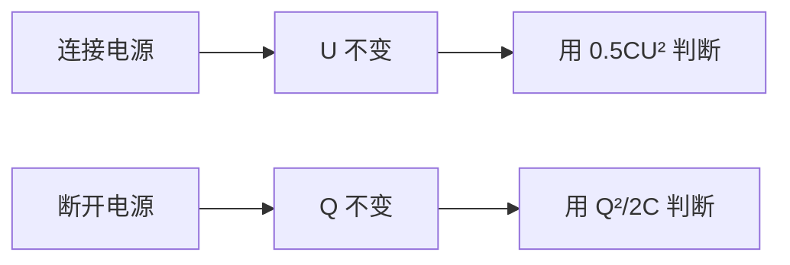

# 静电场的能量与能量密度

## 它是什么

电容充电后，电源做的功并没有消失，而是储存在两极板之间的空间里。我们把这种储存在静电场中的能量叫**静电场能量**。对于电容器：

$$W_e=\frac{1}{2}qU=\frac{1}{2}CU^{2}=\frac{q^{2}}{2C}$$

更普遍地，能量 distributed 在场中，用**静电场能量密度**描述：

$$w_e=\frac{1}{2}\boldsymbol{D}\cdot\boldsymbol{E},\qquad W_e=\int_V w_e\,\mathrm{d}V=\frac{1}{2}\int_V \boldsymbol{D}\cdot\boldsymbol{E}\,\mathrm{d}V$$

## 为什么需要

点电荷系能量 $W_e=\frac{1}{2}\sum q_iU_i$ 只在电荷可数时好用；连续带电体或一般电场分布时，用**能量密度对全空间积分**更自然，也解释了“能量在场里而非仅在电荷上”。

## 怎么做

解题关键是先判断：==电荷 $Q$ 不变，还是电压 $U$ 不变==。

- 接电源：$U$ 固定，$C$ 变则看 $W_e=\frac{1}{2}CU^{2}$。
- 断电源：$Q$ 固定，$C$ 变则看 $W_e=\dfrac{Q^{2}}{2C}$。

## 相近概念区别

| 情况 | 场分布 | 能量密度 $w_e$ | 总静电能比较 |
|---|---|---|---|
| 带电球面 | $r<R$ 内 $E=0$ | 内部 0 | 较小 |
| 带电球体（同 $R,Q$） | $r<R$ 内 $E\neq0$ | 内部非零 | ==更大== |

所以填空 6：孤立均匀带电球体静电能 **大于** 同半径同电量球面。

## 常见的坑

> [!WARNING]
> 别把“接电源拉大板距”当成 $E$ 不变。平行板 $E=U/d$，接电源时 $U$ 不变、$d$ 变大则 $E$ 减小，$C$ 减小，$Q=CU$ 减小，$W_e=\frac{1}{2}CU^2$ 也减小——这正是选择 2 的 B 选项。

> [!CAUTION]
> 介质插入电容器时：若**与电源相连**，$U$ 不变，$\varepsilon_r$ 使 $C\to\varepsilon_r C_0$，则 $W_e=\frac{1}{2}\varepsilon_r C_0U^2$，能量变为原来 $\varepsilon_r$ 倍（填空 5）；若**断开电源**，$Q$ 不变，$W_e=Q^2/(2\varepsilon_r C_0)$，能量反而减小。

## 一个算对了的例子

计算 8：半径 $R$ 金属球真空充电到 $U_0$，断开电源（故 $Q$ 不变），浸入 $\varepsilon_r$ 介质中。

真空电容 $C_0=4\pi\varepsilon_0R$，电量 $Q=C_0U_0=4\pi\varepsilon_0RU_0$；介质中 $C=4\pi\varepsilon_0\varepsilon_rR$。

$$
W=\frac{Q^{2}}{2C}
=\frac{(4\pi\varepsilon_0RU_0)^2}{2\cdot4\pi\varepsilon_0\varepsilon_rR}
=\frac{2\pi\varepsilon_0RU_0^{2}}{\varepsilon_r}
$$

答案即 $\dfrac{2\pi\varepsilon_0RU_0^{2}}{\varepsilon_r}$，和课件解一致。
