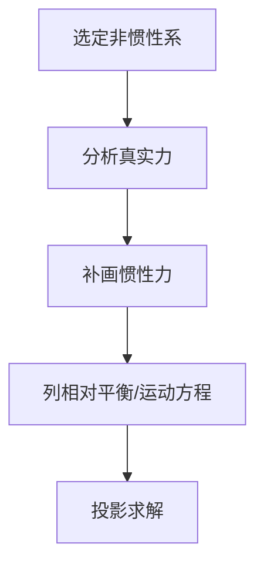

# 非惯性参考系中的惯性力

## 为什么需要引入惯性力

牛顿第二定律 $\boldsymbol{F}=m\boldsymbol{a}$ 仅在惯性系中成立。若站在加速运动的斜面或旋转圆盘上观察，物体明明受力却可能“静止”，或者不受切向力却发生偏转。此时直接套用牛顿定律会失效。为了让牛顿定律在非惯性系中==形式上依然适用==，我们引入一个虚拟的“惯性力”来修正方程：

$$
\boldsymbol{F}_{\text{真实}} + \boldsymbol{F}_{\text{惯性}} = m\boldsymbol{a}_{\text{相对}}
$$

> [!IMPORTANT]
> 惯性力不是物体间的相互作用，没有施力物体，也不存在反作用力。它仅是==参考系加速效应的数学等效==，只在非惯性系中对观测者“真实”存在。

## 两类常见惯性力

根据非惯性系的运动形式，惯性力分为平移与转动两类，解题时务必先判断参考系类型：

| 类型 | 参考系特征 | 表达式 | 方向判定 |
| :--- | :--- | :--- | :--- |
| 平移惯性力 | 平动加速度 $\boldsymbol{a}_0$ | $\boldsymbol{F}_t = -m\boldsymbol{a}_0$ | 与 $\boldsymbol{a}_0$ 反向 |
| 离心力 | 匀角速 $\boldsymbol{\omega}$ 转动 | $\boldsymbol{F}_c = m\omega^2 r \boldsymbol{e}_r$ | 沿径向向外 |
| 科里奥利力 | 转动系中质点有 $\boldsymbol{v}_{\text{rel}}$ | $\boldsymbol{F}_{cor} = -2m(\boldsymbol{\omega}\times\boldsymbol{v}_{\text{rel}})$ | 垂直 $\boldsymbol{\omega}$ 与 $\boldsymbol{v}_{\text{rel}}$ |

> [!WARNING]
> 科里奥利力仅当质点相对转动系==有速度时才出现==。若相对静止（如习题2.3中小环平衡），则 $\boldsymbol{F}_{cor}=0$，切勿多画此项。

## 解题四步法

以习题2.4（圆盘槽内质点）为例演示完整流程：

1.  **建系**：取与圆盘固连的转动系 $K$，$\boldsymbol{\omega}=\omega\boldsymbol{k}$。
2.  **真实力**：重力与支持力抵消，仅剩槽壁侧向力 $\boldsymbol{F}_w=f\boldsymbol{j}$。
3.  **惯性力**：质点有径向相对速度 $\dot{x}\boldsymbol{i}$，故同时存在离心力 $m\omega^2 x\boldsymbol{i}$ 和科氏力 $-2m\omega\dot{x}\boldsymbol{j}$。
4.  **列方程**：在 $K$ 系中应用修正牛顿定律：
    $$
    m\ddot{x}\boldsymbol{i} = m\omega^2 x\boldsymbol{i} + (f - 2m\omega\dot{x})\boldsymbol{j}
    $$
    分量分离得 $\ddot{x}-\omega^2 x=0$ 及 $f=2m\omega\dot{x}$，结合初值即可解出速率、时间与侧向力。

> [!TIP]
> 处理转动系问题时，建议将 $\boldsymbol{\omega}$、$\boldsymbol{v}_{\text{rel}}$、$\boldsymbol{F}_{cor}$ 三者用右手螺旋法则在草稿纸上比划一次，避免叉乘方向出错。

## 易错辨析

-   **混淆参考系**：惯性力只对非惯性系中的观测者有效。若选地面为参考系，==绝对不能画惯性力==，而应直接用真实力求绝对加速度。
-   **遗漏科氏力**：只要质点在转动系中运动，科氏力必存在；它与相对速度垂直，只改变方向不做功，但会影响约束力大小。
-   **临界条件误判**：如习题2.2中“刚离开斜面”对应 $N=0$，此时支持力消失但惯性力仍存在，代入 $N=mg\cos\theta - ma\sin\theta=0$ 即得临界加速度 $a=g/\tan\theta$。

> [!CAUTION]
> 惯性力是“假想力”，但在非惯性系中做功能计算时，==可将其视为保守力引入势能==（如离心势能 $-\frac{1}{2}m\omega^2 r^2$），这是解题捷径，但仅限同一非惯性系内使用。
