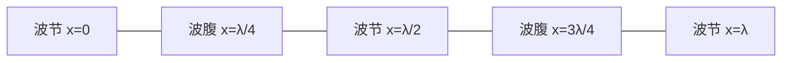

# 驻波的形成、波节与波腹

## 驻波的形成

两列**振幅相同**、**频率相同**、**振动方向相同**、**传播方向相反**的相干波叠加，就会形成驻波。

例如一列入射波遇到固定端反射回来，反射波与人射波满足上述条件，叠加后有些点始终“原地不动”，有些点“剧烈振动”，看起来波形不再向前传播，只在原地起伏——所以叫“驻波”。

> [!IMPORTANT]
> 形成驻波的关键不是“两列相干波”这么简单，而是必须**同振幅、相向传播**。振幅不同则叠加后波节处不会真正静止为零。

设两列波为

$$
y_1 = A\cos 2\pi\left(\nu t - \frac{x}{\lambda}\right),\qquad
y_2 = A\cos 2\pi\left(\nu t + \frac{x}{\lambda}\right)
$$

叠加得**驻波方程**：

$$
y = y_1 + y_2 = 2A\cos\left(\frac{2\pi}{\lambda}x\right)\cos(2\pi\nu t)
$$

注意这个式子的结构：==空间部分 $\cos\frac{2\pi x}{\lambda}$ 只决定各点的振幅==，==时间部分 $\cos(2\pi\nu t)$ 决定各点一起随时间振动==。波不再传播，只是每一个 $x$ 处自己在做简谐运动。

## 波节与波腹

观察振幅因子：

$$
A(x) = \left| 2A\cos\frac{2\pi x}{\lambda} \right|
$$

- **波腹**：$\left|\cos\frac{2\pi x}{\lambda}\right|=1$，振幅最大，为 $2A$。

$$
\frac{2\pi x}{\lambda}=k\pi \quad\Rightarrow\quad x = k\frac{\lambda}{2}\quad(k=0,\pm1,\pm2,\dots)
$$

- **波节**：$\cos\frac{2\pi x}{\lambda}=0$，振幅为零，该点始终不动。

$$
\frac{2\pi x}{\lambda}=\left(k+\frac12\right)\pi \quad\Rightarrow\quad x = \left(k+\frac12\right)\frac{\lambda}{2}
$$

> [!TIP]
> 相邻波节之间距离 $=\dfrac{\lambda}{2}$，相邻波腹之间距离也是 $\dfrac{\lambda}{2}$，而**相邻波节与波腹之间的距离**是 $\dfrac{\lambda}{4}$。

下面是一段波节与波腹分布图：

## 相位关系：两波节之间“一起动”

很多同学以为驻波跟行波一样处处相位不同，其实不是。

把相邻两波节之间的区间单独看，$\cos\frac{2\pi x}{\lambda}$ 不改变符号，所以这段区域内所有质点的时间因子完全相同——==两相邻波节之间各质点的相位相同，步调一致，一起到达最大、一起通过平衡位置==；跨越一个波节后，符号相反，相位差 $\pi$。

例如前面真题里：

> 在驻波中，两个相邻波节点间各质点的振动振幅不同，相位相同。

这正是最常考的判断点。

## 常见的坑

> [!WARNING]
> 写波腹位置时不要只会背 $x=k\lambda/2$，要看原点是不是波节。若驻波方程形如 $y=2A\cos\left(\frac{2\pi x}{\lambda}-\frac{\pi}{2}\right)\cos\omega t$，原点就不是波节，波腹位置要重新令振幅因子等于 $\pm1$ 反解。

> [!CAUTION]
> 振幅必须取绝对值。例如 $y=-A\cos\omega t$ 的振幅是 $A$，初相可写为 $\pi$，但振幅永远写正数。

## 算对一道

已知入射波 $y_1=6.0\times10^{-2}\cos\left[\frac{\pi}{2}(x-40t)\right]$，反射波 $y_2=6.0\times10^{-2}\cos\left[\frac{\pi}{2}(x+40t)\right]$，求 $x=0\sim10\ \text{m}$ 内的波节与波腹。

合成：

$$
y=y_1+y_2=0.12\cos\left(\frac{\pi}{2}x\right)\cos(20\pi t)
$$

波腹令 $\cos\frac{\pi x}{2}=\pm1$：

$$
\frac{\pi x}{2}=k\pi \Rightarrow x=2k\ (k=0,1,\dots,5)
$$

得 $x=0,2,4,6,8,10\ \text{m}$。

波节令 $\cos\frac{\pi x}{2}=0$：

$$
\frac{\pi x}{2}=\left(k+\frac12\right)\pi \Rightarrow x=2k+1\ (k=0,1,\dots,4)
$$

得 $x=1,3,5,7,9\ \text{m}$。

这样就把“背公式”落实到了具体位置判断上，做题不会乱。
