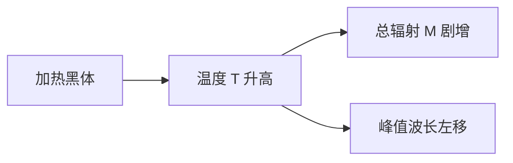

# 黑体辐射规律与普朗克能量子假设

---
requires: [大学物理/热辐射基本概念]
---

如果一个物体能“吃掉”照在它身上的所有电磁波，一点都不反射，它该叫什么？加热它时，它发出的光又遵循什么规律？这两个问题正是量子物理的起点。

## 黑体与实验规律

> [!IMPORTANT]
> ==黑体==是指能够全部吸收外来的任何电磁辐射的物体（即吸收比 $\alpha = 1$）。注意：黑体不是指“颜色纯黑”或“不反射可见光”，而是对**所有波段**的电磁辐射都不反射。

黑体在温度 $T$ 下会向外辐射能量。描述其辐射本领有两个核心实验定律：

| 定律名称 | 公式 | 物理意义 |
| :--- | :--- | :--- |
| 斯特藩-玻尔兹曼定律 | $M(T) = \sigma T^4$ | 辐射出射度（总发射本领）与温度的四次方成正比 |
| 维恩位移定律 | $\lambda_{\mathrm{m}} T = b$ | 峰值波长 $\lambda_{\mathrm{m}}$ 与温度成反比 |

> [!WARNING]
> 选择题常考图像辨析：当 $T_2 > T_1$ 时，正确曲线必须满足两点：① $T_2$ 的曲线整体在 $T_1$ **上方**（不相交）；② $T_2$ 的峰值位置更靠**左**（短波方向）。

## 普朗克能量子假设

经典物理推导出的辐射公式在短波段发散（“紫外灾难”），无法吻合实验曲线。为了解释黑体辐射的实验规律，普朗克提出了革命性的假设：

> [!IMPORTANT]
> 辐射黑体中的谐振子能量不能连续取值，只能是某一最小能量单元 $\varepsilon$ 的整数倍，即 ==$E = n h\nu$==（$n=1,2,3,\dots$），其中 $h$ 为普朗克常量。这就是能量量子化。

> [!NOTE]
> 普朗克假说是专门为解释**黑体辐射**提出的；而光电效应由爱因斯坦光子说解释，X射线散射对应康普顿效应，原子光谱对应玻尔模型。切勿张冠李戴。

## 常见易错坑

> [!CAUTION]
> “温度升高一倍”意味着 $T_2 = 2T_1$。代入 $M = \sigma T^4$ 后，$M_2 = \sigma (2T_1)^4 = 16 \sigma T_1^4$。辐射出射度变为原来的 16 倍，即==增大了 15 倍==。题目问“增大”还是“增大为”务必看清！

> [!TIP]
> 遇到同时涉及波长和总能量的题，先用维恩位移定律求温度比，再代入斯特藩-玻尔兹曼定律求功率比，分两步走最稳。

## 算对了的例子

以填空题为背景进行完整计算：测得太阳最大单色辐出度波长 $\lambda_{\mathrm{m}1} = 0.55\ \mu\mathrm{m}$，北极星 $\lambda_{\mathrm{m}2} = 0.35\ \mu\mathrm{m}$，求表面温度之比 $T_1 : T_2$。

**解：**
由维恩位移定律 $\lambda_{\mathrm{m}} T = b$，可知 $T = \frac{b}{\lambda_{\mathrm{m}}}$。

因此两星温度之比为：

$$
\frac{T_1}{T_2} = \frac{b / \lambda_{\mathrm{m}1}}{b / \lambda_{\mathrm{m}2}} = \frac{\lambda_{\mathrm{m}2}}{\lambda_{\mathrm{m}1}}
$$

代入数据：

$$
T_1 : T_2 = 0.35 : 0.55 = 7 : 11 \approx 0.64
$$

> [!TIP]
> 若此题继续追问“太阳与北极星的辐射出射度之比”，则需再套一步：$\frac{M_1}{M_2} = \left(\frac{T_1}{T_2}\right)^4 = \left(\frac{7}{11}\right)^4$。记住：波长比等于温度反比，总辐射比等于温度比的 4 次方。
