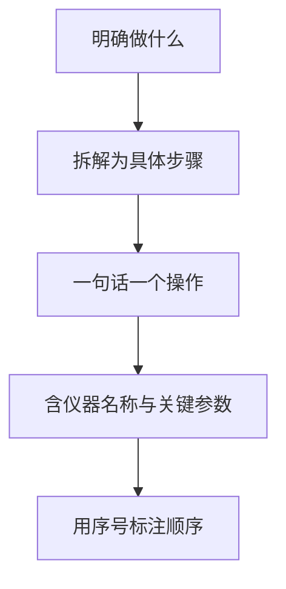

# 实验报告的内容（含实验内容与步骤等）

## 实验报告的内容

实验报告是物理实验的最终成果，它不仅是实验过程的记录，更是分析和提炼结论的过程。一份完整的实验报告像一篇微型论文，==核心是让别人能看懂你做了什么、怎么做的、结果可信吗==。

### 为什么要写报告？

实验做得漂亮，如果报告写不清楚，别人就无法判断你的数据是否可靠、结论是否正确。报告将零散的测量转化为有条理的论证，也是你将来写学术论文的基础训练。

### 报告包含哪几部分？

一份标准的物理实验报告通常包括以下部分：

| 部分 | 核心问题 | 常见坑 |
| :--- | :--- | :--- |
| 实验名称 | 做什么实验？ | 别写成简称或不规范的口语名称 |
| 实验目的 | 要验证什么规律？测量什么量？ | 不是抄教材目标，而是本次要解决的具体问题 |
| 实验原理 | 依据什么公式？各符号什么意思？ | 写主要公式，不要大段抄书；电路图或光路图是必需的 |
| **实验内容与步骤** | 分几步操作？每步测什么数据？ | 用简洁的序号列出操作要点，而不是流水账 |
| 数据记录与处理 | 原始数据如何变成最终结果？ | 写清公式、代入过程、单位；禁用铅笔 |
| 结果与讨论 | 最终值是多少？误差来源是什么？ | 分析系统误差时要具体，别只写“人为误差” |
| 思考题（如有） | 实验背后的原理与拓展 | 主动思考，结合实验现象回答 |

### 实验内容与步骤怎么写？

这部分是报告承上启下的关键。它让读者知道你是按什么顺序操作仪器的，保证实验可重复。写法要点：

- **不要写**：“我走进实验室，打开电源……”（实验背景和耗材清单不是步骤）。
- **应该写**：
  1. 按图连接电路，将滑动变阻器调至最大阻值。
  2. 接通电源，调节 $R$ 使电流表满偏，记录此时标准表读数。
  3. 改变负载，从 $0～2\text{mA}$ 等间距测6组数据，记入表中。

### 报告中的表格与图

每一个数据表都要标 **表头 + 物理量/单位**，如 $t/^\circ\text{C}$；作图要用坐标纸或软件，标明轴名、单位、比例尺。选取图中两点求斜率时，必须==用远端点，不能用原始数据点直接代入==。

[!TIP]
**读图取点口诀**：取远不取近，取线不取点。意思是选取拟合直线上相距远的两点（不是实验数据点）来计算。

### 一个完整的例子：用表格与作图法找经验公式

下面以热电偶温差电动势 $U$ 与温度 $t$ 的关系为例演示报告的数据处理部分。

**表 1  热电偶温差电动势 $U$ 与温度 $t$ 数据**
| $t/(^\circ\text{C})$ | 10.00 | 20.00 | 30.00 | 40.00 | 50.00 | 60.00 | 70.00 | 80.00 |
| :--- | :--- | :--- | :--- | :--- | :--- | :--- | :--- | :--- |
| $U/(\text{mV})$ | 1.18 | 1.96 | 2.78 | 3.63 | 4.48 | 5.34 | 6.20 | 7.12 |

用直角坐标纸描出8个点，发现几乎在一条直线上，所以设经验公式为 $U = kt + b$。沿拟合直线取两个远端点（不是实验点）：
- $P_1(15.00,\ 1.50)$
- $P_2(75.00,\ 6.60)$

算斜率：
$$ k = \frac{6.60-1.50}{75.00-15.00} = 0.085\ \text{mV}/^\circ\text{C} $$

再算截距（用两点式计算）：
$$ b = \frac{15.00\times6.60 - 75.00\times1.50}{15.00-75.00}=0.225\ \text{mV} $$

[!IMPORTANT]
最终经验公式为：
$$ U = 0.085\, t + 0.225\  (\text{单位：mV}) $$
这样从列表中提炼出了物理规律，也方便工程上直接查表换算。
