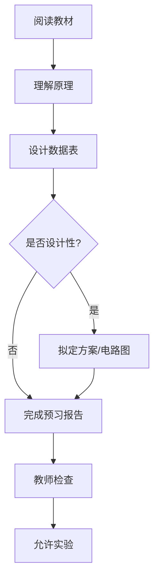

# 物理实验课的基本程序（预习、实验进行、写报告）

# 物理实验课的基本程序

物理实验不仅是验证理论，更是培养科学素养的过程。规范的实验程序分为三个阶段：**预习**、**实验进行**、**写报告**。任何环节的缺失都可能导致实验失败或成绩降级。

## 实验前的预习：成败的关键

预习不是简单的抄书，而是要明确“做什么、怎样做、为什么这样做”。

> [!IMPORTANT]
> **核心要求**：必须携带**预习报告**进入实验室。未预习或报告不合格者，教师有权==停止其实验==或==成绩降一档==。

预习报告应包含以下要素：
1.  **原理与方法**：弄懂实验原理，识别关键条件。
2.  **数据表格设计**：根据待测量和测量条件预先画好表格。
    *   表格需体现==有效数字==规则。
    *   预留足够的测量次数（如声速测量中通常测 8-10 组数据）。
3.  **方案设计**：对于设计性实验，需自拟线路图/光路图及方案，并报老师批准。

## 实验进行：规范与记录

实验过程中，核心原则是**真实**与**规范**。

*   **原始数据记录**：
    *   严禁随意涂改。若数据有误，应在原数据上==画一条斜杠==，将修正值写在旁边，以备查证。
    *   注意仪器的读数规则，如信号发生器调节频率时需确认显示模式为“频率”而非“周期”。
*   **操作规范**：
    *   光学实验：==严禁手摸光学表面==，污染时用专用擦镜纸轻擦。
    *   电学实验：连接电路前确保电源关闭，注意量程选择。

> [!WARNING]
> **常见误区**：认为数据位数越多越精确。
> **正解**：有效数字的位数由==仪器误差==和==测量方法==决定，盲目增加位数无意义（参见判断题 6-8）。

## 数据处理与报告撰写

实验结束后，需对数据进行科学处理并撰写报告。

*   **误差分类**：
    *   **系统误差**：仪器缺陷或理论近似导致。
    *   **随机误差**：环境波动引起，可通过多次测量减小。
    *   **粗差**：操作失误或读数错误导致，应剔除（参见选择题 1）。
*   **数据处理方法**：
    *   **逐差法**：适用于等间距连续测量。例如声速实验中，若测得 10 个位置点 $L_1 \dots L_{10}$，波长计算为 $\lambda = \frac{2}{5}\Delta L$（其中 $\Delta L$ 为对应项之差）。
    *   **有效数字运算**：最终结果的不确定度通常保留 1-2 位有效数字，测量值末位与不确定度对齐。

| 阶段 | 关键动作 | 常见陷阱 |
| :--- | :--- | :--- |
| **预习** | 设计表格、理解原理 | 抄袭旧报告、无数据表 |
| **实验** | 规范操作、原始记录 | 涂改数据、手摸透镜 |
| **报告** | 误差分析、逐差处理 | 有效数字错误、忽略单位 |

> [!TIP]
> **示例**：在惠斯通电桥测电阻中，若要求四位有效数字，比率臂 $R_1/R_2$ 的选择至关重要。若待测电阻约几十欧姆，选 $R_1=100.0\Omega, R_2=1000.0\Omega$ 比选小阻值更能保证精度（参见选择题 5）。
