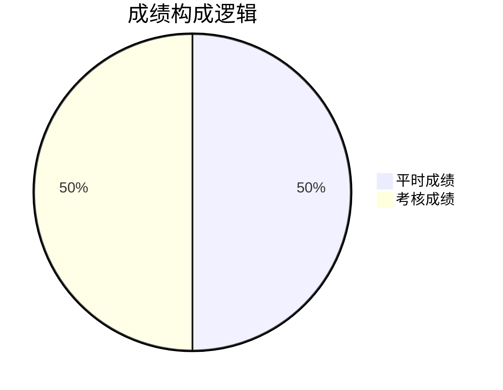

# 物理实验课程的成绩考核方式

## 成绩构成与考核逻辑

南京邮电大学《物理实验》课程的总成绩并非仅由期末一张试卷决定，而是采用 ==平时成绩与考核成绩综合评定== 的模式。这种设计旨在全面考察学生的科学素养：既看重实验过程中的操作规范与态度，也检验对误差理论等核心知识的掌握。

> [!IMPORTANT]
> 核心结论：切勿忽视平时环节。预习、操作、报告均计入平时分，任何一环缺失都可能导致总评不及格。

## 平时成绩：过程即考核

平时成绩贯穿实验全周期，主要考察以下三个维度：

1.  **预习准备**：课前必须明确“做什么、怎样做、为什么这样做”。教师会检查预习情况，==未预习者将被责令停止实验==。
2.  **课堂表现**：包括严肃纪律（不迟到早退）、规范操作（爱护仪器、如实记录数据）以及实验后的整理工作。
3.  **实验报告**：需在实验后一周内完成并上交。报告不仅是数据的罗列，更是对实验结果的分析与反思。

> [!WARNING]
> 高危误区：伪造数据或抄袭结果。一旦发现，不仅该次实验零分，更严重违背“实事求是”的课程培养目标。

## 考核成绩：理论与应用

期末考核通常以笔试形式进行，重点考察**误差理论**（以第一次课内容为主）及实验数据处理能力。

| 题型 | 考察重点 | 答题规范 |
| :--- | :--- | :--- |
| 选择/填空 | 基本概念、单位、不确定度定义 | 概念清晰，术语准确 |
| 作图题 | 数据可视化、拟合直线 | 坐标轴标注完整，比例恰当 |
| 计算题 | 误差传递、结果表达 | 步骤完整，有效数字正确 |

> [!TIP]
> 记忆要点：测量结果三要素缺一不可——**数值**、**单位**、**不确定度**。

## 常见坑点与规范示例

在考核中，最容易丢分的往往不是计算错误，而是**格式不规范**。例如，在表达测量结果时，必须严格遵循 $L = (\bar{x} \pm U) \, \text{unit}$ 的格式，且不确定度 $U$ 通常只保留一位有效数字（首位为1或2时可保留两位），测量平均值 $\bar{x}$ 的末位需与 $U$ 对齐。

**示例：**
假设某次长度测量，算得平均值 $\bar{x} = 12.3456 \, \text{cm}$，不确定度 $U = 0.023 \, \text{cm}$。

*   ❌ **错误写法**：$12.3456 \pm 0.023 \, \text{cm}$ （未对齐，不确定度位数过多）
*   ❌ **错误写法**：$12.35 \pm 0.02$ （缺少单位）
*   ✅ **正确写法**：$(12.35 \pm 0.02) \, \text{cm}$

> [!NOTE]
> 延伸辨析：为何强调“认真细致规范答题”？因为物理实验的核心目标之一是培养严谨的科学作风。在考试中，即使计算结果正确，若缺少单位或有效数字错误，仍会被大幅扣分。
