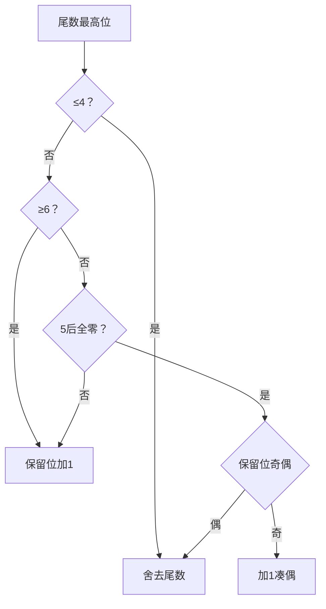

# 有效数字的修约规则（只进不舍等）

## 有效数字的修约规则

测量值最后一位是估读位，本身带有不确定性。当需要把测量结果保留到指定位数时，比如最终计算面积、体积，或写结果表达式时，不能随意“四舍五入”，否则会引入系统性偏差。修约规则的核心目的，是让舍入误差在大量数据中正负抵消，而不是一味偏向某一侧。

先问一个问题：2.5 保留一位有效数字，应该写成 2 还是 3？

如果按“四舍五入”，答案是 3。那 3.5 保留一位就是 4，4.5 保留一位就是 5。把 2.5、3.5、4.5 这些数都修约后再求平均，结果会系统性偏大。问题出在“5”总是进位。

==修约规则：四舍六入五凑偶。==

把要保留的末位记作“保留位”，它后面所有数字统称“尾数”。规则分四种情况：

| 尾数最高位 | 处理方式 | 示例（保留三位有效数字） |
| :---: | :--- | :--- |
| ≤ 4 | 舍去整个尾数 | 2.504 → 2.50 |
| ≥ 6 | 保留位加 1 | 2.506 → 2.51 |
| = 5，且 5 后不全为零 | 保留位加 1 | 2.5051 → 2.51 |
| = 5，且 5 后全为零 | 保留位凑成偶数 | 2.505 → 2.50；2.515 → 2.52 |

“凑偶”的意思是：当尾数恰好是“5 后面全零”时，看保留位——保留位是奇数就进 1 使它变成偶数，保留位是偶数就保持不变。这样进与舍的概率大致各半。

> [!IMPORTANT]
> 核心结论：只有“尾数恰好为 5 且 5 后全零”这一种情况需要凑偶；**5 后只要有任何一个非零数字，直接进位**。这是最常见的失分点。

再看课件中的例子：保留一位有效数字，2.45 和 2.35。尾数都是 45 与 35，5 后全零，看前一位：4 是偶数，舍去 → 2；3 是奇数，进位 → 4。结果分别为 2 和 4。

> [!TIP]
> 记忆口诀：“四舍六入五凑偶，五后非零则进一，五后全零凑成偶。”

## 与其他概念的区别

**有效数字修约 ≠ 数值四舍五入。** 普通四舍五入只依据下一位数字大小决定，修约规则额外区分“5 后是否全零”并引入“凑偶”机制。

**修约 ≠ 保留小数位数。** 有效数字从左边第一个非零数字起算，与小数点位置无关。例如 0.002505 保留三位有效数字，结果为 0.00250，不能只盯着小数点后几位看。

**科学计数法换单位时，有效数字位数不变。** 84030.0 g = 84.0300 kg = $8.40300 \times 10^4$ g，始终是六位有效数字。

> [!CAUTION]
> 修约只能一步到位。如保留三位有效数字，2.5049 不能先舍成 2.505 再进位成 2.51，而应直接看第四位“4”后面的尾数——整体舍去，结果 2.50。

再看一道真题：2.5051 取三位有效数字。将 2.5051 看作 `2.50 | 51`，尾数最高位是 5，但 5 后还有非零数字 1，属于“五后非零”，直接进 1 → 2.51。而 2.505 的尾数是 `5` 且 5 后全零，前一位 0 是偶数，凑偶 → 2.50。答案选 C。

> [!NOTE]
> 在结果表达式 $N = \overline{N} \pm U_N$ 中，$U_N$ 通常只保留一到两位有效数字，**$\overline{N}$ 的最后一位必须与 $U_N$ 的最后一位对齐**，此时修约规则同样适用，不能简单四舍五入。

用一张流程梳理念：

修约规则并不复杂，关键在两条：**只有“5 后全零”才凑偶**，**修约一步完成**。把这两条刻进解题习惯里，基本不会再出错。
