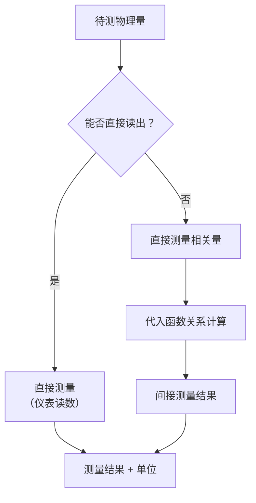

# 测量与单位（含国际单位制重新定义）

## 测量与单位

### 什么是测量

测量的本质是**比较**。取一个待测物理量，跟一个选作标准的同类量（即单位）比较，得出它们之间的比值关系。

因此，一个完整的物理量必须同时包含两部分：

> 数值大小 + 单位

二者 ==缺一不可==。比如「175.0」不是一个物理量，「175.0 cm」才是。单位告诉读者这个数值是在跟谁比较。

### 国际单位制（SI）

本课程要求统一采用**国际单位制**，七个基本单位如下：

| 物理量 | 单位名称 | 符号 |
|--------|----------|------|
| 长度 | 米 | m |
| 质量 | 千克 | kg |
| 时间 | 秒 | s |
| 电流 | 安培 | A |
| 热力学温度 | 开尔文 | K |
| 物质的量 | 摩尔 | mol |
| 发光强度 | 坎德拉 | cd |

> [!IMPORTANT]
> 2018 年第 26 届国际计量大会对 SI 进行了重大修订：千克、安培、开尔文、摩尔四个基本单位改由**普朗克常数、基本电荷、玻尔兹曼常数、阿伏伽德罗常数**等不变的自然常数来定义。这意味着单位定义不再依赖实物基准，在未来都是可靠、不变的。

### 直接测量与间接测量

按测量过程，测量可分为两类：

- **直接测量**：将被测量与仪器直接比较，从仪表上直接读数。例如用游标卡尺测长度、用电压表测电压。
- **间接测量**：先测出若干相关物理量，再通过函数关系算出待测量。例如测量圆柱体密度 $\rho$，需先直接测量质量 $m$、直径 $d$、高度 $h$，再由 $\rho = \frac{4m}{\pi d^2 h}$ 计算得出。

### 常见易错点

1. **忘记写单位**：写「$L = 6.00$」是不完整的，必须写「$L = 6.00\ \mathrm{cm}$」。
2. **混淆直接与间接**：读表是直接测量，代公式算是间接测量。间接测量的不确定度必须通过传递公式计算，不能直接拿仪器误差当总不确定度。
3. **单位换算导致有效数字错乱**：$0.0125\ \mathrm{m} = 1.25\ \mathrm{cm}$，前导零不是有效数字；但 $1.0900\ \mathrm{cm}$ 末尾的零都是有效数字，不能丢掉。大数如 $8880\ \mathrm{mm}$ 易产生歧义，应使用科学记数法：$8.880 \times 10^3\ \mathrm{mm}$。

### 一个算对了的例子

**题**：某正三棱柱体，质量 $m = 144.142\ \mathrm{g}$，高 $H = 9.20\ \mathrm{cm}$，底边长 $a = 2.534\ \mathrm{cm}$。已知密度公式 $\rho = \frac{4\sqrt{3}m}{3a^2 H}$（取 $\sqrt{3} \approx 1.73$），求 $\rho$ 的数值。

**解**：

1. 统一单位：$m = 144.142 \times 10^{-3}\ \mathrm{kg}$，$H = 9.20 \times 10^{-2}\ \mathrm{m}$，$a = 2.534 \times 10^{-2}\ \mathrm{m}$。
2. 代入计算：
   $$\rho = \frac{4 \times 1.73 \times 144.142 \times 10^{-3}}{3 \times (2.534 \times 10^{-2})^2 \times 9.20 \times 10^{-2}} \approx 5.63 \times 10^3\ \mathrm{kg \cdot m^{-3}}$$
3. ==测量结果必须带单位==，此处单位已统一到 SI 制，结果为 $\mathrm{kg \cdot m^{-3}}$。
