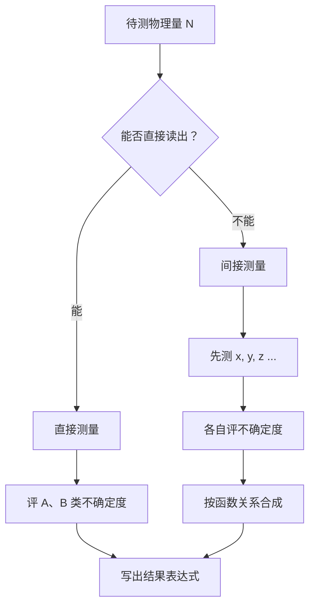

# 测量的分类（直接测量与间接测量）

## 测量的分类：直接测量与间接测量

### 它是什么

物理实验离不开测量。所谓测量，就是对确定量值作一组操作，所得结果必须同时包含**数值**和**单位**。按获取数据的方法不同，测量分为两大类：

| 类别 | 定义 | 举例 |
| :--- | :--- | :--- |
| **直接测量** | 将待测量与定标的测量仪器或量具比较，**直接读出**待测物理量的量值 | 用刻度尺、游标卡尺、螺旋测微仪测长度；用秒表测时间 |
| **间接测量** | 有些物理量**无法用仪表或量具直接测量**，只能先对一些相关物理量做直接测量，再通过它们之间的**函数关系**求出待测量 | 测圆柱体的直径 $D$ 和质量 $m$，由 $\rho = \dfrac{4m}{\pi D^2 h}$ 算密度 |

> [!IMPORTANT]
> **同一物理量，因选用的测量方法不同，既可以是直接测量量，也可以是间接测量量。** 例如测电阻，可用欧姆表直接读数（直接测量），也可由伏安法测 $U$、$I$ 后由 $R=U/I$ 算出（间接测量）。

### 为什么需要区分

这一分类决定了后续**不确定度评定的路线**完全不同：

- **直接测量量**：分别估算 A 类（统计方法）和 B 类（仪器误差等非统计方法）不确定度，再合成为 $U = \sqrt{U_A^2 + U_B^2}$。
- **间接测量量**：先求各直接测量量的不确定度 $U_x, U_y, \cdots$，再通过灵敏度系数或相对不确定度公式**传递合成**。

### 怎么做：一个算对了的例子

长方形边长测量结果为

$$a = 4.00 \pm 0.05\ \mathrm{cm}, \qquad b = 3.00 \pm 0.05\ \mathrm{cm}$$

面积 $S = ab$ 是**间接测量量**。最佳估值

$$\bar{S} = \bar{a}\,\bar{b} = 4.00 \times 3.00 = 12.00\ \mathrm{cm}^2$$

由于 $S$ 是乘除形式，用**相对不确定度**合成更方便：

$$\frac{U_S}{\bar{S}} = \sqrt{\left(\frac{U_a}{\bar{a}}\right)^2 + \left(\frac{U_b}{\bar{b}}\right)^2}
= \sqrt{\left(\frac{0.05}{4.00}\right)^2 + \left(\frac{0.05}{3.00}\right)^2} \approx 0.0208$$

$$U_S = \bar{S} \times 0.0208 \approx 0.25\ \mathrm{cm}^2$$

故结果表达式为

$$S = 12.00 \pm 0.25\ \mathrm{cm}^2$$

> [!TIP]
> 乘除形式的间接测量量，先算**相对不确定度**再乘回最佳估值，比直接用偏导数逐项相加更快捷。

### 常见的坑

> [!WARNING]
> - **不确定度只取一到两位有效数字**，且测量结果末位要与不确定度末位对齐。例如 $12.00 \pm 0.25$ 正确，而 $12 \pm 0.03$ 或 $12.0000 \pm 0.0025$ 均错。
> - 间接测量量的最佳估值 $\bar{N} = f(\bar{x}, \bar{y}, \bar{z}, \ldots)$，即把各直接测量量的最佳估值代入函数，**不是**各次 $N_i$ 再平均（除非函数为线性）。
> - 单次直接测量没有 A 类不确定度，取 $U = U_B \approx \Delta_{\mathrm{INS}}$（仪器误差限值）。

> [!NOTE]
> 按其他标准，测量还可分为静态/动态测量、电学/非电学测量、等精度/非等精度测量等，但直接测量与间接测量是最基本、最常考的一对分类。
