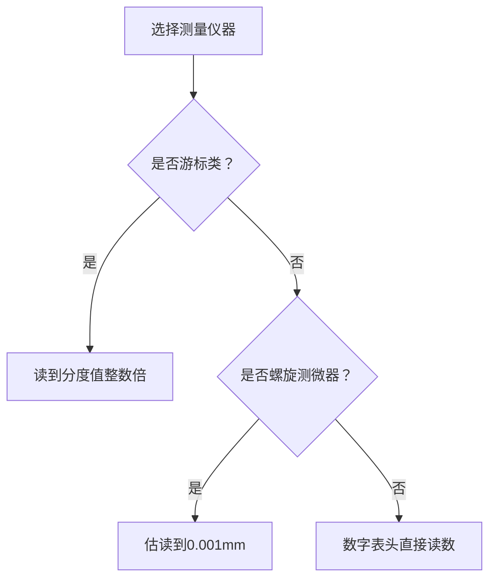

# 直接测量量的有效数字读数原则（游标卡尺、角游标尺、螺旋测微器、数字表头）

> [!IMPORTANT]
> 直接测量量的有效数字读数原则，核心在于：**仪器的最小分度值（或精度）决定了读数的最后一位在哪一位，且不同仪器“估读”的规则截然不同。**

## 为什么需要区分读数规则？

用直尺量长度时，我们会自然地在最小刻度间“目测”一位。但如果换成分光计的角游标或者数字万用表，还能继续目测吗？显然不能。不同仪器的机械结构或显示原理不同，强行套用同一种估读方法反而会引入错误。因此，必须根据仪器类型确定其==有效数字的末位==。

## 各类仪器的读数怎么做？

### 游标卡尺与角游标尺

游标卡尺利用主尺与副尺刻度的微小差值来提高精度。读数公式为 $L = L_1 + L_2$，其中 $L_1$ 为主尺整数部分，$L_2 = K \frac{1}{N} \text{ mm}$（$K$ 为对齐刻线数，$N$ 为分度数）。

> [!WARNING]
> **游标类量具不估读！** 一般应读到游标分度值的整数倍。例如50分度游标卡尺的分度值为 $0.02\text{ mm}$，读数末位只能是偶数（如 $46.00\text{ mm}$），绝不能写成 $46.01\text{ mm}$。角游标尺同理，若最小分度值为 $1'$，则直接读到 $1'$ 的整数倍。

### 螺旋测微器（千分尺）

螺旋测微器的固定套管最小分度为 $0.5\text{ mm}$，微分筒一圈50等分，故每一小格代表 $0.01\text{ mm}$。

> [!TIP]
> 操作细节：当顶针轻轻夹住被测物后，**勿再旋转旋钮**，应改旋微调旋钮直到听到三响“滴答”声为止，以减小形变误差。
> 读数细节：由于微分筒最小分度为 $0.01\text{ mm}$，按物理实验规范需向下估读一位，即==必须估读到 $0.001\text{ mm}$==（千分位）。

### 数字表头

数字仪表直接显示数值，不存在人工目测估读的过程。但数字表末位取整时的随机舍入过程会产生一定的随机误差分量。读数时直接记录屏幕显示的各位数字即可，其末位即为有效数字的末位。

## 相近概念辨析

考试中常要求你根据给出的数据反推使用了什么仪器，关键在于看==数据的末位==。

| 仪器 | 最小分度/精度 | 估读规则 | 典型读数示例 |
| :--- | :--- | :--- | :--- |
| 毫米尺 | $1\text{ mm}$ | 估读到下一位（$0.1\text{ mm}$） | $2.13\text{ cm}$ |
| 50分度游标卡尺 | $0.02\text{ mm}$ | ==不估读==，到 $0.02\text{ mm}$ 整数倍 | $2.14\text{ mm}$ (错: $2.13\text{ mm}$) |
| 20分度游标卡尺 | $0.05\text{ mm}$ | ==不估读==，到 $0.05\text{ mm}$ 整数倍 | $2.15\text{ mm}$ |
| 螺旋测微器 | $0.01\text{ mm}$ | 估读到 $0.001\text{ mm}$ | $2.130\text{ mm}$ |

## 算对了的例子

回顾真题：“某长度测量值为 $2.130\text{ mm}$，则所用仪器可能是？”

1. 观察数据：末位在千分位（$0.001\text{ mm}$）。
2. 排除法：毫米尺只能读到 $0.1\text{ mm}$；游标卡尺不估读，50分度末位必为偶数，20分度末位必为0或5，且都不会出现千分位。
3. 结论：只有螺旋测微器（千分尺）会估读到 $0.001\text{ mm}$，故选D。

再看计算题中千分尺的数据处理：测得直径 $\bar{D} = 9.8362\text{ mm}$，合成不确定度 $U = 0.0043\text{ mm}$。

> [!CAUTION]
> 写最终表达式时，不确定度 $U$ 取一到两位有效数字，尾数只进不舍；而测量平均值 $\bar{D}$ 的末位必须与 $U$ 的末位对齐，尾数四舍六入五凑偶。
> 正确结果表达式为：$D = 9.8362 \pm 0.0043 \text{ mm}$。注意单位不可遗漏！
