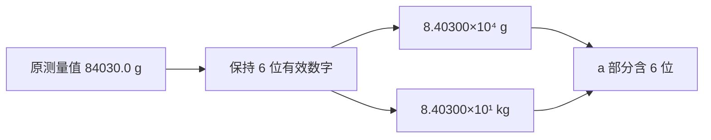

# 科学记数法表示有效数字

## 为什么要用科学记数法

有效数字的位数代表测量的精度，但普通记数法在数值很大或很小时会产生歧义。例如，若某电阻测量结果有三位有效数字，写成 $56000\,\Omega$，别人无法判断末尾三个 0 是有效数字还是仅为定位用的。改用科学记数法 $5.60\times10^{4}\,\Omega$，有效数字一目了然。

> [!IMPORTANT]
> ==科学记数法的标准形式是 $a\times10^{n}$，其中 $1\le a<10$，$n$ 为整数。小数点前的 $a$ 部分就是全部有效数字，位数必须与原测量值一致。==

## 单位换算不改变有效数字位数

一个容易犯迷糊的问题是：$84030.0\,\mathrm{g}$ 换算成 kg 后，有效数字还是 6 位吗？答案是肯定的。**有效数字由测量仪器和读数决定，与单位无关**。换算只是移动小数点或乘以 $10$ 的幂，精度并未改变。

- 换算成 kg：$84030.0\,\mathrm{g}=84.0300\,\mathrm{kg}=8.40300\times10^{1}\,\mathrm{kg}$
- 保持原单位：$84030.0\,\mathrm{g}=8.40300\times10^{4}\,\mathrm{g}$

两种写法的 $a$ 部分都是 $8.40300$，共 6 位有效数字，完全等价。

## 易错点辨析

| 错误写法 | 问题所在 | 正确写法 |
|---------|---------|---------|
| $84.03\times10^{3}\,\mathrm{g}$ | $a$ 部分只有 4 位，精度丢失 | $8.40300\times10^{4}\,\mathrm{g}$ |
| $8.403000\times10^{4}\,\mathrm{g}$ | 多写一位，夸大了测量精度 | $8.40300\times10^{4}\,\mathrm{g}$ |
| $84030\times10^{0}\,\mathrm{g}$ | 未体现末尾的 0 是有效数字 | $8.40300\times10^{4}\,\mathrm{g}$ |

> [!WARNING]
> ==末尾的 0 不能随便增减。== $84030.0$ 中的小数点和末尾 0 表明它是 6 位有效数字；若误写成 $8.403\times10^{4}$，则变成 4 位，相当于把测量精度降低了两个数量级。

## 实例演练

将 $M = 84030.0\,\mathrm{g}$ 分别用 kg 和 g 表示，并保持有效数字位数不变。

**分析**：原值有 6 位有效数字（$8,4,0,3,0,0$）。

**解答**：
1. 换成 kg：小数点左移 3 位，得 $84.0300\,\mathrm{kg}$；写成科学记数法，再左移 1 位，指数为 $+1$，即 $8.40300\times10^{1}\,\mathrm{kg}$。
2. 保持 g：小数点左移 4 位，指数为 $+4$，即 $8.40300\times10^{4}\,\mathrm{g}$。

> [!TIP]
> 口诀：**数点移动几位，指数就是几；$a$ 的位数永不变，有效数字保精度。** 写完后数一遍 $a$ 中的数字个数，与原测量值核对即可自查。
