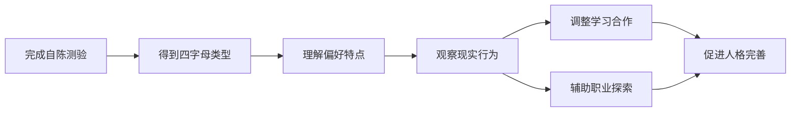

# MBTI性格类型指标及其在大学生中的应用

## MBTI 是什么

MBTI（迈尔斯—布里格斯性格类型指标）是一种**人格类型自陈工具**。它把人在四个维度上的偏好组合起来，形成 $2^4=16$ 种类型，用来描述一个人更习惯怎样获取能量、接收信息、作出决定和安排生活。

| 维度 | 两端偏好 | 核心问题 |
|---|---|---|
| 能量指向 | 外向 E—内向 I | 更倾向外部互动，还是内部思考？ |
| 信息获取 | 感觉 S—直觉 N | 更关注具体事实，还是整体可能？ |
| 决策方式 | 思考 T—情感 F | 更重视逻辑一致，还是价值与感受？ |
| 生活方式 | 判断 J—知觉 P | 更偏好计划确定，还是灵活开放？ |

例如，**INTJ** 表示偏好内向、直觉、思考和判断；**ESFP** 则表示偏好外向、感觉、情感和知觉。这里的字母只是类型代码，不是能力分数。

> [!IMPORTANT]
> MBTI 测的是==相对稳定的行为与心理偏好==，不是智力、品德或心理健康水平；16 种类型没有高低优劣。

## 为什么大学生需要了解它

大学中的学习方式、宿舍交往、社团合作和职业选择，都与人格偏好有关。了解 MBTI 可以帮助学生：

- **理解自己**：解释为何有人在讨论中更有活力，有人需要独处恢复精力。
- **理解差异**：T 型偏好的直接反馈不等于冷漠，F 型偏好的照顾感受也不等于不讲逻辑。
- **改善合作**：小组可同时安排事实核查、创意发散、进度规划和关系协调。
- **辅助探索**：把类型偏好作为职业探索线索，再结合兴趣、能力和价值观验证。

## 怎样正确使用

先根据正式或较规范的测验得到初步类型，再阅读各维度含义，并用真实经历核对：自己在**自然、放松、较少受外界要求影响**时更倾向哪一端？随后把结果用于具体情境。例如，J 偏好较强者可提前分解任务，P 偏好较强者则要设置明确截止点；I 偏好者可先独立思考再发言，E 偏好者也应给同伴留下表达空间。

> [!TIP]
> 记忆顺序可用“**能量—信息—决策—生活**”：E/I、S/N、T/F、J/P。判断类型时逐位读字母，不要把 J 理解成“爱评判”，也不要把 P 理解成“没计划”。

## 一个用对了的例子

某宿舍四人准备课程展示：甲喜欢独自查资料并注意细节，乙善于讨论并提出新方案，丙重视论证是否严密，丁擅长照顾成员感受、协调分工。若直接给四人贴上“甲孤僻、乙浮躁、丙冷漠、丁不理性”的标签，就会制造冲突。

更合适的做法是：把甲的特点理解为可能的 **I、S** 偏好，让其负责资料核实；让乙参与头脑风暴；让丙检查论证；让丁协调沟通，同时共同确定进度。这里并不是凭一次表现“诊断”四人的完整类型，而是==把偏好当作分工线索，再用实际能力和意愿校正==。

## 与相近概念的区别

| 概念 | 主要关注点 | 与 MBTI 的区别 |
|---|---|---|
| 气质 | 情绪与行为反应的强度、速度等 | 更偏先天和反应特点，不等于四字母类型 |
| 性格 | 对现实的稳定态度及习惯化行为方式 | MBTI 是描述性格偏好的工具之一，不是性格全部 |
| 大五人格 | 用连续维度描述人格特质 | 通常强调程度高低；MBTI 更强调偏好分类 |
| 能力测验 | 能否完成某类任务及水平 | MBTI 不判断“做得好不好” |
| 心理诊断 | 是否存在心理障碍及严重程度 | MBTI 不能用于诊断抑郁症、焦虑症等 |

> [!WARNING]
> 常见误区有：把 E/I 等同于“会不会社交”，把 T/F 等同于“理性/感性”，把 J/P 等同于“自律/拖延”，以及一次测验后终身定型。偏好不等于能力，类型也可能受作答情境、自我理解和测验质量影响。

> [!CAUTION]
> 不应仅凭 MBTI 决定专业、职业或恋爱关系，更不能用它排斥同学。若长期情绪低落、失眠或功能受损，应寻求学校心理中心等==专业帮助==，而不是反复测类型。

真正的人格完善不是把自己改造成“最佳类型”，而是认识优势、接纳差异，并在需要时练习非偏好一侧的能力，使自己既有稳定特点，又能灵活适应环境。
