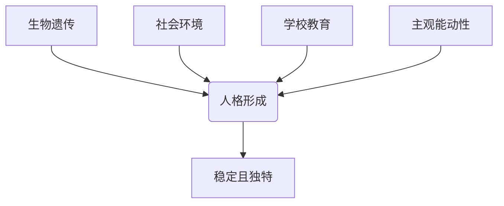

# 人格的定义、特征及其影响因素

## 人格的定义与核心特征

当我们评价一位同学“性格好”或“有个性”时，其实是在描述他的人格。但心理学中的人格并非日常口语中的“人品”，那么它究竟指什么？

> [!IMPORTANT]
> 人格是个体在对人、对事、对己等方面的社会适应中，行为上的==内部倾向性和心理特征==。它表现为能力、气质、性格、需要、动机、兴趣、理想、价值观和体质等方面的整合，是具有动力一致性和连续性的自我，是个体在社会化过程中形成的独特身心组织。

理解这个定义，需把握三个关键词：

-   **整合性**：人格不是零散特质的拼凑，而是各成分协调统一的有机整体。
-   **稳定性**：所谓“江山易改，禀性难移”，人格在时间和情境上具有跨时间、跨情境的一致性。
-   **独特性**：“人心不同，各如其面”，每个人的人格都是遗传与环境交互作用的独特产物。

[!NOTE]
> 区分“人格”与“性格”：性格仅指人对现实的态度及相应行为方式，只是人格的一个组成部分；而人格涵盖范围更广，还包含气质、能力、动机等。考试中切勿将二者等同。

## 人格的影响因素模型

为什么同宿舍的同学人格差异巨大？这涉及多因素的动态交互。我们可以通过下图梳理其作用机制：

各因素的具体作用如下表所示：

| 影响因素 | 作用性质 | 关键说明 |
| :--- | :--- | :--- |
| 生物遗传 | 物质基础 | 提供可能性与限度，如气质类型受神经系统制约 |
| 社会环境 | 决定方向 | 文化、家庭、同伴塑造价值观与行为规范 |
| 学校教育 | 主导作用 | 通过课程、师生互动系统促进人格社会化 |
| 主观能动性 | 内在动力 | ==个体对环境的选择、加工与改造==，是人格发展的决定性因素 |

[!WARNING]
> 常见误区：认为“遗传决定人格”或“环境决定一切”。正确观点是：==遗传提供可能，环境使可能变为现实，主观能动性起调节与决定作用==。三者缺一不可，不可孤立看待。

## 如何准确分析人格成因

面对案例题，怎样避免片面归因？建议采用“三层次分析法”：先识别生物基础（如气质），再考察环境塑造（如教养方式），最后评估个体主动选择（如应对策略）。

例如：某生内向敏感（气质-遗传），成长于高压家庭（环境），但大学期间主动加入心理社团并担任干部（主观能动性），逐渐变得自信开朗。此例中，若只答“家庭导致内向”则失分；完整答案应体现==三因素交互，尤其突出主观能动性的转化作用==。

[!TIP]
> 答题口诀：“一基二境三主动，整合稳定又独特”。遇到辨析题，先判断是否混淆“人格”与“性格”，再检查是否遗漏主观能动性这一关键点。
