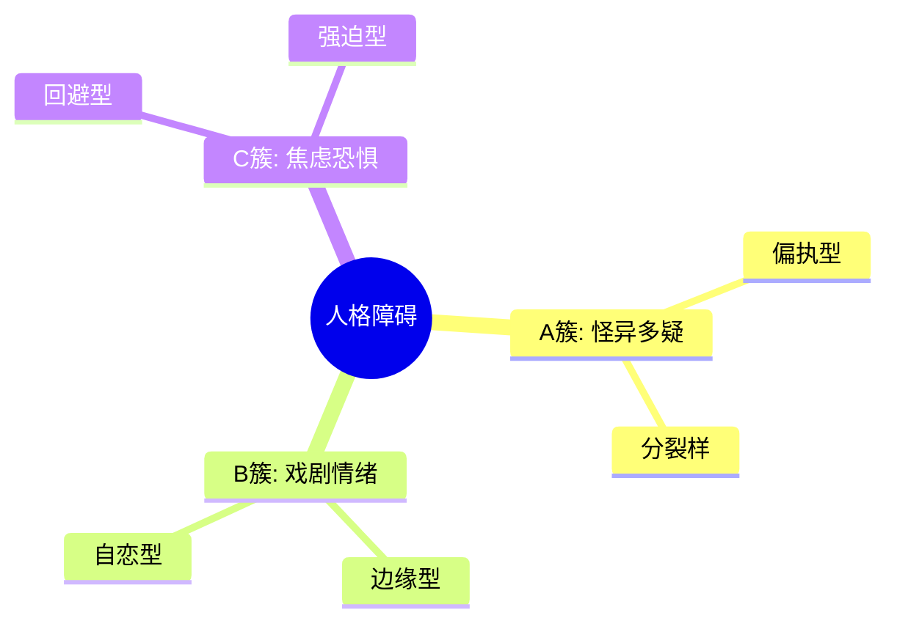

# 常见人格障碍的特征与识别

# 常见人格障碍的特征与识别

人格障碍是指人格特征显著偏离正常，形成了一贯的反映个人生活风格和人际关系的异常行为模式。这种模式通常起始于童年或青少年期，并长期持续，导致个体在社交、职业等功能领域出现明显损害，或给本人带来痛苦。

> [!IMPORTANT]
> ==核心判定标准==：偏离文化常模、长期稳定（非暂时性）、功能受损、始于早年。

## 为什么需要识别？

大学生处于人格完善的关键期，区分“性格特点”与“人格障碍”至关重要。性格内向不等于回避型人格障碍，追求完美也不等于强迫型人格障碍。只有当这些特质变得**僵化、适应不良**且**造成痛苦**时，才需考虑病理层面。早期识别有助于通过心理咨询进行干预，避免问题固化。

## 常见类型与特征辨析

DSM-5 将人格障碍分为三簇，南邮《大学生心理健康》课程重点考察以下几类：

| 类型 | 核心特征 | 典型表现 |
| :--- | :--- | :--- |
| **偏执型** | 猜疑、不信任 | 无端怀疑他人利用或伤害自己，耿耿于怀 |
| **边缘型** | 情绪不稳、冲动 | 人际关系极端理想化或贬低，害怕被抛弃 |
| **强迫型** | 秩序、控制、完美 | 过度关注细节规则，缺乏灵活性，效率反而低 |
| **回避型** | 自卑、社交抑制 | 因害怕批评或拒绝而回避社交，渴望但不敢 |

> [!TIP]
> 记忆口诀：**偏**心多疑，**边**缘情绪，**强**迫完美，**回**避自卑。

## 识别步骤与常见误区

识别并非贴标签，而是为了理解与帮助。请遵循以下逻辑：

1.  **观察行为模式**：是否在不同情境下（宿舍、课堂、社团）表现出一致的异常？
2.  **评估持续时间**：是否从青少年期开始并持续至今？
3.  **判断功能影响**：是否严重影响了学业、交友或自我感受？

> [!WARNING]
> ==常见坑==：切勿将“一时的情绪波动”或“应激反应”误判为人格障碍。人格障碍具有**跨时间的稳定性**。

## 案例分析

**情境**：小A是计算机系大二学生，做事极度严谨。他要求宿舍桌面物品必须按毫米级对齐，室友稍微挪动他的书，他会暴怒并长篇大论指责对方“没有规矩”。他自己写代码时，因纠结变量命名规范，经常无法按时提交作业，导致挂科。他坚信只有自己的方式才是正确的，拒绝任何变通。

**解析**：
*   **非**单纯的爱干净或认真。
*   **符合**强迫型人格障碍特征：过度关注细节、规则、秩序，导致主要活动效率降低（挂科）；僵化固执，难以适应变化。
*   **区别**：若小A仅对自己严格要求但不干涉他人，且能按时完成学业，则属于性格特质而非障碍。

> [!NOTE]
> 诊断需由专业精神科医生进行，本课程旨在提升学生的觉察力与同理心，而非临床诊断。
