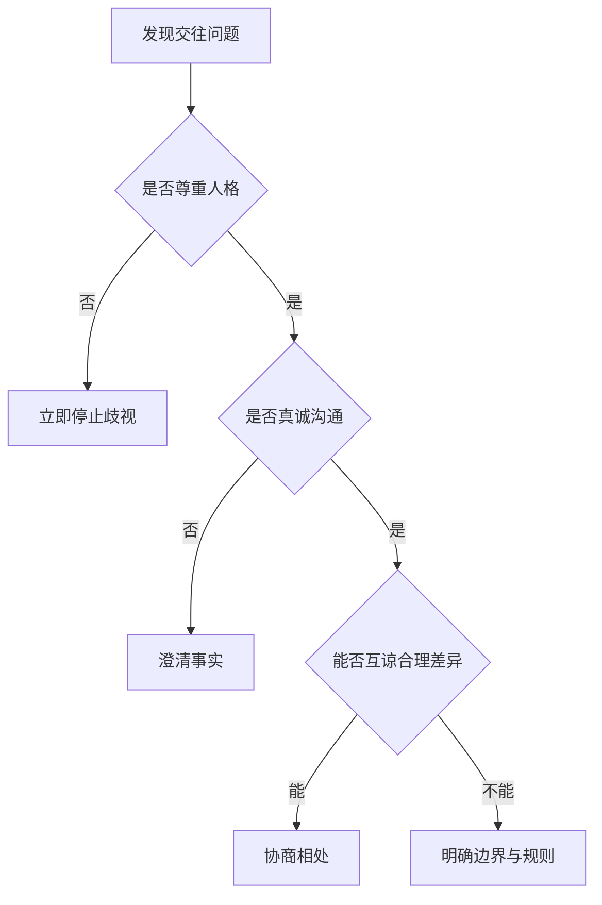

# 人际交往的基本原则（平等、真诚、宽容、互利等）

## 什么是人际交往基本原则

人际交往基本原则，是大学生在认识、接触、合作和处理冲突时应当遵循的基本行为准则，主要包括**平等、真诚、宽容、互利、尊重和适度自我表露**等。

这些原则不是抽象的道德口号，而是判断“我的言行是否合适”的工具。例如，对方是否友善并不能成为我歧视、羞辱或利用他人的理由；关系暂时不顺利，也不等于可以否定对方整个人。

> [!IMPORTANT]
> ==人际交往的核心不是操控别人，而是建立平等、真诚、互利的合作关系。==

## 为什么需要这些原则

大学阶段的学习、住宿、社团活动和社会实践都高度依赖同伴合作。良好的人际交往能够：

- 获得学习信息和心理支持；
- 增强团队协作与责任感；
- 帮助个体认识自我、完善人格；
- 减少误解、冲突和孤立感。

如果忽视基本原则，可能出现以自我为中心、强行改变他人、过度讨好、情绪化反击等现象，最终损害个人信誉和团队效率。

## 各原则怎么理解

| 原则 | 基本含义 | 实际做法 |
|---|---|---|
| 平等 | 尊重彼此人格和权利 | 不因成绩、家境、外貌或地域而歧视他人 |
| 真诚 | 以真实、可靠的方式沟通 | 言行一致，不欺骗、不恶意中伤 |
| 宽容 | 对合理差异和非恶意过失保持包容 | 先理解动机，再讨论行为 |
| 互利 | 交往双方能够合理受益 | 付出与回报不必完全即时等同 |
| 尊重 | 重视对方的意愿和边界 | 不强迫、不贴标签、不越界 |
| 适度自我表露 | 根据关系程度逐步表达真实感受 | 真诚不等于毫无保留 |

其中，**平等是前提，真诚是基础，宽容是修复关系的条件，互利是良好关系的持续动力**。

> [!TIP]
> 可记为：“平等看人格，真诚待他人，宽容存差异，互利求长久。”

## 相近概念要分清

**刻板印象、偏见与投射效应并不相同。**

- **刻板印象**：把某一群体的固定、笼统印象套用到具体成员身上。
- **偏见**：对某类人预先持有否定性的情感或态度。
- **投射效应**：把自己具有的特点、情绪或欲望归因到他人身上。

例如，“某地方的人都不友好”属于刻板印象或偏见；若想攻击对方却认为“对方一定也这样看我”，才更接近投射效应。

宽容也不等于纵容。宽容可以接纳人的差异和行为失误，但不能接受持续侮辱、歧视、欺骗或侵害他人权利。

## 常见误区

> [!WARNING]
> 不要把“真诚”理解为把所有想法和情绪立即全部说出，也不要把“互利”理解为每次交往都必须立刻得到回报。

交流批评时应尽量做到**对事不对人**。如直接批评一个人的能力和人格，容易引发防御；更合适的方式是描述具体行为、说明影响，并提出可执行的改进建议。

> [!CAUTION]
> 使用昵称并非任何场合都合适。昵称应建立在双方熟悉和认可的基础上；公开批评、正式沟通或对方不喜欢昵称时，应使用姓名或恰当称谓。

## 算对了的例子

“和宿舍同学沟通，特别是批评时，使用昵称的模式与不使用昵称的模式，存在明显效果差异。”这一判断题应选**正确**。

例如，舍友在直播中长时间占用公共网络空间，说话者如果说：“你这样特别没教养。”对方容易感到被攻击；如果说：“阿成，你连续占用网络，影响我们做作业。我们商量一下轮流使用的时长，好吗？”则指向具体行为，同时保留了对对方的尊重，更符合平等、真诚和互利原则。

可见，判断交往方式是否恰当，可以连续追问：**是否尊重对方？是否基于事实？是否考虑双方需要？是否给出了可执行的改进办法？**
