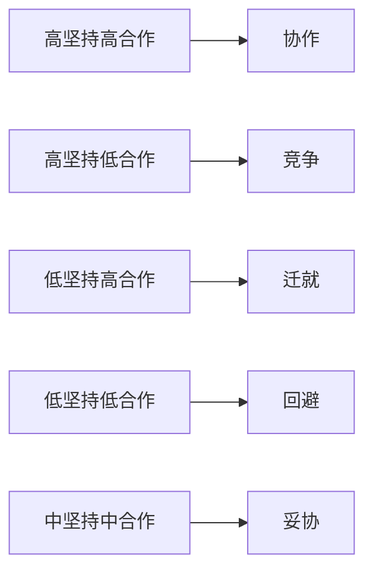

# 人际冲突的类型与解决策略（托马斯-基尔曼冲突模式）

## 它是什么

人际冲突常让人左右为难：想维护关系，又想达成自己的目标。托马斯-基尔曼冲突模式用两个维度来分类：**关注自身需求（坚持度）**与**关注他人需求（合作度）**。按高低组合，得到五种典型处理方式。

> [!IMPORTANT]
> ==核心结论==：五种策略无绝对好坏，==要依情境选择==。

## 为什么需要

先想一个问题：宿舍里有人总外放音乐，你是忍着、吵赢他，还是一起定公约？不同选择就是不同策略。大学生常见冲突来自宿舍作息、小组作业分工、朋友误会；若不选策略，容易要么憋出情绪，要么关系破裂。

## 怎么做与相近区别

| 策略 | 坚持自需 | 合作他需 | 典型做法 | 相近易混 |
|---|---|---|---|---|
| 竞争 | 高 | 低 | 坚持己见，争赢 | ≠ 妥协：不让步 |
| 协作 | 高 | 高 | 共同找双赢 | ≠ 妥协：求整合 |
| 妥协 | 中 | 中 | 各让一步 | ≠ 迁就：也保己需 |
| 迁就 | 低 | 高 | 牺牲自己满足他 | ≠ 协作：不表达己需 |
| 回避 | 低 | 低 | 暂时不处理 | ≠ 冷静：长期逃避 |

> [!WARNING]
> 常见坑：把“回避”当永远的解法；把“迁就”说成“协作”，其实没说出自己真实需求。

## 算对了的例子

题：某宿舍四人作息冲突，甲要早睡，乙丙丁要熬夜外放。最佳解法是？
正确思路：不是乙丁全赢（竞争）或甲忍（迁就），而是四人开会，定“23:00后戴耳机、公区可小声”——==既保甲睡眠又保乙丁使用，属协作==。

> [!TIP]
> 记忆口诀：竞协作妥迁避，看“己需+他需”两轴就够。

> [!NOTE]
> 托马斯-基尔曼是==类型与选择框架==，不是消灭冲突；大学生心理健康课强调“建设性处理”。
