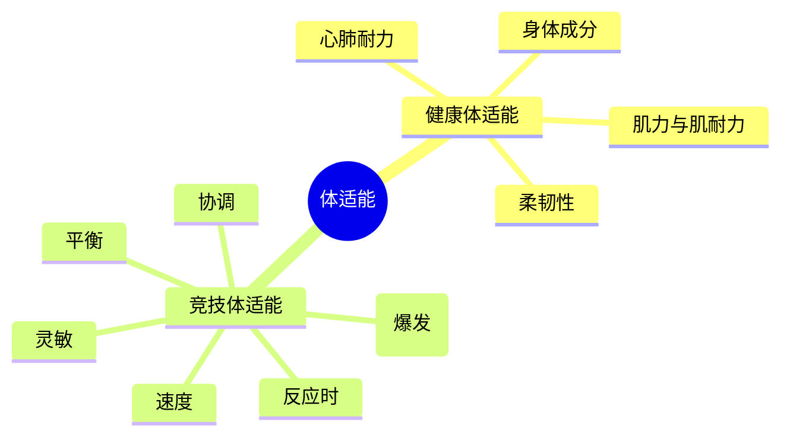

# 健康体适能与竞技体适能的构成要素

## 核心概念辨析

在《体育与健康》章节中，体适能（Physical Fitness）并非单一指标，而是分为**健康体适能**与**竞技体适能**。理解二者的区别是掌握本章逻辑的关键。

> [!IMPORTANT]
> ==健康体适能==是与日常生活质量、抗病能力直接相关的要素；==竞技体适能==则是为了在运动比赛中取得优异成绩所需的特殊身体素质。

## 构成要素详解

**健康体适能**主要包含四大要素：
1.  **心肺耐力**：心脏、肺部向肌肉输送氧气的能力，是健康的基石。
2.  **肌肉适能**：包括==肌力==（肌肉收缩产生的最大力量，如判断题53所述）和肌耐力。
3.  **柔韧性**：关节活动幅度及肌肉伸展能力。
4.  **身体成分**：体内脂肪与非脂肪组织（肌肉、骨骼等）的比例。

**竞技体适能**则侧重于运动表现，包括速度、灵敏、平衡、协调、反应时和爆发力。例如，肩关节因其结构特点，在投掷等高强度竞技运动中极易损伤（判断题68的反例），这要求运动员具备更高的关节稳定性与协调性。

## 常见误区与避坑指南

学生在复习时常混淆“减肥”与“健康”的关系，以下是基于真题的高频陷阱：

| 误区观点 | 正解分析 | 对应真题 |
| :--- | :--- | :--- |
| 减肥时吃得越素越好 | 脂类代谢对延缓衰老、提高免疫力至关重要，完全禁脂有害健康 | 判断28 (错误) |
| 发胖只看体重 | ==腰腹部==是皮下脂肪最早且最明显堆积部位，反映内脏脂肪风险 | 判断27 (正确) |
| 体质千人一面 | 体质受遗传、环境、运动影响，具有显著的==个体差异性== | 判断9 (正确) |

> [!WARNING]
> 不要认为“运动只减脂”。判断题20指出，运动增强物质（尤其是脂类）代谢，能延缓器官衰老并提高免疫力。这是运动对身心关联的核心贡献。

## 实例应用

以**判断题53**为例：“力量是指肌肉紧张或收缩时所表现出来的一种能力。”

*   **分析**：这是肌力的标准定义。在健康体适能中，我们关注基础肌力以维持日常姿态；在竞技体适能中，则转化为爆发力。
*   **结论**：该描述准确，选 **A. 正确**。

再结合**判断题27**，若某同学发现腰围增加快于体重增加，这提示其==身体成分==中的脂肪比例上升，且主要集中在腹部。此时应优先提升心肺耐力（如有氧运动）而非单纯追求竞技性的速度训练，以改善健康体适能。

> [!TIP]
> 记忆口诀：**健康看心肺腰腹，竞技拼速灵协调**。体质因人而异，运动代谢脂类保免疫。
