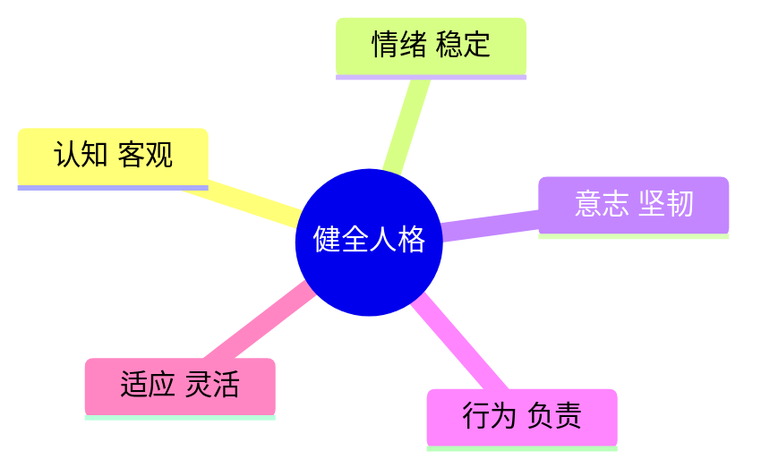
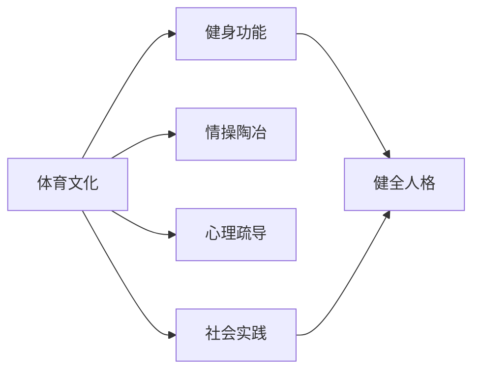

# 大学生健全人格的塑造与完善策略

## 它是什么

先问一句：人格是“天生脾气”还是“可以修”？在《大学生心理健康》里，==健全人格是知情意行协调、能适应环境并持续成长的人格状态==。它不是完美无缺，而是能在挫折里调节、在关系里负责、在目标里坚持。南邮课件把“人格发展与完善”放在成长主线里，说明它是可塑造的，不是固定标签。

## 为什么需要

大学阶段要同时处理学业、交往、独立与未来选择。若人格结构失衡，容易出现内耗、拖延、人际冲突或空虚感。塑造健全人格，是为了==用稳定内在结构支撑外部适应==，而不是靠临时情绪硬撑。

## 怎么做

策略可记为“认识—接纳—训练—关系—意义”：

| 策略 | 做法 | 易错点 |
|---|---|---|
| 自我认识 | 写反思日记、做测评 | 只看缺点 |
| 自我接纳 | 允许不完美 | 接纳≠放纵 |
| 行为训练 | 小目标反复做 | 只立志不行动 |
| 关系滋养 | 真诚沟通 | 讨好或封闭 |
| 意义建构 | 连接专业与价值 | 空谈理想 |

> [!TIP]
> 口诀：==认知清、情绪稳、意志坚、行为实、关系真==。

## 相近概念区别

很多人把“健全人格”和“受欢迎”“成绩好”混在一起。区别是：健全人格强调内部协调与适应力，外在成功只是可能结果；高分数不等于人格完善，社交热闹也可能内在空虚。

## 常见的坑

第一个坑：以为“改变性格”=否定自己。实际是优化表达方式与应对模式。第二个坑：只在心里改，不见行动。人格完善必须落到重复行为。第三个坑：把一次失败看成“我这个人不行”，这是把行为评价泛化到整个人。

## 体育文化与人格塑造的例子

课件提到：大学体育文化功能包括 ==健身功能==、情操陶冶、心理疏导、社会实践；并且对思想、道德教育培养及人格品质陶冶有独特作用。

看一道题：大学体育对大学生（ ）教育培养以及人格、品质的陶冶塑造有积极、独特的作用。选项含“思想、道德的”。算对的过程是：体育不仅练身体，还练规则意识、合作与抗挫，所以选 ==思想、道德的==，不是“身体、心理的”这一表面搭配。它说明：==人格完善要借真实活动载体==，体育就是“身体参与—心理疏导—道德陶冶”的综合路径。

> [!IMPORTANT]
> 核心结论：健全人格=协调可成长；塑造靠自我认识、行为训练与活动载体共同完成。

## 一个算对了的例子

若问“大学体育文化功能不包括哪一项”，你看到“锻炼功能”而非“健身功能”，要警觉：课件术语是 ==健身功能==，不是口语里的“锻炼”。同理，“强身功能”也不是原文记号。记住课件原词，就能避开替换陷阱。
