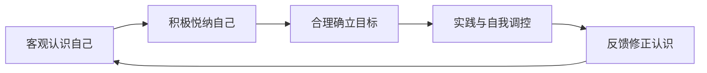

# 健全自我意识的培养途径与方法

## 什么是健全自我意识

自我意识是个体对自己身心状态、社会角色及人际关系的认识与调控，包括**自我认识、自我体验、自我调控**三个相互联系的部分。健全自我意识不是“永远自信”，而是能较客观地认识自己，接纳现实自我，同时主动调整行为，使理想自我逐步接近现实自我。

> [!IMPORTANT]
> 核心标准可概括为：==认识客观、体验积极、调控有效==。既不过高估计自己，也不因一次失败全盘否定自己。

## 为什么需要培养

大学阶段面临学习方式、人际关系和未来规划的变化，容易出现理想自我与现实自我的冲突。若缺少客观评价，可能走向自负、自卑或盲目从众；若只有认识而缺少行动，又可能陷入反复焦虑。健全自我意识有助于稳定情绪、明确目标、改善人际适应，并为心理成长提供持续动力。

## 培养途径与方法

- **客观认识自己**：综合自我观察、他人评价和社会比较，既看优势，也看不足；避免只凭一次成绩或一条评价给自己贴标签。
- **积极悦纳自己**：接纳暂时不能改变的条件，承认不足，同时区分“我这件事没做好”和“我这个人不行”。
- **合理确立目标**：理想自我应建立在现实基础上，把远期目标分解为可执行的小目标，避免目标过高造成持续挫败。
- **在实践中完善自己**：通过学习、交往、文体活动和社会实践检验认识，记录行为与结果，根据反馈调整计划。
- **加强自我调控**：运用自我监督、自我激励和适度反思，把情绪转化为具体行动；遇到长期困扰时主动寻求专业帮助。

> [!TIP]
> 可记为“**认识—接纳—目标—实践—调控**”。答题时不仅写“树立自信”，还要写出客观评价、合理目标和反馈调整。

## 相近概念辨析

| 概念 | 主要特点 | 与健全自我意识的区别 |
|---|---|---|
| 自负 | 高估自己，忽视不足 | 自我认识失真，并非真正自信 |
| 自卑 | 低估自己，过度否定 | 自我体验消极，缺少客观评价 |
| 自我中心 | 过度从自身需要看问题 | 不等于重视自我，反而影响人际适应 |
| 自我接纳 | 承认并容纳现实自我 | 不等于放任缺点，仍需自我调控 |
| 自我实现 | 发挥潜能、追求成长 | 是持续过程，不能脱离现实基础 |

> [!WARNING]
> 常见误区是把“悦纳自己”理解为“不改变”，或把“超越自我”理解为“必须处处胜过别人”。健全自我意识强调==接纳现实与主动成长并重==。

## 例题与迁移

题目：大学体育文化的功能有（　）、情操陶冶功能、心理疏导功能、社会实践功能。

A. 健身功能　B. 教育功能　C. 锻炼功能　D. 强身功能

**正确答案：A。** 体育首先通过身体活动发挥健身功能，并进一步促进情操陶冶和心理疏导。参加体育活动也能为自我意识提供反馈：例如某同学一次长跑落后便认定“我什么都不行”，这是以偏概全；较合理的做法是承认当前耐力不足，同时看到自己在坚持训练方面的优势，制定每周三次、循序渐进的计划，再根据完成情况调整目标。这体现了客观认识、积极接纳和有效调控的统一。
