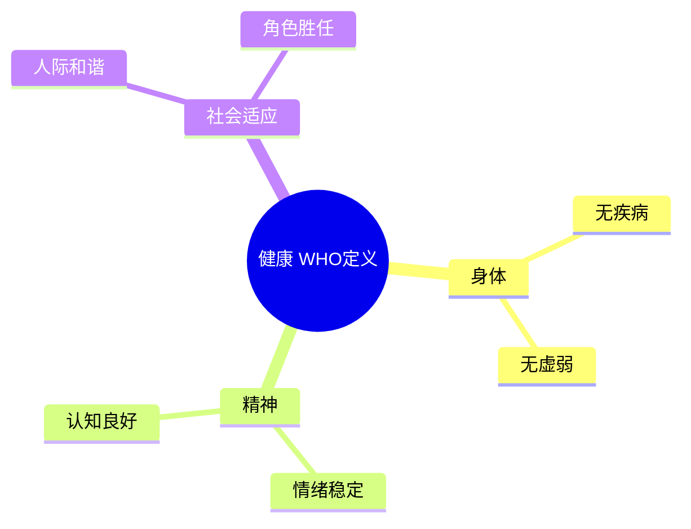

# 健康与心理健康的概念（WHO定义及内涵）

## 什么是健康：不只是“没病”

提到“健康”，很多同学第一反应是“我身体好得很，从不感冒”。但这是否就是健康的全部？试想，一个人体检指标一切正常，却长期失眠、情绪低落或无法融入集体，他算健康吗？

世界卫生组织（WHO）早在 1948 年就对健康下了一个==至今未被超越的经典定义==：

>[!IMPORTANT]
> 健康不仅是没有疾病或虚弱，而是一种在**身体上、精神上和社会适应**方面的完好状态。

这个定义的核心在于==三位一体==，缺一不可。

### 为什么这一定义至今有效？
它首次把人的**心理状态**和**社会功能**提升到与**生理机能**平等的地位。一个人哪怕身体强壮，如果内心长期冲突混乱，或无法与人正常相处，依然是“不健康”的。

## 心理健康的内涵：不是简单的“开心”

> [!NOTE]
> 心理健康 ≠ 整天笑嘻嘻。它是一种**持续的、积极发展的心理状态**。

在这种状态下，个体通常能体现以下特征：

- **认知合理**：对事物有客观判断，不无端歪曲现实
- **情绪稳定**：能感受喜怒哀乐，但不被单一情绪长时间淹没
- **意志健全**：做事有目标、有行动力，遇到挫折能调整而非崩溃
- **行为协调**：行为符合年龄、社会角色，且自身内在一致
- **人际关系和谐**：能建立和维持基本信任与良性互动
- **适应能力良好**：==核心标志——不是环境迁就你，而是你能主动适应环境==

> [!CAUTION]
> 常见误区：把“负面情绪”等同于“心理不健康”。
> 失恋后伤心、考前焦虑、面试紧张，都属**正常心理反应**。心理健康的人不是没有痛苦，而是能识别、接纳并调节这些反应，使之不致长期阻碍生活。

---

## 健康概念的常见延伸与易混淆点

在学习和考试中，你可能遇到对 WHO 定义的“升级版”表述。

### 三要素 vs 四要素

很多时候试卷会加入**道德健康**这一维度，形成“四要素”版本。

| 维度 | 核心问题 | 在大学生活中的直观表现 |
| :--- | :--- | :--- |
| **躯体健康** | “我能跑能跳吗？” | 作息规律，饮食合理，精力充沛 |
| **心理健康** | “我内心自洽吗？” | 悦纳自我，善于应对压力与挫折 |
| **社会适应健康** | “我和别人处得来吗？” | 宿舍关系融洽，能参与集体协作 |
| **道德健康** | “我的行为伤害别人吗？” | 遵守规则，诚信考试，不传播谣言 |

> [!WARNING]
> WHO 的原始定义只包含**身体、精神、社会适应**三者。“道德健康”是后来学者和部分教材增补的维度。判断题中若出现“健康是身体上、精神上、道德上和社会适应上的完美状态”——按南邮考题语境，这句话通常被判定为 **正确** ，因为它符合当前拓宽后的教育理念。但注意“完美状态”的措辞在部分题目中可能视为绝对化而判错，要依据具体题干判定。

---

## 为什么大学生需要特别关注心理健康？

从**生理年龄**看，你们正处于青年中期，大脑前额叶（负责控制冲动、规划决策）要到 25 岁左右才完全成熟。
从**生活任务**看，这是离开家庭、独立处理学业、情感、人际的“心理断乳期”。

这两个因素叠加，使大一成为心理困扰的高发期。但这并非坏事——==危机也是转机==，大学阶段恰是人格重塑和心理成长的关键窗口。

### 一个算对了的例子（判断题实战）

**题目：** 人的健康不仅包括生理健康而且包括心理健康。（ ）
**答案：** ✅ 正确

**分析：**
这题考查 WHO 定义的核心。健康≠身体没病，“不仅……而且……”的表述准确对应了 WHO“身体、精神、社会适应”的三位一体框架。即使只记到身心健康两个层面，这句话也是成立的。若审题时被“不仅……而且”的句式迷惑，怀疑是不是遗漏了“社会适应”，反而容易误判。记住：==包含关系可以宽泛，否定关系必须精确。==
