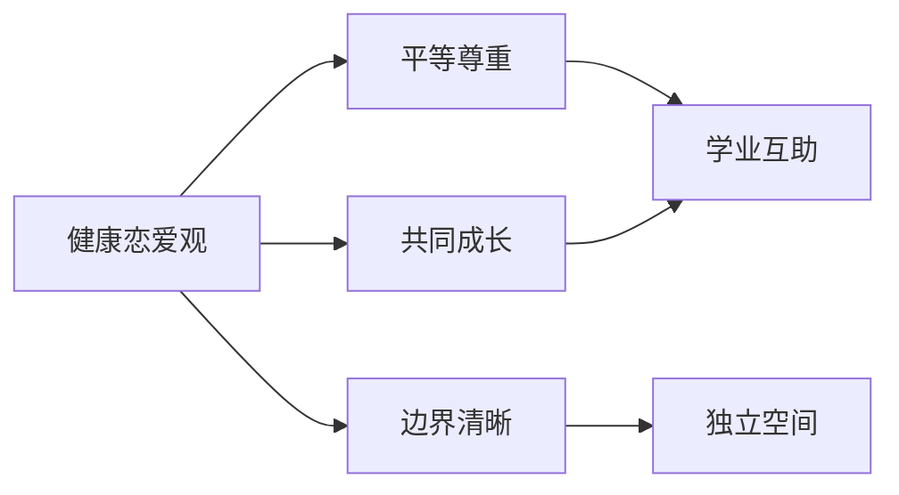

# 树立健康的恋爱观与处理恋爱与学业的关系

恋爱是大学生活的重要组成部分，但健康的恋爱关系不应成为学业的对立面。==树立健康恋爱观的核心，在于把爱情视为促进双方成长的伙伴关系，而非填补空虚或逃避压力的工具==。当感情与学业产生冲突时，我们需要的不是二选一，而是建立**相互支持、边界清晰**的相处模式。

## 健康恋爱观的内涵

健康的恋爱观建立在**平等、尊重、责任**三大基石之上：

- **相互成就**：双方既是恋人也是学友，能共享图书馆的安静时光，也能在对方迷茫时提供情绪支撑，形成“1+1>2”的成长合力。
- **独立人格**：保持各自的社交圈、兴趣爱好和人生目标，爱情只是生活的一部分而非全部。
- **理性认知**：理解爱情包含亲密、激情与承诺三要素（斯滕伯格爱情三元论），不因一时冲动开始，也不因困难轻易放弃。

## 平衡恋爱与学业的实操策略

处理二者关系的关键在于**时间管理与优先级动态调整**。

| 场景 | 健康做法 | 危险信号 |
|------|---------|---------|
| **日常安排** | 约定共同自习时间，恋爱与学习任务并行不悖 | 为约会频繁翘课、熬夜补作业 |
| **考试周** | 提前沟通减少见面频率，转为线上互相鼓励 | 因对方要求陪伴而放弃复习 |
| **情绪波动** | 吵架后先冷静处理，不带情绪进入课堂 | 因失恋长期旷课、挂科 |
| **未来规划** | 将对方纳入职业发展蓝图，共同进步 | 为追随对方盲目放弃保研/就业机会 |

> [!TIP]
> 采用“**时间块管理法**”：将每天划分为学习时间、恋爱时间、个人时间。学习时开启飞行模式，恋爱时专注陪伴，避免“人在自习室，心在聊天框”的低效状态。

## 常见误区警示

> [!WARNING]
> **过度依赖陷阱**：把全部情感需求寄托在恋人身上，导致社交圈萎缩。一旦感情波动，整个生活系统崩溃，学业也随之塌方。
> 
> **本末倒置**：将“谈恋爱”当作大学必修课，为了恋爱而恋爱，在低效社交中消耗大量时间精力。

> [!CAUTION]
> **高危行为**：因感情纠纷产生极端行为（自伤、威胁、跟踪），或发生无保护性行为导致身心双重创伤。遇到感情危机应主动寻求学校心理咨询中心帮助，而非独自硬扛。

## 情境示例：考试周的明智选择

**情境**：下周有三门专业课考试，但恋人因你最近联系减少而生气，要求你今晚必须陪 TA 过生日，否则分手。

**错误处理**：立即妥协，通宵庆祝后第二天旷课补觉，考试周节奏全乱；或情绪崩溃与恋人激烈争吵，带着抑郁情绪进考场。

**正确示范**：
1. **共情沟通**：先肯定对方感受，“我理解你想一起过生日，这对我同样重要。”
2. **提出方案**：“考试结束后我补你一个完整的周末庆祝，今晚我们先视频连线切蛋糕，我复习到 11 点陪你聊天半小时，好吗？”
3. **执行边界**：若对方仍不理解，坚持完成当日复习计划。真正的伴侣会尊重你的学业追求；若因此分手，恰恰说明这段关系缺乏健康的基础。

==判断一段恋爱是否健康的简易标准：它让你更有动力成为更好的自己，还是让你不断牺牲底线去讨好对方？== 学业是大学阶段的核心任务，健康的爱情应当如虎添翼，而非雪上加霜。
