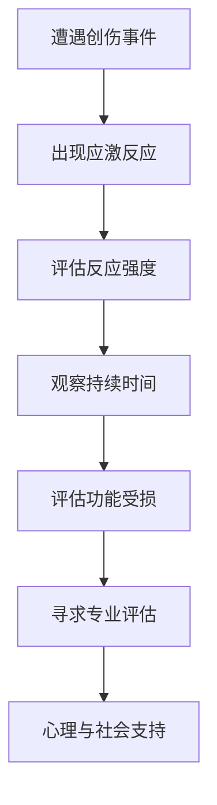

# PTSD（创伤后应激障碍）的症状与干预

创伤后应激障碍（PTSD）是个体经历、目睹或接触创伤事件后，延迟出现且持续存在的精神障碍。判断创伤事件时，==不能只看事件是否有生命威胁，更要看当事人的反应强度==；若事件使个体产生强烈的害怕、无助感或恐怖感受，就可能构成创伤事件。因此，复习题中的说法正确。

## 为什么需要识别 PTSD

大学生可能经历事故、灾害、暴力侵害、亲人突然离世等事件。多数人在事件后会出现短暂的紧张、失眠或反复回想，这并不必然是 PTSD；但若症状持续、明显影响学习生活和人际交往，就需要及时评估与干预。识别 PTSD 的目的，是避免把当事人的痛苦误解为“矫情”“意志薄弱”，也避免错过专业帮助。

## 核心症状与判断思路

PTSD 的症状可概括为以下几组：

| 症状组别 | 主要表现 | 识别关键词 |
|---|---|---|
| 再体验 | 创伤画面反复闯入、噩梦、闪回，仿佛事件再次发生 | “重新经历” |
| 回避 | 回避相关人物、地点、谈话，不愿回忆事件 | “躲开提醒” |
| 认知与情绪改变 | 持续恐惧、内疚、麻木，兴趣下降，与他人疏离 | “情绪受挫” |
| 警觉性增高 | 易惊吓、失眠、注意力难集中、易怒、过度戒备 | “一直戒备” |

判断时不能只数症状，还要结合==症状持续时间、痛苦程度及功能受损==。例如，创伤后几天睡不着、反复回想，可能是正常的急性应激反应；若相关症状长期持续并严重影响上课、社交，则应考虑专业评估，而不是自行贴标签。

## 相近概念的区别

| 概念 | 与 PTSD 的区别 |
|---|---|
| 一般应激反应 | 较常见，通常随支持和时间逐渐缓解，不一定达到障碍标准 |
| 急性应激障碍 | 出现较早、持续时间相对较短；PTSD 更强调症状持续及延迟发生的可能 |
| 抑郁症 | 以持续情绪低落、兴趣减退等为主；PTSD 必须结合创伤经历及再体验、回避等特征 |
| 正常悲伤 | 丧失后的痛苦可呈波动，仍可能保留温情回忆；不能仅凭悲伤诊断 PTSD |

> [!WARNING]
> “创伤事件必须有生命威胁”是常见误区。事件性质与当事人的==强烈害怕、无助或恐怖反应==都要考虑；同时，经历过创伤也不等于一定患 PTSD。

## 干预怎么做

干预应遵循“安全优先、专业评估、持续支持”的原则。首先稳定作息和饮食，减少酒精等不当应对，帮助当事人恢复可预期的生活；其次提供倾听和陪伴，允许其按自己的节奏表达，不强迫详细复述创伤。若症状持续或功能明显受损，应转介心理中心或精神专科，由专业人员采用创伤聚焦心理治疗，必要时配合药物治疗。若出现自伤、自杀想法或无法保证自身安全，应立即启动危机干预，联系辅导员、学校心理中心、医疗机构或急救资源，不能让其独处。

> [!TIP]
> 做题可用“三看”：一看事件后的反应强度，二看症状是否持续，三看学习社交是否受损。题干强调“强烈害怕、无助或恐怖”，正是在考查创伤事件的判断标准。
