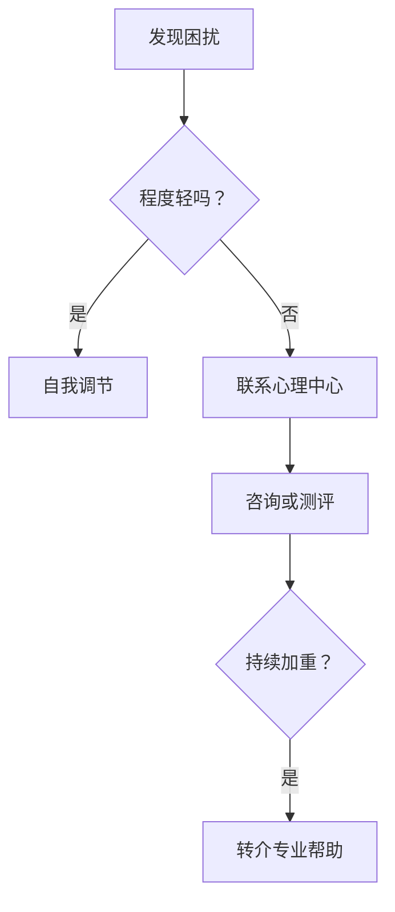

# 南京邮电大学心理健康教育中心与求助渠道

## 心理健康教育中心与求助渠道概览

==南京邮电大学心理健康教育中心==是校内的专业支持机构，为学生提供心理咨询、心理测评、危机干预和心理健康教育。它的核心价值不是“只有出问题才去”，而是把心理困扰当作可处理的信号：早识别、早求助，通常更容易恢复。

可以这样理解求助路径：先观察自己，再选择合适渠道，必要时升级求助。

## 它是什么

这里说的“求助渠道”，通常包括学校心理中心、辅导员、班级心理委员、校内心理热线或咨询预约方式，以及必要时的校外专业资源。它们的分工不同：心理中心偏专业，辅导员偏日常支持，心理委员偏同伴连接，校外资源偏进一步诊疗。

> [!IMPORTANT]
> 求助不是“承认失败”，而是主动利用资源，尽早把困扰降下来。

## 为什么需要

很多心理问题在初期只是睡眠变差、情绪低落、注意力下降、社交回避。如果拖到影响学习和生活，恢复成本会变高。求助渠道的意义就在于：把模糊的不适变成可评估、可支持、可干预的问题。

## 怎么做

可按“三步走”：

1. 先识别信号：情绪、睡眠、食欲、学习效率是否持续异常。
2. 再找渠道：先联系校内支持，如心理中心或辅导员。
3. 最后持续跟进：一次求助不一定立刻解决，要按建议复诊或调整。

> [!TIP]
> 记忆口诀：**看信号、找渠道、跟到底**。

## 和相近概念的区别

| 渠道 | 更适合处理什么 | 特点 |
|---|---|---|
| 心理中心 | 咨询、测评、危机干预 | 专业性强 |
| 辅导员 | 日常压力、适应问题 | 方便及时 |
| 心理委员 | 同伴支持、初步识别 | 贴近同学 |
| 校外专业机构 | 更严重或持续问题 | 更系统深入 |

> [!WARNING]
> 常见误区：把“求助”只理解成“去心理咨询”，其实它是一个多渠道支持系统。

## 常见的坑

一是拖延，觉得“再忍忍就过去了”；二是找错对象，只向朋友倾诉却迟迟不寻求专业支持；三是把一次咨询当成“万能药”，忽略持续跟进。还要注意，危机时刻要优先保证安全，不能只靠自己硬扛。

## 一个做对了的例子

题目说：“使用弹性绷带对受伤部位进行包扎时，应注意从肢体近端往末端方向包扎。”答案是 **错误**。正确做法通常是==从末端向近端包扎==，这样更有利于血液回流，减少肿胀。

这个例子给我们的启发也适用于心理求助：==顺序对了，效果才好==。遇到困扰时，不是先硬撑到最严重才行动，而是尽早在合适渠道中一步步处理。
