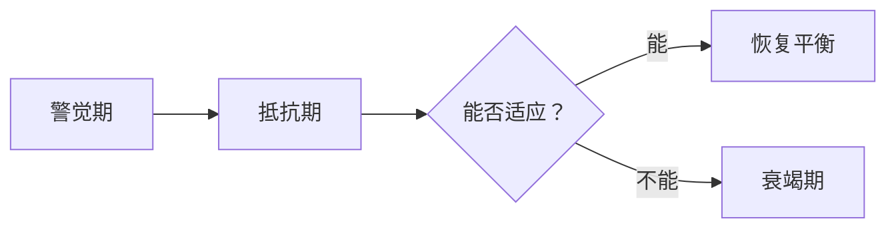

# 压力的概念、压力源与一般适应综合征（GAS）

> [!IMPORTANT]
> ==压力（Stress）==是个体在面对具有威胁性、挑战性的情境时，经认知评估后产生的生理与心理紧张反应。

## 它是什么

试着回想一下：期末考试前一周、社团答辩上台前，你的心跳加速、手心出汗，这种身心紧绷的状态就是压力。压力本身不是坏事，它是机体为了应对环境要求而启动的“动员机制”。

但引发压力的原因各不相同，这些刺激被称为==压力源==。对大学生而言，常见压力源包括学业负担、人际关系冲突、就业焦虑以及生活作息紊乱等。

> [!NOTE]
> **压力 vs 焦虑**：压力通常有明确的外部压力源（如考试）；焦虑则可能没有具体对象，是一种弥散性的担忧不安。

## 身体如何应对压力：GAS 模型

加拿大生理学家塞里（Selye）提出了==一般适应综合征（GAS）==，将人体面对持续压力的反应分为三个阶段：

1. **警觉期**：刚遇到压力源，交感神经兴奋，“战斗或逃跑”反应启动。
2. **抵抗期**：若压力持续，身体调动资源努力适应，表面看似正常，实则内部消耗巨大。
3. **衰竭期**：若压力长期存在且无法消除，适应能量耗尽，免疫力下降，导致身心疾病。

> [!WARNING]
> 判断题中“无规律的加班不会对健康产生影响”是**错误**的。无规律作息本身就是一种慢性压力源，会迫使机体长期停留在抵抗期甚至滑入衰竭期，严重损害健康。

## 为什么需要懂这些

理解了 GAS，你就会明白：考前熬夜突击（急性压力）和长期作息混乱（慢性压力）对身体的破坏机制是不同的。掌握压力规律，是为了在“衰竭期”到来前主动干预。

结合课件中关于生活方式的考点，日常行为直接影响我们对压力的抵抗力：

> [!TIP]
> - **饭后不宜立即运动**：血液重新分配流向肌肉骨骼，影响消化，易引起腹痛恶心。（判断40：正确）
> - **睡前避免剧烈运动**：交感神经高度兴奋，阻碍入睡，降低睡眠质量。（判断42：正确）

## 相近概念辨析

| 维度 | 一般适应综合征（GAS） | 挫折（Frustration） |
| :--- | :--- | :--- |
| **侧重点** | 生理层面的非特异性应激反应 | 心理层面目标受阻后的情绪体验 |
| **触发条件** | 任何需要适应的压力源 | 动机行为遇到障碍或干扰 |
| **结果导向** | 适应成功或走向衰竭 | 产生攻击、退化、固着等心理防御 |

## 常见的坑

> [!CAUTION]
> 误区：“压力越小越好”。实际上，完全没有压力会导致动机不足、表现平庸；适度的压力（良性应激）反而能提升专注力和效率。我们要管理的是“过度且失控”的压力。

## 算对了的例子

以判断题 14 为例：

**题目**：无规律的加班不会对健康产生影响。（ ）
A. 正确 B. 错误

**分析过程**：
1. “无规律的加班”属于典型的==时间与生活压力源==。
2. 根据 GAS 模型，不规律作息打破了生物节律，使机体反复进入“警觉期”，无法有效过渡到平稳状态。
3. 长期如此必然消耗适应能量，最终进入“衰竭期”，引发心血管或免疫系统问题。
4. 因此该说法违背了压力与健康的基本关系。

**答案**：==B. 错误==
