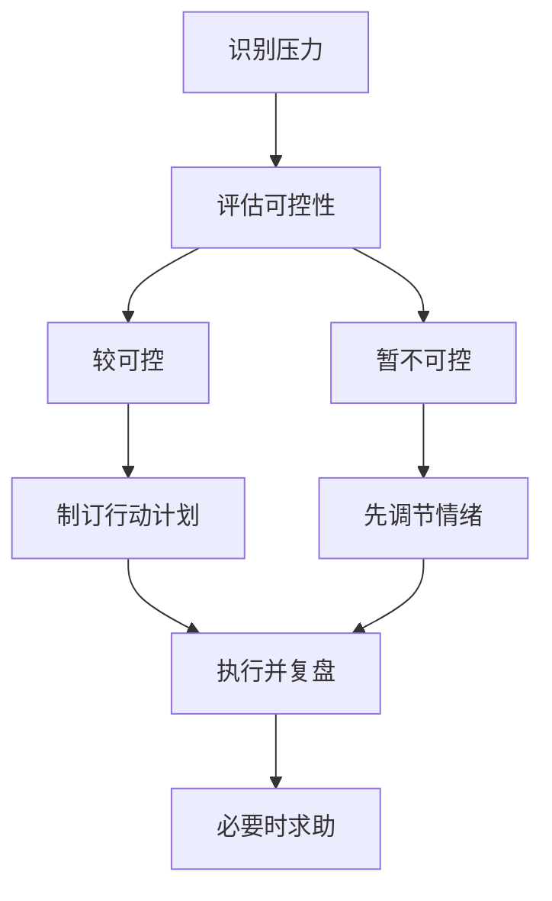

# 问题指向应对与情绪指向应对策略

## 两种应对策略是什么

面对压力，先问自己一句：**我现在更想改变这件事，还是先让自己不那么难受？** 前者对应**问题指向应对**，后者对应**情绪指向应对**。

> [!IMPORTANT]
> ==问题指向应对是直接处理压力源，情绪指向应对是调节压力引起的情绪反应。== 二者都可能有积极作用，关键不在“哪种更高级”，而在是否符合当前情境。

| 比较维度 | 问题指向应对 | 情绪指向应对 |
|---|---|---|
| 主要目标 | 改变、减少或消除压力源 | 缓解焦虑、悲伤、愤怒等反应 |
| 核心问题 | “这件事能怎样解决？” | “我怎样先稳定下来？” |
| 常见方式 | 分析问题、制订计划、寻求帮助、时间管理、直接沟通 | 运动、放松、倾诉、转移注意、重新评价、合理宣泄 |
| 适用情境 | 问题较明确，且有一定可控性 | 情绪过强，或事件暂时不可控 |
| 典型风险 | 对不可控事件反复硬碰硬 | 只缓解情绪，长期回避问题 |

## 为什么两种都需要

压力不仅来自事件本身，也与个体对事件的评价及拥有的资源有关。同样一次考试失利，有人把它理解为“复习方法需要调整”，于是分析错题、请教老师；有人先陷入强烈自责，连书也看不进去，这时就需要先睡眠调整、运动或倾诉，再处理学习问题。

因此，应对不是二选一，而常常是**先稳定情绪，再解决问题；解决问题后，情绪也会随之改善**。体育运动能够缓解、转移现代生活方式造成的疲劳，属于具有积极意义的调节方式；有规律地生活、科学用脑，也有助于增强压力承受能力。

## 怎样选择和组合

可以按以下步骤操作：

1. **说清压力源**：不要只写“我压力很大”，而要具体到“下周三门考试，复习时间不足”。
2. **区分可控与不可控**：复习顺序、求助对象通常可控；已经发生的成绩、他人的评价未必可控。
3. **匹配应对方式**：可控部分用行动解决，不可控部分减少反复内耗，并照顾自己的情绪和身体。
4. **检查结果**：若情绪有所缓解却仍不行动，或忙碌很久却没有触及压力源，就需要调整策略。

> [!TIP]
> 记忆口诀：**能改就处理，难受先调节；情绪稳下来，行动跟上去。**

## 一个做对了的例子

某学生因期末考试临近而焦虑，夜间刷手机，白天无法集中注意力。他先用跑步和规律作息降低疲劳、稳定情绪，再把复习任务拆成每天可完成的小单元，并向任课教师请教薄弱环节。这里，跑步和作息调整主要属于情绪指向应对，拆分任务和主动求助主要属于问题指向应对；二者配合，既减轻了焦虑，也直接处理了复习不足这一压力源。

## 常见的坑

> [!WARNING]
> **情绪指向应对不等于消极逃避。** 适度运动、倾诉和放松是积极调节；长期沉迷游戏、酗酒或拒绝面对现实，则可能暂时麻痹情绪，却使问题加重。

还要注意三个边界：

- **不是解决问题就不需要情绪调节**：情绪过强时，人往往难以有效思考和行动。
- **不是情绪平稳就算应对成功**：若压力源仍可改变，还需采取实际行动。
- **不是所有事都必须独自扛住**：向同学、教师或心理专业人员求助，本身也是有效应对，而非软弱。
