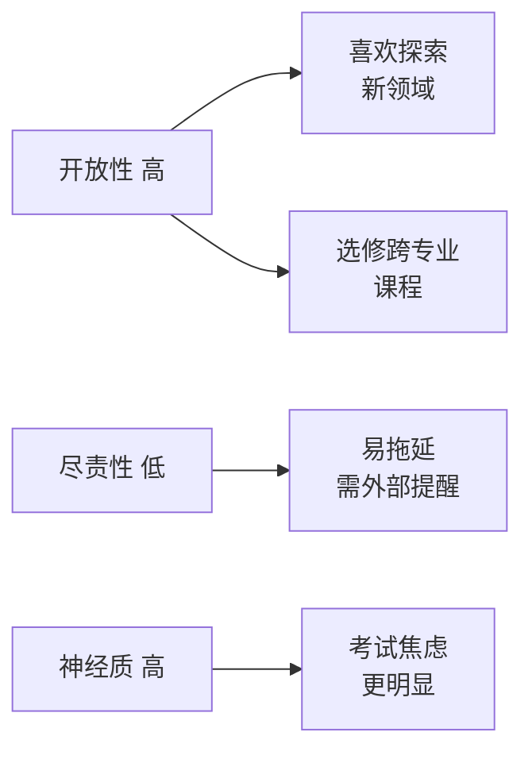

# 大五人格模型（OCEAN）的维度与应用

## 大五人格模型（OCEAN）

大五人格模型（Big Five Personality Model）是目前心理学界公认的、实证基础最扎实的人格描述框架之一。它不把人分成“类型”，而是用五个连续维度刻画每个人的倾向程度。五个维度首字母组成 **OCEAN**（海洋）：开放性（Openness）、尽责性（Conscientiousness）、外向性（Extraversion）、宜人性（Agreeableness）、神经质（Neuroticism）。

> [!IMPORTANT]
> 大五人格是**维度模型**，不是**类型模型**。每个人在每个维度上都有一个分数，而不是被归入某一“型”。这是它与 MBTI、九型人格等分类体系最根本的区别。

### 五个维度分别指什么

先问一个问题：如果让你用最少的词向陌生人描述自己的性格，你会先说哪几个特征？大概率会落在“爱不爱说话”“做事靠不靠谱”“容易不容易焦虑”这几类上——大五正是把这些朴素观察系统化了。

| 维度 | 低分端 | 高分端 | 日常表现 |
|---|---|---|---|
| **开放性 O** | 务实、保守、喜欢熟悉事物 | 好奇、爱想象、愿意尝试新体验 | 是否喜欢新课程、新观点、艺术审美 |
| **尽责性 C** | 随性、拖延、计划性弱 | 自律、有条理、目标导向 | 是否按时交作业、坚持复习计划 |
| **外向性 E** | 安静、独处充电 | 健谈、活跃、从社交中获得能量 | 是否主动参加社团、课堂发言 |
| **宜人性 A** | 竞争性强、直言不讳、多疑 | 信任他人、合作、富有同情心 | 是否容易与室友磨合、团队协作 |
| **神经质 N** | 情绪稳定、抗压 | 易焦虑、易怒、情绪波动大 | 考试前是否过度紧张、遇挫折是否崩溃 |

> [!TIP]
> 记忆口诀：**O**penness 开脑洞，**C**onscientiousness 靠得住，**E**xtraversion 爱出头，**A**greeableness 好相处，**N**euroticism 常emo。

### 为什么需要大五

大学阶段是人格可塑性仍较高的时期。了解大五，不是为了给自己“贴标签”，而是为了：

- **自我觉察**：知道自己在哪些维度上偏高或偏低，理解自己的行为模式（如“我拖延不是因为懒，而是尽责性偏低，需要外部监督机制”）。
- **人际理解**：室友冲突、小组合作中的摩擦，很多时候不是“谁对谁错”，而是维度差异（如高宜人性者觉得低宜人性者“太冲”，低宜人性者觉得高宜人性者“太假”）。
- **生涯规划**：研究发现尽责性与学业成绩、工作绩效的正相关最为稳定；外向性与销售、管理类岗位匹配度较高。

### 人格剖面图怎么读

大五的结果通常是一张剖面图，五个维度的百分位分数连成折线。读图的关键不是看单点高低，而是看**整体形态**。

> [!WARNING]
> 任何单一维度都不能孤立解读。例如“高神经质 + 高尽责性”的人可能表现为完美主义驱动的焦虑，“高神经质 + 低尽责性”则可能表现为慌乱而无序。孤立地看某一个维度的高分或低分，很容易误判。

### 与大五相近的概念辨析

| 易混概念 | 与大五的关系 |
|---|---|
| **MBTI（16型）** | 类型论，把人分箱；大五是维度论，给人打分。MBTI 的重测信度和效度争议较大，大五有更强的跨文化、跨年龄稳定性 |
| **艾森克三因素** | 外向性、神经质、精神质三者可以大致映射到大五中的 E、N 和 A/C 的混合，是大五的“前身”之一 |
| **卡特尔 16PF** | 用因素分析从表面特质提取根源特质，大五是在更高层级上进一步浓缩的结果 |

### 一个算对了的例子

某同学完成大五量表后，各维度原始分和常模均值如下（假设满分 50，常模 SD = 10）：

| 维度 | 原始分 | 常模均值 | Z 分数 | 百分位（约） |
|---|---|---|---|---|
| O | 38 | 30 | $Z_O = (38-30)/10 = 0.8$ | 约 79% |
| C | 24 | 30 | $Z_C = (24-30)/10 = -0.6$ | 约 27% |
| E | 32 | 28 | $Z_E = (32-28)/10 = 0.4$ | 约 66% |
| A | 40 | 32 | $Z_A = (40-32)/10 = 0.8$ | 约 79% |
| N | 35 | 26 | $Z_N = (35-26)/10 = 0.9$ | 约 82% |

**解读**：该生 ==开放性高、宜人性高，但神经质也偏高、尽责性偏低==。这意味着 TA 对新事物感兴趣、容易与人合作，但情绪容易波动，且自我管理能力需要加强。针对性的发展建议不是“改性格”，而是：利用高开放性尝试不同的时间管理工具来弥补低尽责性；用高宜人性建立互助学习小组来缓解高神经质带来的考试焦虑。

> [!CAUTION]
> 不要用大五分数给自己或他人下“好/坏”判断。每个维度的高分低分都有适应性优势与代价。比如高宜人性利于合作，但可能在需要坚持己见的场合吃亏；高神经质虽然难受，但往往伴随对威胁的敏锐觉察。人格测评的价值在于**觉察与适配**，而非**评判与定型**。
