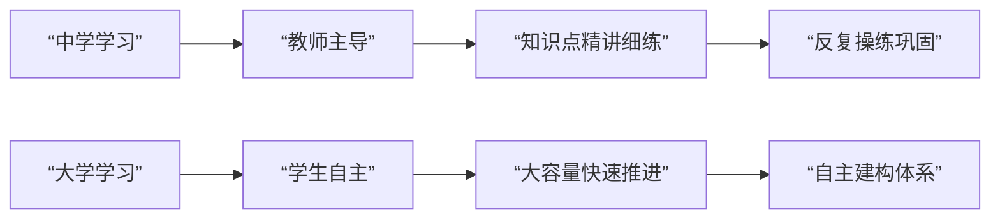

# 大学学习与中学学习的差异及特点

## 大学学习与中学学习的差异及特点

如果你刚进入大学，可能会觉得“上课听得懂，考试却不会”——这背后其实是中学和大学的学习逻辑发生了根本转变。我们先从最直观的变化看起。

### 为什么需要认清这种差异？

==中学学习是“学会已知”，大学学习是“应对未知”。== 如果不及时调整学习策略，沿用中学“等老师投喂”的模式，很快就会在知识广度、深度和速度的三重压力下陷入被动。

### 两种学习模式的核心差异

| 维度 | 中学 | 大学 |
| :--- | :--- | :--- |
| **目标** | 升学导向，掌握确定性高的“标准答案” | 能力导向，培养专业思维与问题解决能力 |
| **内容** | 基础广、深度浅，范围固定 | 专业深、更新快，常涉及学科前沿与争议 |
| **教学** | 慢节奏、细讲解，反复操练典型题型 | 快节奏、大容量，一节课可能覆盖几十页教材 |
| **方法** | “听-记-练”为主，教师督促到位 | 自主阅读、讨论、研究，要求==课前大量文献输入== |
| **评价** | 频繁测验，排名明确 | 过程与期末结合，强调综合应用与创新 |

### 大学学习的独特要求

大学课程容量大且进度飞快，你必须在短时间内完成大量内容的输入。这需要你具备两个新习惯：

1.  **预习先行**：不预习就去听课，容易被海量信息淹没。你需要在上课前通过阅读教材、文献构建一个**粗略框架**，知道哪里是重点、哪里是你自己看不懂的。
2.  **结构化笔记**：不能只做忠实的“听写员”。笔记应当记录你的**编码与重构**过程，比如画出概念关系图，或标注“此处与前一章某概念矛盾/相关”。

> [!IMPORTANT]
> 大学生学习的核心不是记忆孤立的结论，而是==建立知识点间的逻辑网络，能用理论解释并解决现实问题==。

### 常见的坑与辨析

| 常见误区 | 为什么错 | 正确做法 |
| :--- | :--- | :--- |
| “考前突击背重点” | 大学考试侧重迁移应用，背诵无法应对主观题与案例题 | 日常分章节梳理逻辑链，理解一个理论**被提出是为了解决什么问题** |
| “上课全抄PPT” | 复制粘贴式笔记未经过大脑加工，课后即忘 | 采用康奈尔笔记法，将书页分为笔记区、线索区、总结区 |

>[!WARNING]
> 许多同学栽在“专业导论课就是听故事”这个认知上。事实上，它是在帮你构建学科的**认知地图**，若等闲视之，到大二会突然发现所有专业课像散落的珠子，根本串不起来。

### “大学学习与中学学习差异”的应用案例

**场景**：大一《心理学导论》期中作业要求提交一篇1500字短文，论述“网络游戏中的强化机制”。

-   **中学生思维**：翻书找“正强化”“负强化”定义，抄下来，举一个简单例子，字数不够就扩写定义。**结果**：及格线上下的分数，评语是“缺乏分析与深度”。
-   **大学学习要求的思维**：
    1.  **理解本质**：强化是使行为频率增加的后果。
    2.  **发现联系**：游戏中“击败Boss掉落装备（正强化）”和“氪金跳过重复枯燥任务（负强化）”如何共同作用于玩家。
    3.  **解决问题**：不是解释定义，而是用这两种概念分析游戏为什么“上瘾”，可以画出游戏设计的强化流程图，并讨论数值膨胀对强化效果的削弱。
    4.  **形成结论**：游戏设计的核心是精密编排的强化计划表，与斯金纳箱实验在底层逻辑上同构。

>[!TIP]
> 当预习 30 页教材并感到无从下手时，先花 5 分钟浏览所有大小标题与图表，合上书复述一遍大致的骨架，这个方法可以帮你快速提炼出那节课的“认知地图”。
