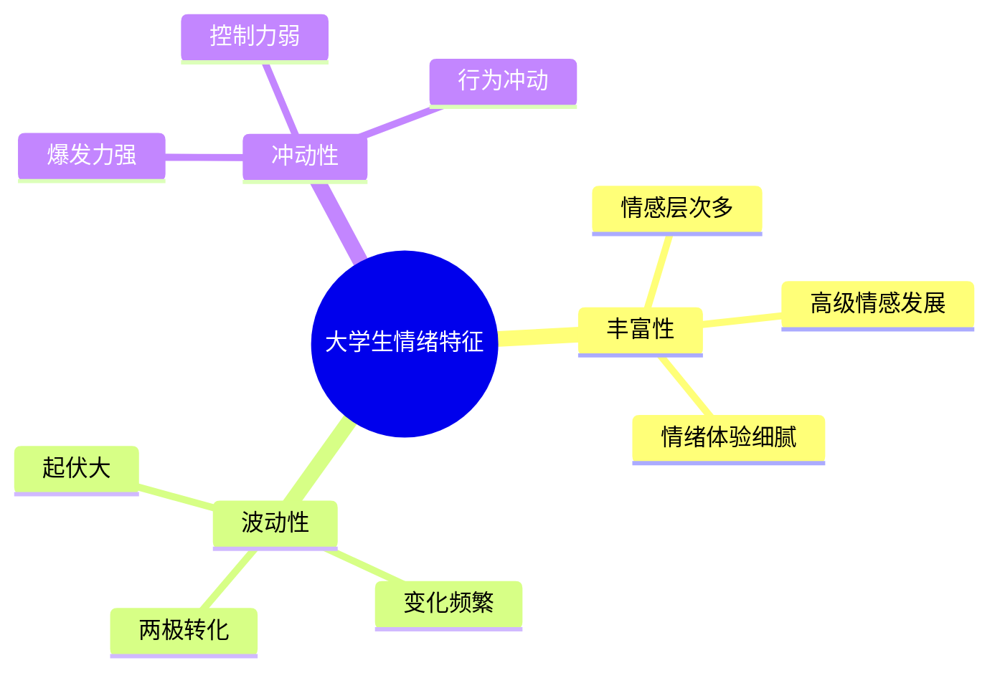

# 大学生情绪发展的典型特征（丰富性、波动性、冲动性等）

## 情绪像什么

进入大学后，不少同学会发现自己的情绪体验和高中阶段明显不同：有时候一天之内能从兴奋跌入低落，有时候明知道不该发火却控制不住。这不是“性格变差了”，而是大学生情绪发展的典型特征在起作用。

大学生情绪发展有三个最突出的特征：==丰富性、波动性、冲动性==。

## 三个特征分别指什么

### 丰富性

大学阶段，随着认知水平提升、社交范围扩大、自我意识深化，情绪内容变得多元而细腻。你不再只是“高兴”或“不高兴”，而是能体验成就感、归属感、审美愉悦、道德义愤、存在焦虑等复杂情感。==高级情感（道德感、理智感、美感）在这一阶段迅速发展==。

### 波动性

情绪容易在两级之间摆动。一次考试成绩、一句评价、一条没回的消息，都可能让情绪从高峰跌到低谷。这背后有两个原因：一是大学生内分泌系统仍处于活跃期，生理基础影响情绪稳定性；二是自我同一性尚未完全确立，对外界评价敏感。

### 冲动性

大学生情绪体验强烈，一旦被激发，行为反应可能很快、很猛，来不及经过理性的“缓冲带”。冲动性不等于“坏”，它是活力与行动力的来源；但如果缺乏觉察，容易演变为冲动消费、冲动冲突、冲动恋爱或冲动放弃。

## 为什么需要了解这些特征

> [!IMPORTANT]
> 核心结论：大学生情绪特征不是缺陷，而是发展阶段的表现。==理解它们，是情绪管理的前提——先觉察，才能调节。==

如果你知道“波动性”是正常的，就不会在情绪低落时立刻给自己贴上“我是不是抑郁了”的标签；如果你知道“冲动性”存在，就会在愤怒上头时给自己留出几秒钟的暂停空间。

## 一个容易混淆的坑

> [!WARNING]
> 不要把“情绪波动”等同于“情绪障碍”。波动是情境性的、可恢复的；情绪障碍（如抑郁症、双相障碍）是持续性的、影响社会功能的。判断标准看**持续时间、严重程度、功能损害**三个维度。

另外，题目中提到的“契可尼效应”也能用情绪特征来解释：未完成的事情之所以让人反复回忆，正是因为大学生情绪体验==丰富且深刻==，未完成事件留下的情绪张力持续激活记忆，让人难以释怀。

## 情绪特征在生活中的表现

| 特征 | 日常表现举例 | 应对思路 |
|------|-------------|---------|
| 丰富性 | 看一场电影能同时感到感动、遗憾、启发 | 记录情绪，提升情绪粒度 |
| 波动性 | 上午因小组汇报成功而兴奋，下午因室友一句无心话而低落 | 识别触发点，区分事实与解读 |
| 冲动性 | 深夜冲动下单、吵架时口不择言 | 建立“六秒暂停”习惯 |

## 一个算对了的例子

结合题目中的判断题来看：

> 大学生在学校群体生活中，要时刻注意养成良好的学习生活习惯，学会有规律地生活。这有利于大学生科学用脑，排除心理障碍，促进心理健康。

**答案：正确。**

这里面的逻辑链条是：规律的生活习惯 → 生理节律稳定 → 情绪波动性降低 → 心理障碍风险下降。==规律作息是对抗情绪波动性的基础性策略==，因为睡眠不足和作息紊乱会直接放大情绪的冲动性和波动性。

契可尼效应那题同理：正因为大学生对未完成的情感事件有强烈的情绪卷入，所以“没有结果的爱情”会因未完成感而长期占据记忆，这与情绪丰富性和深刻性直接相关。

---

**小结**：丰富性让你体验更深，波动性让你起伏更大，冲动性让你反应更快。你不需要消除它们，而需要==觉察它们、命名它们、给它们留出缓冲空间==。做到这一点，情绪就从“控制你的力量”变成“你理解自己的信号”。
