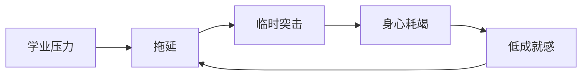
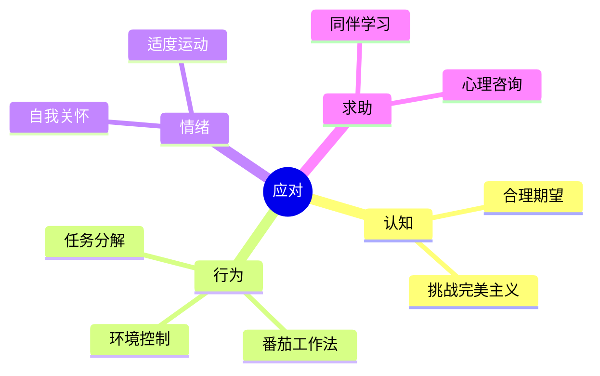

# 学习倦怠（学业拖延）的表现与应对

## 它是什么

**学习倦怠**指学生在长期学业压力下产生的==耗竭、消极疏离与低成就感==的综合状态；**学业拖延**指明知该学却故意推迟、非理性地把学习任务拖到最后一刻的行为模式。二者常互相强化：拖延→临时抱佛脚→疲惫低效→更不想学→继续拖延。

> [!IMPORTANT]
> 倦怠是一种**状态**（情绪与身心层面），拖延是一种**行为**（决策与执行层面）；两者可同时出现，但定义角度不同。

## 为什么会形成

- **任务特征**：任务枯燥、难度与自己水平不匹配、缺乏即时反馈。
- **动机因素**：外部动机（绩点、家长期望）压过内部兴趣，导致==价值感缺失==。
- **情绪调节**：面对焦虑任务时，拖延是一种短期"逃避负性情绪"的策略，但代价是长期更焦虑。
- **自我管理**：时间知觉失真（"还有时间"）、完美主义（"做不到完美就不开始"）。

## 典型表现（如何识别）

| 维度 | 学习倦怠 | 学业拖延 |
|---|---|---|
| 情绪 | 疲惫、烦躁、厌学 | 焦虑、内疚、自我否定 |
| 认知 | "学了也没用" | "等状态好了再学" |
| 行为 | 注意力涣散、效率骤降 | 刷手机、做无关小事 |
| 结果 | 长期低产出、易病 | 突击赶工、质量不稳 |

## 应对策略

> [!TIP]
> 对付拖延的起点不是"打起精神"，而是==先做 5 分钟==——启动往往比坚持更难。

- **任务分解**：把"复习第 4 章"拆成"读 3 页 + 做 5 题"，用小目标换取即时反馈。
- **时间管理**：番茄工作法（25 分钟专注 + 5 分钟休息）、两分钟规则（能立刻做的先做）。
- **环境调节**：手机静音并放到视线外，固定自习位，减少启动阻力。
- **情绪调节**：正念呼吸、规律运动、充足睡眠，切断"压力→拖延"的循环。
- **寻求支持**：同伴互相监督，必要时寻求学校心理咨询中心帮助。

## 与相近概念的区别

| 概念 | 核心 | 举例 |
|---|---|---|
| 学习倦怠 | 长期压力下的耗竭状态 | 期末阶段彻底提不起劲 |
| 学业拖延 | 非理性推迟学习任务 | 明天交作业今天才动笔 |
| 学习困难 | 能力或方法问题导致成绩差 | 想学但不得要领 |
| 考试焦虑 | 特定情境的紧张情绪 | 一进考场就大脑空白 |

## 常见的坑

> [!WARNING]
> **拖延 ≠ 懒惰**：拖延者常伴随强烈内疚，本质是情绪调节失败而非缺乏意愿；简单批评会加重其自我否定，反而恶化拖延。

> [!CAUTION]
> 把"熬夜突击"当"状态来了"是高危误区——短期看似有效，长期会加剧倦怠与低效，形成恶性循环。

> [!NOTE]
> 适度拖延在统计上普遍存在（"主动拖延"者能承受后果并按时完成），==并非所有拖延都需要干预==；只有当其显著影响学业、情绪与生活时才构成问题。

## 一个"算对了"的例子

小李一学期 8 门课，面对高数作业反复推迟，考前通宵仍挂科，从此见书就烦。判断其状态：
- 情绪上"见书就烦"、身体疲惫 → 符合**倦怠**的耗竭与疏离。
- 行为上明知该做却反复推迟 → 符合**拖延**的非理性推迟。

应对方案：把高数作业拆成每天 2 题，用番茄钟完成，完成即给自己小奖励，两周后作业不再堆积，焦虑下降，倦怠感随之缓解。
