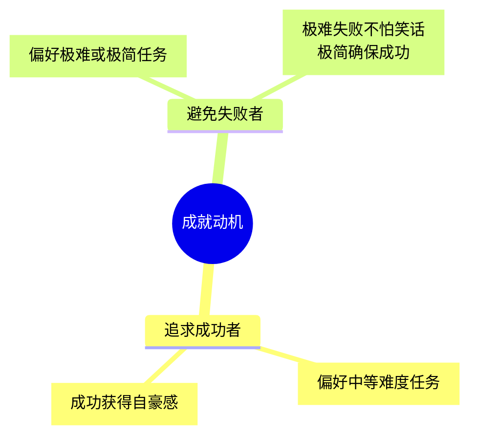
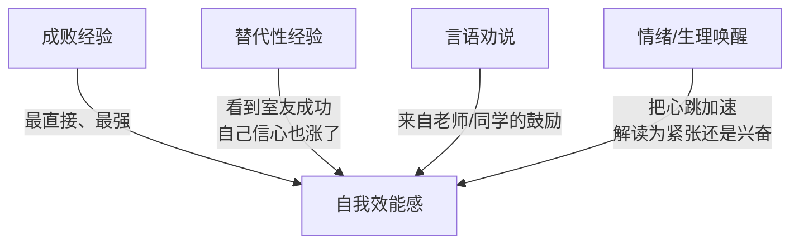

# 学习动机的分类及主要动机理论（如成就动机、自我效能感）

## 学习动机的分类及主要动机理论

学习动机是推动我们进行学习活动的内在原因，它回答了“我为什么要学习”这个问题。在南邮的《大学生心理健康》课程里，理解动机不仅是为了考试，更是为了看清楚自己学习的驱动力，从而找到持续努力的方法。

我们可以先问自己一个问题：同样是在图书馆坐一整天，为什么有人觉得充实，有人觉得煎熬？答案往往不在于“坐”这个行为本身，而在于驱动这个行为的原因不同。

### 学习动机的分类

心理学上通常按动机的来源和目的进行分类：

| 分类维度 | 类型 | 核心含义 | 南邮课程常见的例子 |
| :--- | :--- | :--- | :--- |
| **按来源** | **内部动机** | 由学习活动本身带来的满足感驱动，如兴趣、好奇心。 | “我就是觉得解出高数题很有成就感。” |
| | **外部动机** | 由学习结果带来的外部奖赏或惩罚驱动。 | “为了拿奖学金”“为了不挂科”。 |
| **按目的指向** | **==掌握目标==** | 以掌握知识、提升能力为目的，关注自身进步。 | “我想真正弄懂通信原理，而不只是背考题。” |
| | **==成绩目标==** | 以展示自身能力、获得好名次或避免负面评价为目的。 | “我一定要考得比室友高。” |

>[!IMPORTANT]
> 内部动机与掌握目标通常指向更持久的学习投入和更好的心理健康水平。但这不代表外部动机毫无价值，在完成一些基础或枯燥任务时，外部动机能提供初始的推力。==关键是如何将外部动机逐步内化==。

### 主要的动机理论

理论帮助我们系统地解释这些分类背后的心理机制。南邮课程中重点涉及以下两种：

#### 成就动机理论

这个理论关注的是：人为什么愿意挑战任务？

**阿特金森**提出了一个经典公式，他认为个体追求成功的倾向（ $T_s$ ）是三个因素的乘积：

$$T_s = M_s \times P_s \times I_s$$

-   **$M_s$ （追求成功的动机）**：你内心渴望成功的稳定性格特质。
-   **$P_s$ （成功概率）**：你认为这件事能做成的可能性。
-   **$I_s$ （成功诱因值）**：做成这件事带来的自豪感，它与 $P_s$ 的关系是 $I_s = 1 – P_s$。

**这告诉我们一个有趣的结论**：一个任务太难（$P_s$ 低）或太简单（$I_s$ 低，因为 $1-P_s$ 趋近于 0），动机都强不起来。==当任务的难度适中（如 $P_s = 0.5$），即你有一半把握时，动机最强。==

#### 自我效能感理论

**班杜拉**提出，自我效能感不是指你“会”多少，而是你**相信自己有能力做好某件事**的判断。

>[!TIP]
> **自信心 vs. 自我效能感**：自信心是一个更泛化的概念（“我很棒”），而自我效能感是**针对特定领域**的（“我相信自己能完成这篇课程论文”）。

**为什么它很重要？** 它直接决定了你在学习中的选择、努力程度和坚持性。

**自我效能感的四大来源（由强到弱）：**

### 一个帮你理解的例子

**场景**：小南准备参加全国大学生数学建模竞赛。

-   **成就动机判断**：小南选择了一个需要努力但团队有信心解决的题目。如果按他估计成功率约50%，根据阿特金森的理论，此时他追求成功的动机==最强==。
-   **自我效能感判断**：赛前，小南回顾了上次校赛获奖的经历（这是**成败经验**）；看到同水平的学长也拿了国奖（这是**替代性经验**）；指导老师说“以你们的能力做这个选题没问题”（这是**言语劝说**）。这些共同提升了他的自我效能感，使他在熬夜建模时更能坚持。

### 常见的坑

>[!WARNING]
> **“虚假高自我效能感”**：只靠自我打气和简单任务堆砌出来的高自我效能感是脆弱的。一旦遭遇真实的、有挑战性的失败，会迅速崩塌。真正的、稳定的自我效能感，必须建立在**真实的成功经历**之上。

>[!CAUTION]
> **混淆成绩目标与掌握目标**：如果一个学生只把“拿高分”当作唯一目的，他可能为了规避风险而拒绝挑战难题，选择偏题、怪题的背诵策略，最终陷入内卷焦虑，反而丧失了深度学习的乐趣和能力。这才是对学习心理最深刻的损伤。
