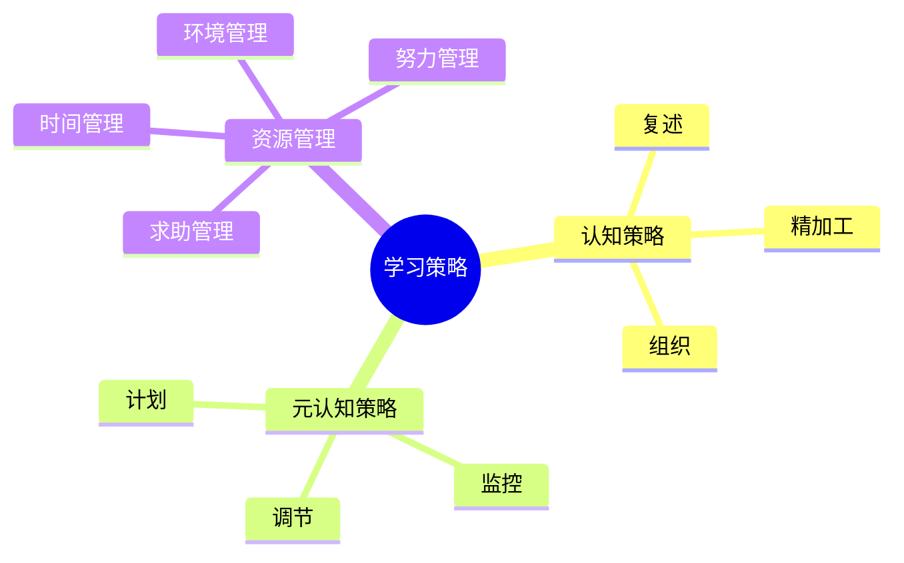

# 认知策略、元认知策略与资源管理策略

## 学习策略的三维架构

在《大学生心理健康》第4章中，学习策略并非单一的“努力”，而是分为**认知策略**、**元认知策略**与**资源管理策略**。你可以将学习想象成驾驶一辆车：认知策略是“引擎”（处理信息），元认知策略是“方向盘与仪表盘”（监控过程），资源管理策略则是“燃油与路况”（环境与时间支持）。

> [!IMPORTANT]
> ==核心结论==：三者协同作用。认知策略直接加工材料，元认知策略调控认知过程，资源管理策略辅助前两者高效运行。

## 三大策略详解与辨析

**认知策略**是直接对信息进行加工的方法。
- **复述策略**：如反复背诵单词，目的是保持信息在短时记忆中。
- **精加工策略**：如记忆术、做笔记、类比，目的是建立新旧知识联系。
- **组织策略**：如列提纲、画思维导图，目的是构建知识结构。

**元认知策略**是对“认知的认知”，即对自己学习过程的监视与控制。
- **计划策略**：学习前设置目标、浏览材料。
- **监控策略**：学习中自我提问、“我读懂了吗？”。
- **调节策略**：发现不懂时调整速度、重新阅读。

**资源管理策略**是辅助性的，涉及外部条件与内部状态。
- **时间管理**：统筹安排学习时间。
- **环境管理**：寻找安静、固定的学习场所。
- **努力管理**：维持意志力，自我激励。
- **求助管理**：主动向老师或同学请教。

> [!NOTE]
> **易混点辨析**：
> | 场景 | 所属策略 | 理由 |
> | :--- | :--- | :--- |
> | 画重点线 | 认知（复述/精加工） | 直接作用于材料 |
> | 检查是否看懂重点 | 元认知（监控） | 评估理解状态 |
> | 去图书馆自习 | 资源（环境管理） | 优化外部条件 |

## 常见误区与实战示例

> [!WARNING]
> **高频坑点**：混淆“精加工”与“组织”。**精加工**侧重添加意义（如谐音梗、联想），**组织**侧重梳理逻辑关系（如层级图、分类表）。

**实战示例**：
小明备考《心理健康》期末考：
1. 他先列出复习计划表（**元认知-计划**）。
2. 他将“焦虑、抑郁”等概念整理成对比表格（**认知-组织**）。
3. 他用“焦虑是未来的恐惧，抑郁是过去的丧失”来理解区别（**认知-精加工**）。
4. 复习时他自问：“这部分我真的掌握了吗？”（**元认知-监控**）。
5. 发现难点后，他决定多花30分钟攻克，并关闭手机（**元认知-调节** + **资源-环境管理**）。

> [!TIP]
> **记忆口诀**：
> 认知加工靠复精组，
> 元知监控计调辅，
> 资源管理时环努，
> 求助也是好出路。

掌握这三类策略，关键在于**觉察**。当你感到学习效率低下时，先检查资源管理（环境/时间），再检查元认知（计划/监控），最后优化认知策略（方法）。
