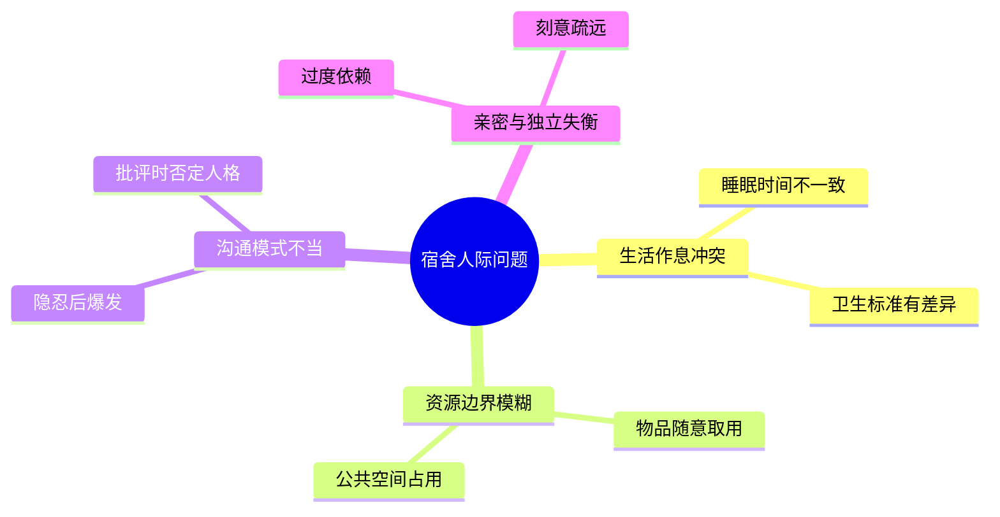

# 大学生宿舍人际关系的常见问题与建设

## 宿舍人际：常见问题与建设

你有没有经历过这样的时刻：室友外放短视频，你忍了很久，终于开口说了一句，结果对方觉得你“小题大做”，关系反而更僵。为什么同样是想解决问题，有的沟通能拉近关系，有的却制造隔阂？

关键在于**关系信号**。人际沟通理论指出，每一次沟通都同时传递两层信息：==内容层面（说了什么）与关系层面（怎么说、暗示双方是什么关系）==。宿舍矛盾很少单纯因为“事情对错”，更多是关系信号出了问题。

### 宿舍常见问题的本质

这些问题表面上争的是“你几点熄灯”“谁该倒垃圾”，底层争的往往是==尊重感与掌控感==：我的边界有没有被承认？我在这个小群体里有没有话语权？

### 为什么昵称会影响沟通效果

回到开头那道判断题：「和宿舍同学沟通特别是批评时，使用昵称的模式和不使用昵称的模式之间，存在着很大的效果差异。」——正确答案是**正确**。

这背后的原理不难理解。批评属于**负面反馈**，天生会威胁对方的“面子”。当你用正式称呼甚至全名称呼对方时，关系信号是「我们之间是正式的、有距离的」，负面反馈叠加距离感，容易被解读为攻击。

而昵称（如“小张”“阿琳”或者你们之间的专属称呼）传递的关系信号是「我们很亲近，这是一次自己人之间的提醒」。同一句话，关系信号不同，对方的接收态度就完全不同。这就是为什么==人际沟通技巧中，批评前先通过称呼、语气确认亲近关系，是降低防御的关键一步==。

[!IMPORTANT]
> 昵称不是讨好，而是用关系信号为沟通内容搭建安全容器。==有效的批评 = 亲近的关系信号 + 具体的行为描述 + 不否定人格。==

### 建设宿舍关系的四个日常动作

光知道“出问题时怎么沟通”还不够，日常建设才是减少问题的根本：

| 建设动作 | 具体做法 | 核心原则 |
|:---|:---|:---|
| **确立边界** | 入住初期协商作息、卫生、访客等规则 | 丑话说在前，好过事后翻脸 |
| **主动反馈** | 小事及时说，不累积，用“我”句式表达感受 | 先说自己感受，不先指责对方 |
| **增加正向互动** | 偶尔带份零食、顺手帮忙取快递 | 关系账户有积蓄，取款时才不崩 |
| **尊重差异** | 不强行改变对方习惯，寻求共存方案 | 宿舍不是统一标准，是协商空间 |

[!WARNING]
> 常见坑：很多人以为“关系好就不用定规矩”，结果边界全靠猜，踩雷了又不好意思说，最终小事憋成大事。==关系越好，越需要清晰的边界==——亲近不等于无界限。

### 一个对比例子

假设室友连续三天没倒垃圾，你想提醒他：

- **无效模式**（直呼其名）：「王明，你怎么又不倒垃圾？每次都是你。」——对方接收到的关系信号是“你在指责我这个人”，大概率防御或反击。
- **有效模式**（昵称 + “我”句式）：「明明，我看到垃圾袋有点满了，咱们今天谁方便去扔一下？我昨天扔的。」——昵称确认亲近，“我”句式描述事实而非指责，给出协商空间。

同样的诉求，关系信号不同，效果天差地别。==宿舍人际的建设功夫不在争论对错时，而在日常每一次称呼、每一句表达方式里。==
