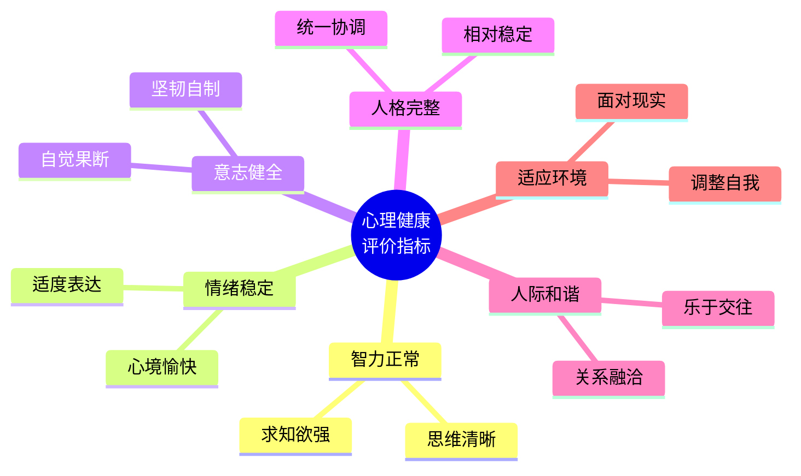

# 大学生心理健康的标准与评价指标

# 大学生心理健康的标准与评价指标

## 它是什么：超越“无病即健康”

在《大学生心理健康概述》中，我们首先要破除一个迷思：**心理健康不仅仅是没有心理疾病**。正如世界卫生组织（WHO）所定义，健康是生理、心理和社会适应的完好状态。

> [!IMPORTANT]
> ==核心结论==：心理健康是一种**持续且积极**的心理状态，个体能充分发挥潜能，有效应对生活压力，并实现社会功能。

如果认为“吃得饱、睡得香”就是心理健康的全部，那就混淆了**生理舒适**与**心理健全**的界限。生理指标正常是基础，但心理健康更强调认知、情绪、意志和行为的协调统一。

## 为什么需要：多维度的评价体系

大学生处于从青春期向成年早期过渡的关键阶段，面临学业、人际、就业等多重压力。单一维度的评价无法全面反映个体的心理韧性。我们需要一套综合指标来评估：

## 怎么做：对照标准进行自我觉察

如何判断自己或他人是否心理健康？可以参考以下六大通用标准进行自查：

| 维度 | 关键表现 | 常见误区 |
| :--- | :--- | :--- |
| **智力** | 能正常学习、思考 | 智商高不等于心理健康 |
| **情绪** | 乐观为主，波动合理 | 允许偶尔的负面情绪 |
| **意志** | 目标明确，抗挫力强 | 固执不是意志坚定 |
| **人格** | 言行一致，表里如一 | 性格内向≠人格缺陷 |
| **人际** | 尊重他人，界限清晰 | 独处不等于孤僻 |
| **适应** | 顺应环境，积极改变 | 顺从不等于盲从 |

> [!TIP]
> **记忆口诀**：智情意格人适。即：智力、情绪、意志、人格、人际、适应。

## 常见的坑：辨析易错概念

在考试和实际应用中，学生容易陷入以下误区：

1.  **混淆生理与心理**：如判断题中提到“心理健康的基本标准是吃得饱，睡得香”。这是错误的，因为这仅描述了生理满足感，忽略了心理层面的社会功能和内心体验。
2.  **绝对化标准**：认为心理健康的人“永远快乐”或“从不焦虑”。事实上，==适度的焦虑和悲伤是正常的心理反应==，关键在于持续时间和强度是否影响正常生活。
3.  **静态看待**：心理健康是一个动态过程，而非固定状态。一时的心理失衡不代表心理不健康。

> [!WARNING]
> **高危误区**：不要将“心理问题”等同于“精神病”。大多数大学生的困扰属于发展性心理问题，通过调整和咨询即可改善，并非病理性的精神障碍。

## 算对了的例子：真题解析

让我们回顾课件中的两道判断题，应用上述知识进行解析：

**题目 1**：人的健康不仅包括生理健康而且包括心理健康。
*   **解析**：符合 WHO 的健康定义及本课程第一章概述。健康是身心统一的总体状态。
*   **答案**：A. 正确

**题目 2**：心理健康的基本标准是吃得饱，睡得香。
*   **解析**：“吃得饱，睡得香”主要反映生理需求的满足。虽然良好的睡眠和饮食有助于心理健康，但它们不能涵盖智力、情绪、人格等核心心理指标。一个抑郁症患者也可能维持基本的饮食睡眠，但其心理状态显然不符合健康标准。
*   **答案**：B. 错误

通过这两个例子可以看出，掌握心理健康的**多维性**和**功能性**特征是解题的关键。
